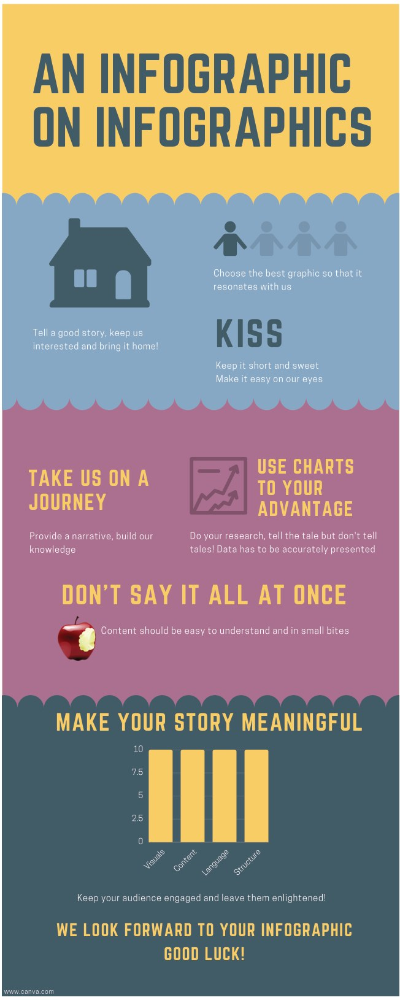
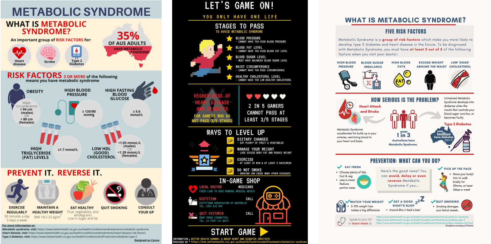

# A Picture Paints a Thousand Words: Infographics for Authentic Learning in Undergraduate Students

**Saw Hoon Lim and Rosa McCarty**  
*Department of Biochemistry and Pharmacology, University of Melbourne*

> *Australian Biochemist* Vol 52 No 1, April 2021, pages 19–20

Frontiers in Biomedicine is a final semester capstone subject for third year Bachelor of Biomedicine students at the University of Melbourne. In this subject, we take a holistic approach to understanding established and developing issues affecting both health and disease, by exploring the breadth of complex determinants across disciplinary boundaries. An important learning outcome is for our students to synthesise and integrate information on selected health matters in a coherent narrative, from differing perspectives.

One of the four major health issues that we examine is the metabolic syndrome, which has an associated assignment themed ‘Writing for Your Audience’ involving three interrelated tasks. Students are provided with the following real-world context. They are employed to develop educational material for the Victorian Government’s Better Health Channel for two audiences: health practitioners and a lay audience. In the third task, students reflect upon and articulate the strategies they used to tailor their presentations to the two audiences.

The lay writing task was an update to the previous year’s assignment, which was a plain text submission. Students were asked to prepare an infographic for the general public around metabolic syndrome. This follows earlier studies that have shown that the infographic development process increases engagement, promotes deeper learning and improves student skills through the distillation of information for a non-expert audience (1,2). To fully immerse the students in this assignment, instructions to this activity were also presented as an infographic (**Fig. 1**). As we anticipated, students relished the opportunity to bring to life their learning in an eye-catching format, capitalising on visual storytelling to deliver their health message. They did not disappoint! The infographics produced were of stellar quality and carefully considered, with creative use of pictorial representations to effectively communicate and stimulate the interest of their audience. They realised through this assignment that often, less is more when conveying complex concepts and information to engage with your audience (3). From our student evaluation survey (n=124), 73% indicated that this was a good/excellent assignment (four and five of a maximum Likert Scale of five). Many students commented that they enjoyed and benefitted from this assignment. This is an excellent outcome as biomedicine cohorts are very high achievers.

***Fig. 1.** Instructions on creating an infographic were delivered via an infographic.*

***Fig. 2.** The top three infographics as voted by students in Frontiers in Biomedicine, University of Melbourne, 2020.*

We were overwhelmed by the standard of the infographics produced in terms of clarity of presentation and creativity in disseminating knowledge about the metabolic syndrome. To reinforce the authentic nature of the task, we decided to share their creations with the Australian Medical Association, the Heart Foundation and Diabetes Australia in the hope that they will find these infographics useful as information for the public, bringing to life the assignment’s scenario. We employed a democratic and entertaining approach to select which infographics were shared by inviting the cohort to vote for their favorite infographics (which were shortlisted by their tutors), dubbing this ‘the people’s choice award’. This had the tripartite benefit of garnering the students’ voice, allowing students to learn from their peers and building camaraderie. A total of 118 votes were received and the top three infographics made their way to those organisations (**Fig. 2**).

We are delighted to report that Diabetes Victoria has responded to us very positively. They stated that the depiction of health information pictorially is an important way to improve health literacy and that they will consider how they might use our students’ infographics in the future. This news was indeed a fitting conclusion to our infographic assignment. Moreover, our students have used creativity to consolidate their learning and communicate their understanding.

## References

1. Mitchell DG, Morris JA, Meredith JM, Bishop N (2017) Chemistry infographics: experimenting with creativity and information literacy. *In: Liberal Arts Strategies for the Chemistry Classroom*. Chapter 7. American Chemical Society.
2. Shanks JD, Izumi B, Sun C, Martin A, Byker Shanks C (2017) *Front Public Health* 5:315.
3. Smiciklas M (2012). *The Power of Infographics: Using Pictures to Communicate and Connect with your Audiences.* Que Publishing.
## About the authors

Dr Saw Hoon Lim is a Senior Lecturer and Teaching Specialist in the Department of Biochemistry and Pharmacology, University of Melbourne. <sawhoon.lim@unimelb.edu.au>
 

Dr Rosa McCarty is a Lecturer and Teaching Specialist in the Department of Biochemistry and Pharmacology, University of Melbourne. <rmccarty@unimelb.edu.au>
 

---

*This article first appeared in the ASBMB Education Feature of the [Australian Biochemist](https://www.asbmb.org.au/magazine) Vol 52 No 1, April 2021. © 2021 Australian Society for Biochemistry and Molecular Biology Inc.*

[← Back to the April 2021 issue](../README.md)
