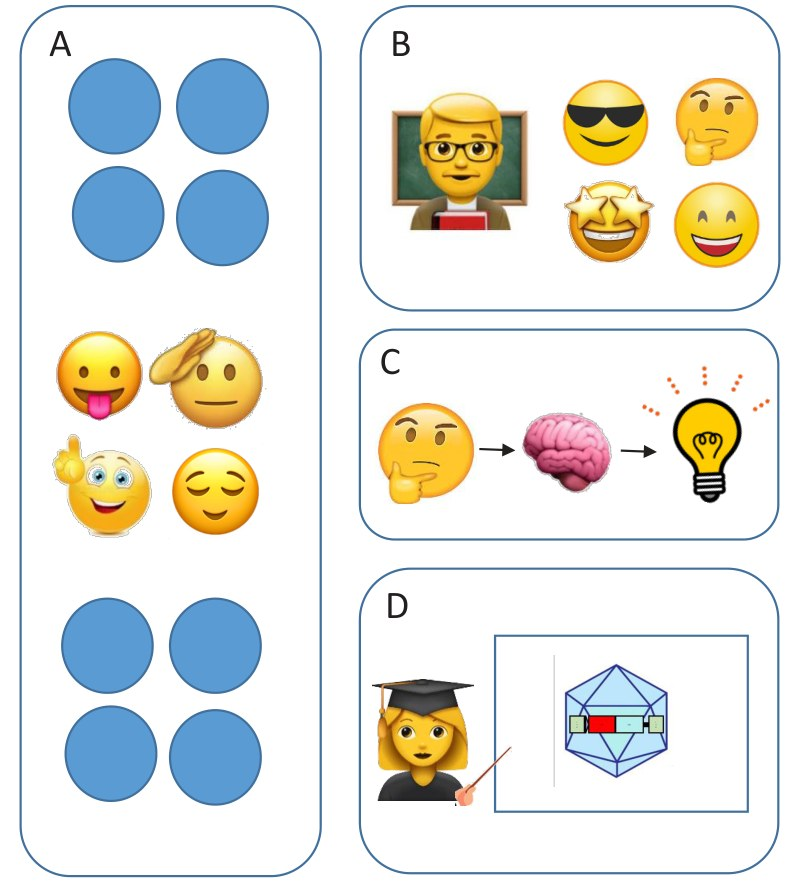

# The Journey from Teaching Face-to-face, to Online, and Back Again – Revealing Four Important Elements of Effective Teaching and Learning

**Nikki Curthoys**  
*School of Chemistry and Molecular Bioscience, University of Wollongong*

> *Australian Biochemist* Vol 52 No 1, April 2021, pages 21–22

I am a teaching-intensive lecturer with experience as a laboratory demonstrator, tutor, lecturer and subject coordinator. After delivering entirely remotely in 2020, I am relishing a return to face-to-face teaching. We have watched our students lose their access to physical practical skills, which are fundamental to what we do as biochemists and molecular biologists. These learners also missed out on the face-to-face engagement in lectures and tutorials. However, this year has revitalised some core tenets of effective teaching, which we can now apply into the future. There are many elements that lead to effective student learning; below I focus on just four that resonated with me through my experiences in moving teaching from face-to-face to online and back again.

***Fig. 1.** Four essential elements for effective teaching and learning: A. Small group teaching. B. Casual staff to support students. C. Active learning strategies. D. Quality teaching materials.*

## 1. Small group learning

Small group teaching is essential for effective learning. Online teaching has (at times) resulted in large classes of silent, disembodied logos who will not turn on their camera or their microphone; only indicating their presence with perhaps a word or two in the chat bar. Teaching students in large groups (even 30 students) can really stifle engagement. Our learners openly appreciate working in smaller groups of two to four, rather than a group of 30. Breakout rooms are effective online; just as small group work is effective face-to-face.

## 2. Learners need support – casuals are essential

Effective teaching requires support for teaching assistants. They are an essential element of the teaching team and are inextricably linked to effective student learning. Smaller group teaching certainly helps, but we all know of situations where learners are hesitant to participate – because they are nervous, disinterested, or otherwise disengaged. We want all learners to demonstrate their understanding of the material – and to feel comfortable in exploring what they don’t understand. In my experience, crucial to this is having academics and casual teaching staff who actively engage with the learners in these small groups.

## 3. Long lectures can be boring

Utilising active learning strategies in all facets of teaching supports student learning. We’ve all been there, listening passively to long lectures whilst trying to process a wealth of information. Last year, an education designer reminded me I have an attention span of about eight minutes (and that’s on a good day!). In 2020, I broke up and focused my sometimes two-hour long lectures into smaller, manageable chunks of about 20 minutes of information to keep learners stimulated. I also reconnected with active learning strategies. These practices transform learners from passive observers to living, participating members of the subject.

## 4. Quality teaching materials require ongoing development

Simple but informative instructional material using a variety of media can enhance student learning. Nothing spells nap-time like a bank of PowerPoint slides which are bulletpoint wads of text that a lecturer duly reads off verbatim, with the implicit connotation that the learners are illiterate. Throughout 2020, we rapidly evolved our learning materials – not just with slick animations and fun demonstrations. A few well-explained, informative images really aids understanding. Redesigning or updating teaching material yields big increases in learner comprehension – especially when subject matter is inherently visual; like so much of molecular biology and biochemistry.

As we return to face-to-face delivery, we will all take our learnings from remote teaching back into the classroom and laboratory. This will undoubtedly enhance the experience not only for ourselves, but also our colleagues and students. Whilst I have captured just four elements that stood out to me, I wonder what stood out to you?

## About the author

Dr Nikki Curthoys is a Lecturer in the School of Chemistry and Molecular Bioscience at the University of Wollongong. <ncurthoy@uow.edu.au>
 

---

*This article first appeared in the ASBMB Education Feature of the [Australian Biochemist](https://www.asbmb.org.au/magazine) Vol 52 No 1, April 2021. © 2021 Australian Society for Biochemistry and Molecular Biology Inc.*

[← Back to the April 2021 issue](../README.md)
