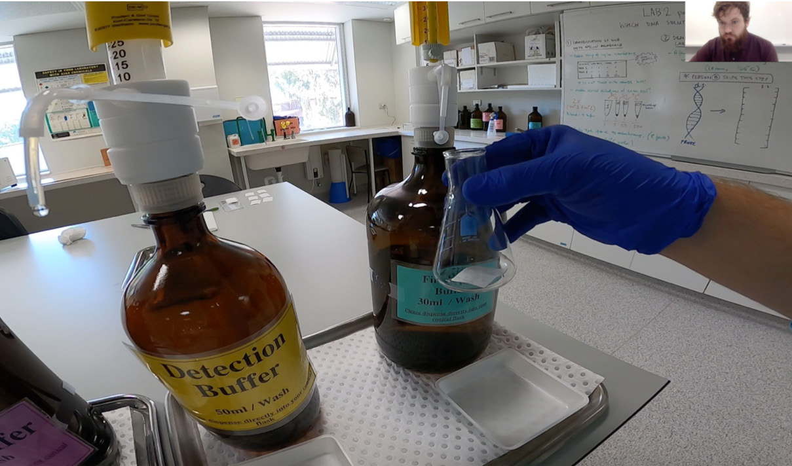
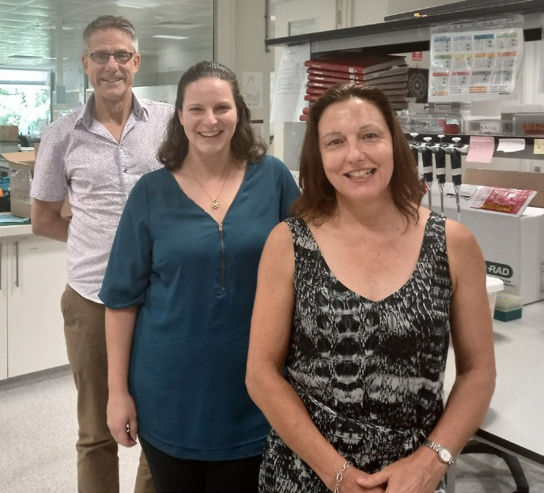

# Silver Linings of Rapidly Transformed Biochemistry Laboratory Teaching During the COVID-19 Pandemic

**Joanne Castelli, Sean Ramsey, Alyssa Van Dreumel and Peter Arthur**  
*School of Molecular Sciences, University of Western Australia*

> *Australian Biochemist* Vol 52 No 1, April 2021, pages 22–23

Laboratory training for University of Western Australia Biochemistry undergraduates follows a well-established *Prepare Do Review* model (1), a flipped learning modular format based on specific laboratory techniques. Students *Prepare* by undertaking online pre-labs consisting of watching videos and PowerPoint presentations, and completing readings and formative and summative quizzes, all available on the learning management system (LMS). This preparation means when they *Do* the practical experiment in the laboratory they can concentrate on the hands-on techniques, troubleshooting and problem-solving aspects of the lab. The following week, students *Review* their learning by preparing for oral presentations and completing an in-class quiz in the post-laboratory session.

The model has been very successful, but we decided there is always room for improvement, so we formed a Community of Practice to bring together expertise from across the university to help us transform the way we teach in the laboratory.

The emergence of the COVID-19 pandemic disrupted our plans to review the course in 2020. We had started teaching the unit BIOC2001 Biochemistry and Molecular Biology of the Cell to a cohort of 102 second year students. The students were already familiar with preparing for their laboratory sessions with asynchronous online teaching, but suddenly we had to convert the laboratory and post-laboratory sessions to emergency remote teaching formats.

The laboratory procedures were filmed using a GoPro, and edited to produce five-minute videos. Laboratory sessions incorporating active learning strategies were presented and recorded synchronously using Zoom with up to 50 students in each session. In these sessions, students watched the video and discussed the theoretical background and techniques with learning supported using formative Zoom Poll questions. The video was then repeated, with the demonstrator stopping and starting the video in order to clarify concepts and respond to questions posted by students in the Zoom Chat. Preset questions related to the laboratory were completed and discussed online as a group, using audio and video or the Chat feature of Zoom.

***Fig. 1.** Demonstrator Sean Ramsey presents the laboratory to students via an interactive Zoom session.*

In the following week, during synchronous Zoom sessions, students delivered one five-minute PowerPoint presentation each over the course of the semester. These sessions were recorded and will be useful for future assessment moderation, and as a training tool for new markers. The students finished the module with a summative asynchronous LMS quiz.

There were many challenges in the synchronous online delivery that were not under our control. The differences in student access to technology and internet needed to be considered to ensure we took steps to make the learning as equitable as possible by providing learning alternatives and recordings.

We are strong advocates for the value of hands-on laboratory experience and it has become even clearer the teamwork, problem solving, manipulations and precision work that students learn from being in the laboratory can’t be taught effectively online. But there are silver linings, as we have developed new skills and resources that support both student and teacher in learning during hands-on laboratories. Students have increased their digital skills by adapting to new ways of learning and sharing their knowledge. Teachers have had to prepare new learning materials and ways to ask questions, and plan for delivery in unconventional ways. We have gained expertise in new ways of online synchronous and asynchronous teaching and now have a trove of resources, including videos, poll and quiz questions, student and demonstrator feedback and student presentations. The reflections we have made and the changes we will implement in the future will ultimately improve the learning experience for us and our students.

*From left: Peter Arthur, Alyssa Van Dreumel and Joanne Castelli.*

## Reference

1. Arthur P, Ludwig JM, Castelli J, Kirkwood P, Attwood P (2016) *Biochem Mol Biol Educ* 44(3):276–287.
## About the authors

Dr Joanne Castelli is a Learning Designer in the Educational Enhancement Unit of the University of Western Australia. <joanne.castelli@uwa.edu.au>

Sean Ramsey is a Laboratory Demonstrator in the School of Molecular Sciences at the University of Western Australia. <sean.ramsey@uwa.edu.au>

Dr Alyssa Van Dreumel is a Teaching Academic in the School of Molecular Sciences at the University of Western Australia. <alyssa.vandreumel@uwa.edu.au>

Dr Peter Arthur is a Teaching and Research Academic in the School of Molecular Sciences at the University of Western Australia. <peter.arthur@uwa.edu.au>

---

*This article first appeared in the ASBMB Education Feature of the [Australian Biochemist](https://www.asbmb.org.au/magazine) Vol 52 No 1, April 2021. © 2021 Australian Society for Biochemistry and Molecular Biology Inc.*

[← Back to the April 2021 issue](../README.md)
