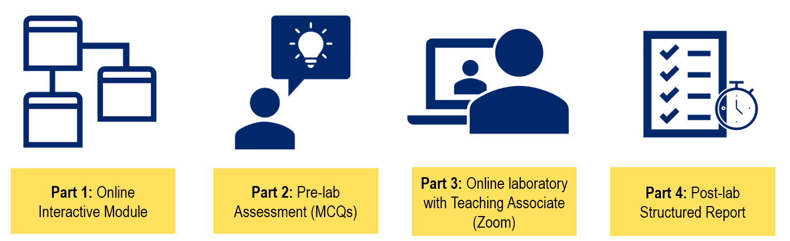
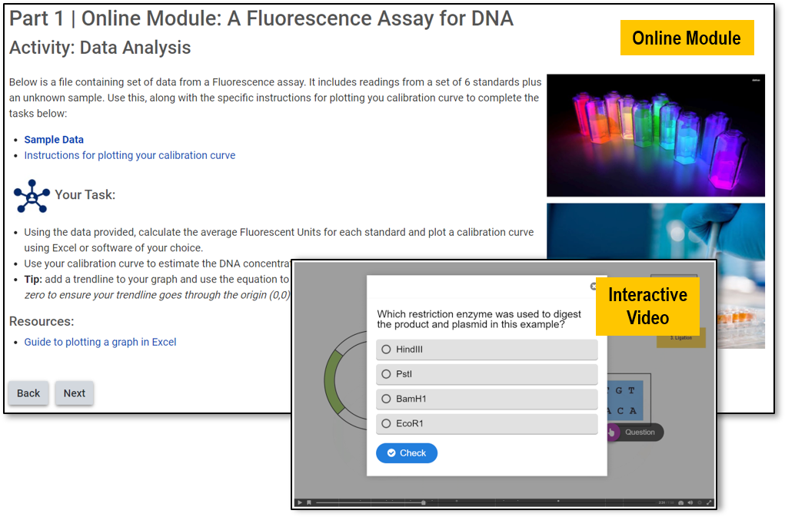

# Skill Development in the Online Laboratory Class

**Jessica Gibbons**  
*Biomedical Discovery Institute, Monash University*

> *Australian Biochemist* Vol 52 No 1, April 2021, pages 23–24

For many of us, one of the biggest challenges for teaching in 2020 was rapidly converting our laboratory classes to online equivalents. Our students would not have the opportunity to develop technical laboratory skills, so we decided to focus on the skills we knew we could develop without the laboratory classroom: scientific communication, experimental design, and data analysis and interpretation.

## Our approach

To replace ten weeks of wet laboratory classes for our first year molecular biology unit within the Bachelor of Biomedical Science course, we designed a suite of ten online laboratories and divided the program into two phases. The first five-week phase was dedicated to teaching students about individual laboratory techniques such as PCR, assays and cloning. Students were also introduced to data interpretation and analysis, exploring imperfect results, failed experiments and troubleshooting.

In the second phase, the focus of the laboratories shifted to a project-style sequence investigating the plasmid pGlo and the controlled expression of green fluorescent proteins (GFP), adapted from (1). Students used the techniques learnt in phase 1 to design a course of experimental enquiry to investigate the effect of mutations and the effect they have on GFP, including mutations that change its fluorescence from green to blue. Students were required to make hypotheses, analyse experimental data and draw conclusions.

## Weekly format

Each week students had four parts to their online laboratory that replaced the weekly three-hour face to face session (**Fig. 1**). Part 1 comprised an interactive online module that introduced them to the week’s experiment (**Fig. 2**). Students also completed a short multiple choice quiz (Part 2) prior to their Zoom session to encourage them to work through the online module.

***Fig. 1.** The components of the weekly online laboratory sessions.*

## Impact and conclusions

Feedback from the end of semester unit evaluation was overwhelmingly positive towards the online laboratory program. Students found the interactive online modules effective in preparing them for the online sessions, which they found valuable in consolidating their understanding overall. Students also reported that the assessment was effective in developing scientific communication skills:

“The labs were very engaging and I found that I gained a greater understanding of the particular topic investigated each week than I would have by passively learning about it”

“The laboratories were extremely helpful in demonstrating the practical application of the molecular biology content, as well as developing key skills required in scientific investigation such as constructing a scientific report”

“I liked the continuation of the ‘same’ topic (pGLO plasmid) for the later weeks in lab sessions – this was fun and engaging to learn in depth about the processes required for various types of experiments”

While students weren’t able to perform the experiments themselves, they gained exposure to the execution of a scientific project, and experimental techniques that are not always possible in an undergraduate laboratory.

***Fig. 2.** The weekly online modules included a range of activities for students to complete prior to attending the online Zoom session with their teaching associates including interactive videos, questions to consider and tasks such as data analysis shown here.*

## Reference

1. Girón MD, Salto R (2011) *Biochem Mol Biol Educ* 39:309–315.
## About the author

Dr Jessica Gibbons is a Lecturer, Biomedical Sciences Teaching, Monash University. <jessica.gibbons@monash.edu>
 

---

*This article first appeared in the ASBMB Education Feature of the [Australian Biochemist](https://www.asbmb.org.au/magazine) Vol 52 No 1, April 2021. © 2021 Australian Society for Biochemistry and Molecular Biology Inc.*

[← Back to the April 2021 issue](../README.md)
