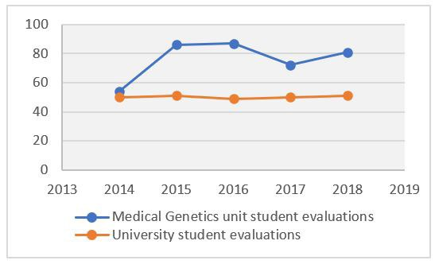
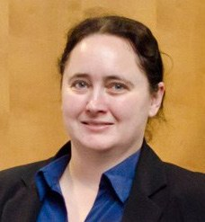

# Designing Learning Opportunities to Enrich Student Understanding Through Community and Professional Engagement

**Lois Balmer**  
*School of Medical and Health Science, Edith Cowan University, Western Australia*

> *Australian Biochemist* Vol 52 No 2, August 2021, pages 18–19

## Background

The Medical Science undergraduate degree at Edith Cowan University (ECU) has a diverse student cohort. As a result, their experience at university requires a carefully designed and engaging curriculum. These students often find it difficult to make connections between theoretical concepts in textbooks and the real world, the human face of medical genetics, raising several ethical considerations (1). As an active researcher in the field of medical genetics as well as an educator of undergraduate students at ECU, I am all too aware of this disconnect.

Over the past five years, it has been my constant aim to expose students to more than just a repeating cycle of lectures, laboratories and tutorials. While these are essential components of university education, we should not lose sight of the fact that the ultimate motivation for, and benefit of, medical genetics knowledge is to improve the lives of patients in the community (2). Drawing on my extensive research, and industry- and community-based professional connections, I have refined the curriculum to engender a deeper, more relevant understanding of medical genetics. Students actively engage with support organisations, patients and their families to develop a truly holistic and empathic understanding of the concepts underpinning the reality of living with a genetic disease. The evidence below demonstrates how my work has led to vastly improved student satisfaction and outcomes, and a truly transformative learning experience.

## Developing curriculum: connecting with community-led approaches to learning and teaching

My development of curricula and resources is guided by my connections with community, and a focus on student learning through engagement. Prior to taking over the Medical Genetics (third year) unit in 2014, student satisfaction by institutional student evaluation was approximately 50%. The unit content was delivered through a traditional approach of weekly lectures while the assessment consisted of an essay on a genetic disease, mid-semester test and final exam. In 2015, I started using a human-centred, authentic learning approach (3) to transform the unit into one that was engaging and reflective.

I utilised my professional connections and industry relationships to enhance the weekly lectures to include guest speakers, as well as staging a Genetics Forum where students engaged with people with a lived experience of genetic disease: patients, families and care workers. Involving the community members and provision of a ‘real human focus’ developed the students’ empathy, and they began to think about ways to facilitate patient goals with real action, rather than remaining passively sympathetic.

The essay was replaced by a research and reflection cycle built around the forum experience (4). Following a period of research into genetic diseases, students were required to formulate questions that are ethically appropriate and culturally sensitive. After the forum, students submitted a reflection for the assessment alongside the forum participants’ responses to their questions.

***Fig. 1.** Unit satisfaction, 2014–2019.*

**Table 1.** Evidence of transformative learning experienced by students.

| **Theme** | **Students’ Perspectives** |
|---|---|
| Connecting theory to practice | “The guest speakers really helped me piece together textbook learning to actually reality.” Student evaluations 2016 “I feel it has given me a greater understanding that real people with challenges do exist outside textbook readings.” Student evaluations 2018 |
| Envisaging future work in the health sector | “This unit has shown me that this is the area that I want to pursue for my life, I don’t know yet exactly what but I am so excited about looking into a career in MG.” Student reflection 2019 “I am considering going into the health sector so I need to keep this in mind when dealing with patients and not just see the science but understand that forming a rapport encourages good health outcomes.” Student reflection 2019 “The perspectives the carers, parents and the three young people was very moving for me and listening to them helped me see the people not just the condition.” Student reflection 2017 |
| Developing empathy and challenging perspectives of disability | “Meeting the Directions clients reinforced how these individuals should be treated respectfully and that they are just another person within the grand spectrum of humanity.” Student communication 2019 “The most rewarding experience for me came from listening to and writing about the experience of the careers, I didn’t know such people existed.” Student reflection 2017 |
| Inspiring and transforming mindsets | “What an inspirational forum, thank you so much, Dr Lois Balmer, for putting it all together. The best that I had for my study life at ECU. I know that their fighting spirit will be with me throughout my life’s journey.” Student correspondence 2018 “Initially I thought they would present as depressed people, forget about them I felt depressed even by the thought of people living with chronic diseases. However, my thoughts are totally changed by the fact that all of the guest speakers lived/live a better and fuller life then majority of normal people would even think of living.” Student reflection 2019 |

The improvements in overall student satisfaction that have occurred since implementation of the changes to curriculum in 2014 are clear (**Fig. 1**). Overall, student satisfaction for the unit has been 22 to 38 points higher than the ECU average; this is in the context of ECU being the highest rated public university for overall student satisfaction in Australia (5). Student reflections demonstrate a highly transformative learning experience (6) that fosters the connection of theory to practice, while students envision their future employment and develop empathy and respect, particularly for people with disabilities, leading to an inspired and transformed mindset (**Table 1**).

## Conclusion

I feel privileged to be able to bring to students community-based initiatives that provide an authentic human-centred focus. I believe that the ripple effects of these experiences will reach into the community in positive and meaningful ways. The enhanced quality of student learning is evident in the improved grades since the curriculum transformation. Already for some, the passion for their future career and commitment to ongoing learning is developing.

## References

1. Carter J (2006). [Why it’s important for students to have real-world experience](https://www.careers.govt.nz/articles/why-its-important-for-students-to-have-real-world-experience). Career Practitioners, Careers New Zealand.
2. Mattick J, Dziadek M, Terrill B, Kaplan W, Spigelman A, Bowling F, Dinger M (2014) *Med J Aust* 201(1): 17–20.
3. Darcy Associates (2009). [Best Practice Clinical Learning Environments within Health Services for Undergraduate and Early-Graduate Learners Final Report](https://bpcletool.net.au/media/medialibrary/2016/09/BPCLE_PMF_Aug_2016.pdf).
4. Eaton M (2013) Progressive Scaffolding and Evaluation. *Instructional Strategies to Transform Learning.* Avila University.
5. QILT (2019) [2018 Student Experience Survey National Report](https://www.qilt.edu.au/docs/default-source/ses/ses2018/2018-ses-national-report75e58791b1e86477b58fff00006709da.pdf?sfvrsn=d733e33c_4).
6. Mezirow J (2000). Learning as Transformation: Critical Perspectives on a Theory in Progress. *The Jossey-Bass Higher and Adult Education Series.* Jossey-Bass Publishers, USA.
## About the author

Dr Lois Balmer is a Senior Lecturer in the School of Medical and Health Science, Edith Cowan University. <l.balmer@ecu.edu.au>
 

---

*This article first appeared in the ASBMB Education Feature of the [Australian Biochemist](https://www.asbmb.org.au/magazine) Vol 52 No 2, August 2021. © 2021 Australian Society for Biochemistry and Molecular Biology Inc.*

[← Back to the August 2021 issue](../README.md)
