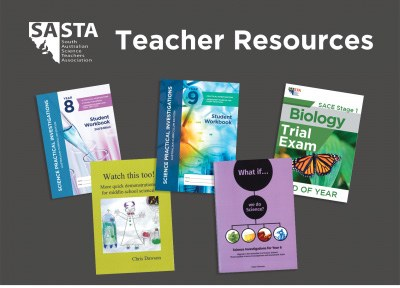
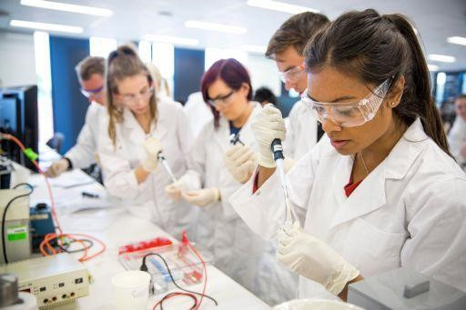
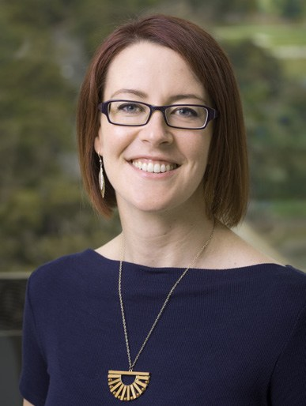

# Planting the Seeds of Learning in the Future Biochemist

**Melissa Pitman**  
*School of Biological Sciences, University of Adelaide*

> *Australian Biochemist* Vol 52 No 2, August 2021, page 20

One of the aims of the ASBMB is to facilitate training and education in biochemistry and molecular biology. Engaging and inspiring students at high school level could play a major role in boosting the uptake of biosciences at university. Identifying the best way to do this is the first step in the process. I reached out to the South Australian Science Teachers Association (SASTA), Biology Teachers of South Australia (BTSA) group and bioscience educators at the three universities (University of Adelaide, Flinders University and University of South Australia) to seek their insights on how to encourage student engagement at a high school level.

*SASTA supports science teachers in South Australia through conferences, scholarships and awards and teaching resources. SASTA also runs the annual [Oliphant Science Awards](https://www.oliphantscienceawards.com.au/). SASTA is celebrating an incredible milestone of 70 years in 2021 and currently has over 500 members.*

*Undergraduate students learning molecular biology techniques. Image: [adelaide.edu.au](https://www.adelaide.edu.au/)*

From a high school educator perspective, it was suggested that students would benefit from experiences in professional laboratories and access to ‘real world’ science and scientists to help with some assessment tasks. One possible way to address this is to tap into the network of ASBMB members to find volunteers for give talks at schools or for students to interview. However, providing students access to a laboratory to gain experience remains a challenge when the number of students is likely to far outweigh the capacity of regular research laboratories. While it may be possible for some labs to take on a small number of students for internships or work experience, an alternative avenue for larger cohorts of students may be facilitated through universities to run practical classes in their purpose-built undergraduate teaching laboratories. Some universities already run STEM programs for high school students that do encompass some bioscience aspects but would benefit from more hands-on time at the bench.

Professional development for high school teachers to boost their laboratory experience may be another way to improve student experiences. Some universities run a personal development training workshop, co-developed by high school and university educators, for high school teachers to help them gain experience in running molecular biology experiments. This program may prove to be an excellent model to replicate in other universities. One assumption with this model is that teachers have adequate equipment in their school laboratories to run these more advanced experiments and so it’s likely that a combination of approaches may be required.

Keeping up to date with content and methods requires training and support and most importantly, time. Initiatives that empower high school teachers and build their confidence will ultimately flow onto students. In addition, universities and scientists could build stronger networks with high schools to inspire budding scientists into a career in biosciences. With the links that I have made, I am keen to advocate for the teachers and students here in SA and find new ways to encourage and support their bioscience journey.

## About the author

Dr Melissa Pitman is a Senior Lecturer and researcher in the School of Biological Sciences at the University of Adelaide. Melissa’s research spans drug discovery and cancer biology. <melissa.pitman@adelaide.edu.au>
 

---

*This article first appeared in the ASBMB Education Feature of the [Australian Biochemist](https://www.asbmb.org.au/magazine) Vol 52 No 2, August 2021. © 2021 Australian Society for Biochemistry and Molecular Biology Inc.*

[← Back to the August 2021 issue](../README.md)
