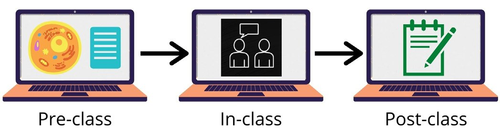
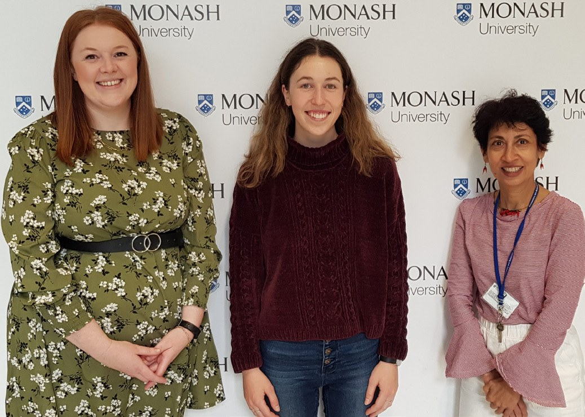

# Zooming in on Seven Recommendations for Online Teaching

**Emma Gamble, Jessica Gibbons and Nirma Samarawickrema**  
*Monash University*

> *Australian Biochemist* Vol 52 No 2, August 2021, pages 21–22

Online active learning in biochemistry education is a contemporary pedagogy which has been fast-tracked by the COVID-19 pandemic and the associated era of online learning. Active learning in biochemistry is well-researched, but teaching online offers the opportunity for an exploration of alternative techniques.

In 2018, the biochemistry unit ‘Metabolic Basis of Disease’ undertaken by 216 second year science undergraduate students transitioned to a flipped learning format with students required to review material before attending an active learning workshop component. In 2020, this classroom workflow was converted into an online learning format (**Fig. 1**). The active learning workshops were run over Zoom and involved the use of breakout rooms, where students were required to work collaboratively to analyse case studies, problem solve and analyse data. We studied students’ perceived learning gains in online active learning workshops over one semester in 2020 using a mixed methods approach.

Our study drew on a survey based on the Student Assessment of their Learning Gains (SALG) survey used in a flipped biochemistry classroom (1) to evaluate students on their perceived learning gains from the online active learning workshops. Interviews involving two students were also conducted to gain a greater depth of understanding of the survey results.

***Fig. 1.** The workflow of the flipped learning format with an online active learning workshop component.*

Several findings were identified from this data and in response, a series of recommendations have been devised for educators when conducting online active learning workshops. These findings are juxtaposed with the recommendations in **Table 1**.

**Table 1.** Findings from online active learning workshops and proposed recommendations.

| **Finding** | **Recommendation** |
|---|---|
| Educators were very welcoming and approachable and contributed to a positive learning environment. | Continue to create a safe and positive environment for students. |
| Students felt the worksheets and questions were useful. | Provide students with digital worksheets to work on during the workshops, which can be used as a study resource. |
| Participation in the Zoom breakout rooms was low due to intimidation by the online platform and inconsistent breakout rooms. | Group students in the same breakout rooms throughout the semester to promote engagement and relationship development. |
| Students felt there was a lack of engagement with their peers, which made it difficult to interact during the breakout room activities. | Start each class with an icebreaker in the main discussion room and have teachers actively monitor breakout room activity. |
| Students felt the questions to check understanding of content delivered during the pre-workshop online module considerably helped their learning compared to other resources. | Incorporate opportunities to track learning by using in-class quizzes (e.g. Kahoot) at the start of the workshops. |
| Students’ perceived that they couldn’t always apply what they had learnt in the workshops to their daily life. | Make explicit links to the students’ lives (e.g. nutrition, exercise) when designing the pre-class activity, which is then linked to the in-class activity. |
| When students had their cameras on, the online environment was positive and collaborative, as opposed to when students had their cameras off and the participation was low. | Encourage students to turn their cameras on wherever possible. |

These recommendations will be implemented during the Semester 1 online active learning workshops in 2021 and students’ perceived learning gains will be surveyed in order to gather more data. In the future, we hope to continue testing our recommendations through this iterative process to ultimately improve the learning outcomes in biochemistry online active learning workshops.

*From left: Jessica Gibbons, Emma Gamble and Nirma Samarawickrema.*

## Reference

1. Ojennus DD (2016). *Biochem Mol Biol Educ* 44(1):20–27.
## About the authors

Emma Gamble is a 4th year Bachelor of Education (Honours) and Bachelor of Science student. This research was completed as part of a student research in action project. <egam0001@student.monash.edu>

Dr Jessica Gibbons is a Lecturer in Biomedical Sciences Teaching, Monash University. <jessica.gibbons@monash.edu>

Dr Nirma Samarawickrema is a Senior Lecturer in the Department of Biochemistry and Molecular Biology, Monash University. <nirma.samarawickrema@monash.edu>

---

*This article first appeared in the ASBMB Education Feature of the [Australian Biochemist](https://www.asbmb.org.au/magazine) Vol 52 No 2, August 2021. © 2021 Australian Society for Biochemistry and Molecular Biology Inc.*

[← Back to the August 2021 issue](../README.md)
