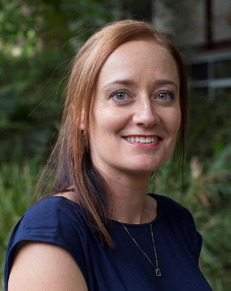

# Student Panel: Perspectives on Assessment and Academic Integrity at the 2021 ASBMB Education Symposium

**Tracey Kuit (University of Wollongong) and Amber Willems-Jones (University of Melbourne) talk to undergraduate Biochemistry students Taku Chitambo, Eleanor Lawton-Wade and Ella Scott.**  

> *Australian Biochemist* Vol 52 No 3, December 2021, pages 17–19

At the ASBMB 2021 Education Symposium, a student panel discussion was held with three undergraduate students: Taku Chitambo, a third year Bachelor of Science student from Monash University, Eleanor Lawton-Wade, a second year Bachelor of Biomedicine student from the University of Melbourne, and Ella Scott, a second year Bachelor of Science student from the University of Sydney. Eleanor, Taku and Ella shared their experiences and perspectives on online assessment and academic integrity. Responses to questions have been paraphrased and condensed with permission.

## Do you think online and in-person assessments are equivalent? Can you describe any specific examples?

**Eleanor** – In-person and online assessments are not equivalent, but that doesn’t mean there is a difference in competence or validity, they are just assessing different things. For example, in-person exams often focus on recall rather than application of knowledge, whereas online assessments have a stronger focus on data analysis. Online assessments that include questions based on clinical application and data interpretation are preferred; though they should not be overly complex or too clinical to the point that course material is not actually examined.

**Taku** – No, they are not the same, but that is not a bad thing, they simply have a different focus. In in-person assessments, exams often relied on recalling lecture content and specific words. Online assessments however, focus on understanding ideas and topics, and applying these to key concepts. Case studies are a great way to assess biochemistry topics and scenarios that require application to real life situations; they can assess concepts that students do not properly understand. Conversely, quizzes – if designed to require basic knowledge recall – are not that helpful in terms of assessing complex concepts because while the student may be able to recall certain words, they may lack the understanding of the underlying principles.

## How do you uphold academic integrity as a student, both individually and in a group?

**Taku** – When I have worked in a group, we would ensure that we split up the work evenly, and use software that records history and contribution (such as Google Docs). It is often easy to tell if someone has breached academic integrity because their assessment begins to sound different from how they speak and write. The best way to be able to maintain academic integrity in a group is by having regular meetings to gauge each member’s work ethic, and to ensure each member conveys ideas inline with their contribution to the group’s Google Doc, etc.

**Ella** – My approach to upholding academic integrity is essentially the same whether I’m working in a group online or in-person. In some ways it is easier to uphold academic integrity online because everything is recorded, e.g. through access to each other’s contributions via version history on Google Docs, or through Zoom meeting attendance, etc. Personally, I also ensure that I am honest when completing the peer review component of group assignments, where each group member assesses their own and everyone else’s contribution to the assignment. Such peer review is useful for ensuring academic integrity because it encourages group members to contribute equally to an assignment and ensures that everyone gets the marks they deserve based on their contribution. If any issues with academic integrity arise, it is important to communicate openly and early with the subject coordinator to try to resolve any potential issues from developing further.

## Is academic misconduct openly discussed by students and do you have any specific concerns about academic integrity that you’d like to share?

*Biochemistry students, from left: Taku Chitambo, Eleanor Lawton-Wade and Ella Scott.*

**Taku** – As a third-year student, I have had the opportunity to see the transition of university education from in-person to online. In-person cheating or breaches in academic integrity in examinations were often active acts that required the individual to actively breach them. This made it easy for students to identify what constitutes cheating in an exam – the line was clear. In online examinations and assignments however, the line is blurred, resulting in uncertainty for both students and teaching staff as to what counts as a breach of academic integrity and how to handle a breach. Personally, my concerns do not necessarily pertain to whether academic integrity has been breached by students but rather, to ensuring students properly and clearly understand what they can and cannot do in assignments and online examinations, and the steps they can take to stay within the bounds of academic integrity.

**Ella** – Student concerns relate to: *1. Transparency.* The need for universities to clearly define what academic integrity means in a digital world and how collusion is defined in terms of student contact. *2. Fairness and equity.* When students pre-prepare answers to questions compared to those who type them out during an exam, there is inequity and a lack of fairness. There is the sense that this can influence how much knowledge an individual can demonstrate during the exam under time constraints. *3. Productive dialogue:* Academic integrity benefits both students and academics alike. Engaging in productive dialogue, rather than fear tactics is likely to elicit more responsive and positive engagement from students, and improve relationships between academics and students.

## What was your experience with proctored exams this year? Do you have feedback you’d like to share with those considering using proctored exams in a unit of study?

**Ella** – My experience with ProctorU included exams in both Biochemistry and Pharmacology. For both disciplines, the settings included recording, and no internet access. In Biochemistry, we had access to local files, while this was prohibited for Pharmacology. Overall, sitting a proctored exam is slightly more stressful than an unproctored exam, for two main reasons (aside from having in the back of your mind that you are being watched): *1. Technical issues.* The responsibility is on the student to ensure the technology is working correctly. This can be challenging and stressful if it is not clear what to do, who to contact or how to provide sufficient proof of the technical difficulties encountered.

*2. Maintaining exam conditions.* Responsibility is again on the student, which can cause additional anxiety as you often worry about accidentally doing something wrong, e.g. will reading a question aloud or a rubbish truck driving past outside trigger the AI? Open-book exams with ProctorU seem to provide a good balance between upholding academic integrity and giving students the best chance of focusing on the exam because the monitoring does not feel quite as strict as the closed-book exam, so it is less distracting.

## If you could design an online assessment what would it look like?

**Ella** – I would embrace the opportunities presented by online exams rather than trying to recreate an exam room. In an online setting, it is impossible to achieve conditions like those of past in-person exams, and the more you try, the more stressful and distracting it becomes for the student. My tips for an online assessment include:

- Set open-book proctored exams to ensure that the individual who is sitting the exam is the person who is meant to be sitting it. Set a time limit and provide access to local files and the internet (where possible).
- Use open-book to everyone’s advantage by ensuring all students have access to their notes so that questions can be higher-level, e.g. set questions on content taught across the semester, but relate it to a disease/biological situation that hasn’t been explicitly explored. This will rely on students drawing on their knowledge to link the content, while still being able to search for definitions etc. where needed.
- Less is more: Reduce the number of separate documents/images required to upload, or if possible, keep it all in one quiz, so that there’s less that can go wrong technically.

**Taku** – In my ideal online examination, there would be:

- Continual ‘case-study’ style questions that are built upon each other.
- A small section of multiple-choice questions on a broad range of topics that require deductive reasoning as compared to recall capability.
- Problem solving questions that centre around the ability of students to properly apply theory, in addition to extended response questions where students can demonstrate their knowledge on mechanisms that underpin the development of disease.
- No ‘drag and drop’ style questions as they can often get messy and make the exam harder to navigate.

Online exams should be open-book. Students will almost always find a way to cheat so if the exam is open-book then all students are on the same playing field. The more points of control you add in an exam the more points of possible failure you add, with an increased likelihood of collusion. Instead of exam questions being taken directly from lecture content examples, they could be based on fictional diseases or applications to ensure that ‘googling’ the answer isn’t an option. Alternatively, students could be assigned different case studies to help reduce collusion.

Finally, instead of assessing a whole semester in the final exam, there would be a mid-semester exam on topics covered in the earlier half of semester, with the final examination involving questions that pertain directly to the overall learning outcomes of the subject (in the format described above).

**Eleanor** – In an ideal world, it would be good to have an exam in two parts (similar to the two forms of learning/processing papers that many Physical Sciences departments run):

- Part 1, closed-book exam with questions on content recall. This could be a proctored exam as long as there is transparency about the technology. While I understand why academics have moved away from recall questions, the reality is that to be a successful student you still need to know many specific details/terms and there simply isn’t time in an exam to look everything up.
- Part 2, open-book exam with authentic application-style questions. This could include scenario-based or data interpretation questions. Importantly, sufficient time would be provided to answer these types of questions, thereby emphasising the importance of the care and consideration required to craft a well written response; something that is hard to achieve when you have unrealistic time pressures.
## About the authors

Tracey Kuit is an Education-Focused Associate Professor in the School of Chemistry and Molecular Bioscience, University of Wollongong. <tracey_kuit@uow.edu.au>
 

Dr Amber Willems-Jones is a Senior Lecturer in the Department of Biochemistry and Pharmacology, University of Melbourne. <amber.willems@unimelb.edu.au>
 

---

*This article first appeared in the ASBMB Education Feature of the [Australian Biochemist](https://www.asbmb.org.au/magazine) Vol 52 No 3, December 2021. © 2021 Australian Society for Biochemistry and Molecular Biology Inc.*

[← Back to the December 2021 issue](../README.md)
