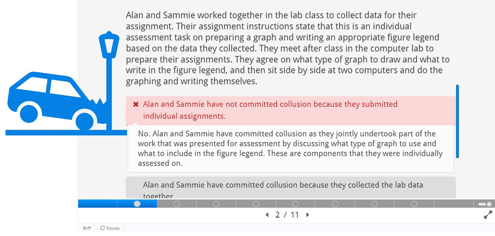

# Avoid a Collision with Collusion: an Academic Integrity Module Embedded in a First-year Cell Biology Subject

**Ann Parkinson¹, Eva Hatje¹,², Mary Kynn³ and Nicole Reinke¹**  
*¹School of Health and Behavioural Sciences, University of the Sunshine Coast*  
*²School of Biomedical Science, Faculty of Health, Queensland University of Technology*  
*³Institute of Applied Health Sciences, University of Aberdeen, UK*

> *Australian Biochemist* Vol 53 No 1, April 2022, pages 14–15

Many students commence university lacking knowledge and skills in academic integrity or carrying with them practices that do not align with the rigour and quality expected at a university level. This can contribute to them unwittingly engaging in behaviours deemed as dishonest. Academic integrity is important, not just in the university setting but beyond, as students graduate and move into their professional careers.

After collusion was uncovered in a second-year Physiology course at University of the Sunshine Coast in 2017, a need was recognised to teach students about academic integrity at the start of their program. At this time, our university did not have any formal academic integrity education available for students, so we decided to develop our own modules and implement them in a first year, first semester subject, Cell Biology, in 2018. With these modules we aimed to improve students’ understanding of academic integrity and to empower them to make appropriate decisions.

The three sequential academic integrity modules included examples of academic dishonesty students might encounter when completing the subject’s assessment. Modules consisted of multiple-choice style questions, specific to the assessment in Cell Biology. Students received feedback (in-class discussions or narrated video) on each module before submitting their assessment. This feedback also included links to real world examples of professional dishonesty, which highlighted the importance of acting with integrity now and in their future careers.

We found that whilst students could clearly identify examples of cheating, fraud and contract cheating, many did not understand what constituted collusion. In particular, a large proportion of students could not recognise collusion when presented with scenarios involving friends or family. Whilst the development of both individual and collaboration skills is important in science, we still need to be certain that a student’s grade on an individual assessment task reflects their own work. Therefore, for students to avoid a collision with collusion, it is our role as academics to provide clear guidelines about what is legitimate collaboration and what is collusion for each assessment task. As part of this strategy, we developed a Statement of Legitimate Collaboration, to help students identify which behaviours are acceptable (and which are not).

At the end of semester, students also completed an anonymous survey about their experiences with the academic integrity modules. Most students stated they felt confident that they could apply their newly acquired knowledge of academic integrity in their future studies and professions (1).

*“The examples in real life were very helpful as well.”*

*“I think it provided clarity with certain scenarios – who was at fault.”*

*“I liked the ‘post degree’ application of the modules.” First year Cell Biology students, 2018*

***Fig. 1.** Example of the Academic integrity module in the H5P platform, showing a scenario-based question with incorrect response and feedback.*

Moving forward, our revised goal is to offer multiple opportunities for students to engage in discussion around academic integrity as they progress through their studies. Based on student feedback, we refined the modules created in 2018 and deployed them in Cell Biology in 2019 and 2020. In 2021, the scenario-based questions were updated to reflect changes to the assessment in the subject. In addition, the module was adapted for assessment tasks in a second-year Physiology subject. Separate modules were created using H5P interactive software, see **Fig. 1**.

Academic integrity is important for us all, and our experiences have shown that students need explicit guidelines around legitimate collaboration for each assessment task to avoid a collision with collusion. In addition, students need support to understand the importance of academic integrity in their studies and future careers. They also need to engage in multiple discussions and have opportunities to seek clarification.

*Clockwise from top left: Ann Parkinson, Eva Hatje, Mary Kynn and Nicole Reinke.*

## Reference

1. Parkinson AL, Hatje E, Kynn M, Kuballa A, Donkin R, Reinke NB. *Assess Eval High Educ* 2022; In print. DOI: [10.1080/02602938.2022.2040947](https://doi.org/10.1080/02602938.2022.2040947)
## About the authors

Dr Ann Parkinson is Teaching and Research Academic in the School of Health and Behavioural Sciences at the University of the Sunshine Coast. <aparkins@usc.edu.au>

Dr Eva Hatje is a Teaching Academic in the School of Biomedical Science, Faculty of Health, at the Queensland University of Technology. <e.hatje@qut.edu.au>

Dr Mary Kynn is Teaching and Research Academic in the Institute of Applied Health Sciences, at the University of Aberdeen, United Kingdom. <mary.kynn@abdn.ac.uk>

Dr Nicole Reinke is Teaching and Research Academic in the School of Health and Behavioural Sciences at the University of the Sunshine Coast. <nreinke@usc.edu.au>

---

*This article first appeared in the ASBMB Education Feature of the [Australian Biochemist](https://www.asbmb.org.au/magazine) Vol 53 No 1, April 2022. © 2022 Australian Society for Biochemistry and Molecular Biology Inc.*

[← Back to the April 2022 issue](../README.md)
