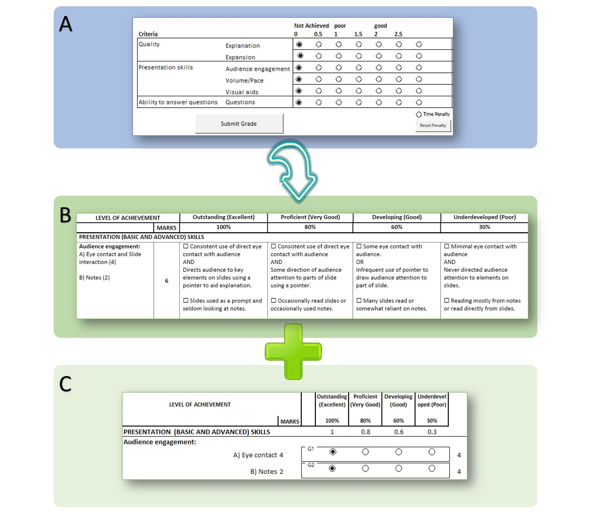

# On the Fly: a Rubric Balancing the Need for Speed and Provision of Feedback – the Oral Presentation

**Alyssa Van Dreumel and Peter Arthur**  
*School of Molecular Sciences, University of Western Australia*

> *Australian Biochemist* Vol 53 No 1, April 2022, pages 16–17

Creating a well-constructed assessment rubric as a scoring guide is time consuming, conceptually difficult and an iterative process of redevelopment (1). A rubric is used to assess communication skills in a second-year undergraduate biochemistry unit, BIOC2001 –Biochemistry and Molecular Biology of the Cell, with approximately 100 students each year. The laboratory component of this unit follows the Prepare–Do–Review model (2). The ‘review’ component is focused on a post-laboratory discussion session in which students give short oral presentations (up to five minutes) to develop their skills in data interpretation and analysis, and communication of scientific information.

One drawback of the pre-existing scoring guide, by definition a rating scale, was a lack of performance level descriptions, leading to open interpretation between assessors and marking variation. Further, this rating scale did not provide students concrete information on how to achieve the highest level of performance, or feedback on performance against assessed criteria. We reconstructed the rating scale into an analytic, student-centred rubric (**Fig. 1**). This rubric was refocused to align with the learning outcomes, divided into two main criteria with expanded subcriteria: 1) presentation skills: audience engagement and delivery, and 2) content: addressing the laboratory question, organisation, visual aid design, and ability to respond to audience questions. The rubric was designed to feedforward summative judgements about student work via clear criteria and carefully constructed descriptions at four levels of achievement (3). This redeveloped rubric was shared on the learning management system to provide students instruction and feedback on their performance to support student learning (1). The use of a rubric provides students a better understanding of what is being assessed, on what criteria grades are based, and what standards are expected.

***Fig. 1.** Reconstruction of a pre-existing scoring guide, a rating scale (A) to an analytic, student-centred rubric† (B) with a tick-box version (C) for quick assessment of a time-restrained oral presentation. †Rubric not shown in full.*

Balancing the learner-centred approach with functionality, the design included an easy-to-use ‘on the fly’ measure, achieved by categorised criteria, use of concise performance descriptions and limiting multifactor subcriteria or descriptions. Simplified descriptors were used to improve interpretation and distinction of achievement and so enhance marking consistency between academics. It was marked using a tick box system to increase grading process efficiency, optimise academic time and minimise marking workload for a time-restrained assessment.

Marks of the 2019 cohort (114 students) assessed using the former rating scale and the 2021 cohort (68 students) using the redeveloped rubric were analysed using the Mann-Whitney U test to evaluate the difference in mark distribution spread. The 2021 data were less skewed, more symmetrical and had a wider spread than the 2019 data, however the median scores were not statistically significantly different. Note that the 2020 data were omitted from analysis due to modified delivery and assessment of oral presentations given online. The rubric also proved reliable, with consistency between assessors indicated by lower standard deviation within the marks awarded in 2021 than in 2019.

The design employed did enable easy use ‘on the fly’ and optimised academic time, once familiarised with the criteria and performance descriptions. Reflecting on use of the rubric to assess student performance, the authors and colleagues reviewed the students’ quality of work: the majority of students performed highly on this assessment task. Nevertheless, there is still room for improvement and the rubric is being improved iteratively (4). For example, there were still minor interpretive issues of a few descriptors between assessors in scoring student work and, as a result, those descriptors have been rephrased to enhance clarity. Further, it was unclear if students in the 2021 cohort reviewed or engaged with the rubric in either a feedforward or feedback manner via the LMS. To enhance student learning the revised rubric will be formally introduced to students, with provision of instruction on how to utilise feedback, provided and delivered in a timely manner, to adjust their performance for future assessment tasks (3).

The authors may be contacted for a copy of the full rubric and would appreciate any feedback.

## References

1. Ragupathi K, Lee A. Beyond Fairness and Consistency in Grading: the Role of Rubrics in Higher Education. In: Sanger C, Gleason N (eds), (2020) *Diversity and Inclusion in Global Higher Education*. Palgrave Macmillan. pp73–95.
2. Arthur P, Ludwig M, Castelli J, Kirkwood P, Attwood P (2016) *Biochem Mol Biol Educ* 44(3):276–287.
3. Jonsson A (2012) *Act Learn High Educ* 14(1):63–76.
4. Jonsson A, Svingby G (2007) *Educ Res Rev* 2(2):130–144.
## About the authors

Dr Alyssa Van Dreumel is a Teaching Academic in the School of Molecular Sciences at the University of Western Australia. <alyssa.vandreumel@uwa.edu.au>
 

Dr Peter Arthur is a Teaching and Research Academic in the School of Molecular Sciences at the University of Western Australia. <peter.arthur@uwa.edu.au>
 

---

*This article first appeared in the ASBMB Education Feature of the [Australian Biochemist](https://www.asbmb.org.au/magazine) Vol 53 No 1, April 2022. © 2022 Australian Society for Biochemistry and Molecular Biology Inc.*

[← Back to the April 2022 issue](../README.md)
