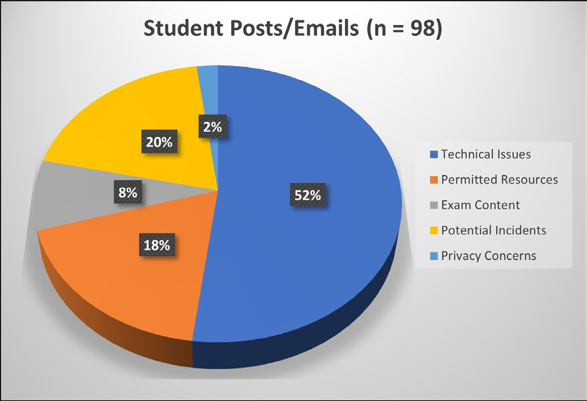

# Student and Staff Perspectives on Online Proctored and Open-book Exams

**Matthew Clemson and Alice Huang**  
*School of Life and Environmental Sciences, University of Sydney*

> *Australian Biochemist* Vol 53 No 1, April 2022, pages 17–18

The adoption of online exams at most universities has transformed the final exam experience for both students and staff. The constraints of running exams remotely, without face-to-face invigilation, has prompted many coordinators to question the practicability of exams as a method of assessment as we adapt to changes caused by the pandemic.

The emergency response to remote learning in 2020 required a rapid transition to online exams, wherein most exams were conducted without invigilation. This style of exam challenged course coordinators to strive for higher Bloom’s level testing, composing exam papers that required students to apply knowledge, extrapolate data and formulate conclusions with justifiable logic. Googleable recall-style questions became pointless, and testing was arguably more authentic for students.

***Fig. 1.** Summary of student queries about online proctored exams.*

Academic integrity was managed primarily by imposing limits on the weighting, exam duration, randomisation of questions and options, development of question banks, presenting questions one at a time and using text-matching software for written responses. However, composing and managing unique open-book exams each semester generated an overwhelming workload for academics, and the residual risks to academic integrity were apparent.

In 2021, two-thirds of all exams within the Faculty of Science at the University of Sydney were remotely invigilated using ProctorU Review+ software that utilises artificial intelligence to identify potential academic integrity breaches during the test. Potential breaches are reviewed centrally, and further action is taken if necessary. In our large second-year Biochemistry and Molecular Biology course (n = 800 students), we utilised this system to run exams in both closed-book (mid-semester test) and open-book, closed-web (final exam) formats.

For course coordinators, the Review+ software provided confidence in the identity of the test takers and assurance that the exam was conducted independently, under appropriate exam conditions, and with access only to permitted resources. It also provided some protection over the exam paper itself being copied and shared online.

For students, the concept of being monitored by AI whilst completing their exam took some getting used to. From the 98 emails and online discussion boards that related to the exams, surprisingly few students (n = 2) highlighted issues with privacy concerns (**Fig. 1**). However, we expect many harboured concerns that were not openly shared. Many posts related to technical issues with setting up ProctorU software along with their computer, webcam and microphone in preparation for the exam (n = 51). Students frequently sought clarification of the exam rules and permitted materials during the test (n = 18). Many students were concerned that they would be perceived as cheating because of incidents that occurred whilst the exam was in progress (n = 19). These included bathroom breaks, mobile phones ringing, email notifications, pop ups and people speaking in the background or entering their room during the exam. So, whilst there were no human invigilators in the exam, students remained acutely aware that they were being watched, and they felt this pressure during the exam.

Anecdotally, students that had previously experienced Live+ (human) invigilation said that they greatly preferred the Review+ AI-driven proctoring system, and they preferred open-book exams for obvious reasons. The number of questions and concerns raised was also greatly reduced for their second exam, as students became familiar with the online exam software and procedures.

Aside from some technical issues, most online exams ran smoothly: within Biochemistry and Molecular Biology, from 1,600 total exams conducted, there were only two recorded incidents of academic integrity breaches. However, to achieve this, there was a substantial academic and professional staff workload behind the scenes. We continue to carefully consider the challenges, limitations and successes of online exams as we plan our assessment for 2022.

## About the authors

Dr Matthew Clemson is a Lecturer in Biochemistry, Cellular and Molecular Biology in the School of Life and Environmental Sciences (SOLES) at the University of Sydney. <matthew.clemson@sydney.edu.au>
 

Dr Alice Huang is a Lecturer in Biochemistry, Cellular and Molecular Biology in the School of Life and Environmental Sciences (SOLES) at the University of Sydney. <alice.huang@sydney.edu.au>
 

---

*This article first appeared in the ASBMB Education Feature of the [Australian Biochemist](https://www.asbmb.org.au/magazine) Vol 53 No 1, April 2022. © 2022 Australian Society for Biochemistry and Molecular Biology Inc.*

[← Back to the April 2022 issue](../README.md)
