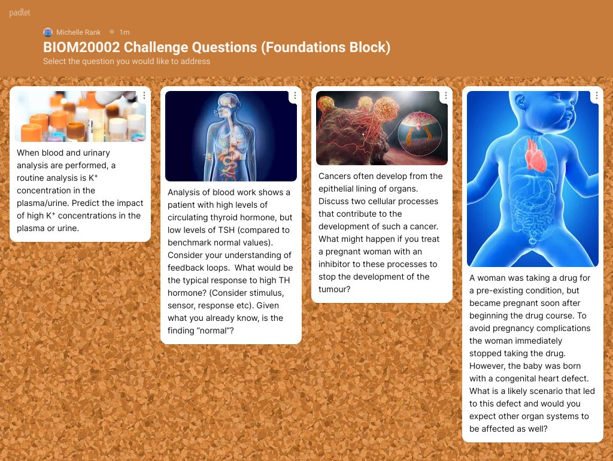
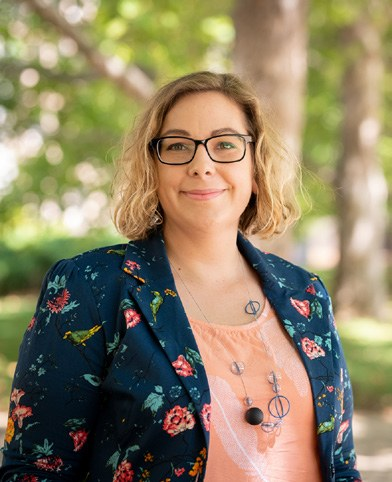

# Using Digital Technologies to Create an Engaging Small Group Learning Experience in Large Cohorts

**Michelle Rank**  
*Department of Anatomy and Physiology, University of Melbourne*

> *Australian Biochemist* Vol 53 No 2, August 2022, pages 16–17

Students have been impacted by a high degree of social isolation over the past two years of emergency remote learning. Many students early in their undergraduate learning journey have been disproportionately affected by the lack of on-campus interaction and have not yet had the opportunity to foster new social connections and participate in their education as part of a community of learners. This is important in the context of learning because effective learning is an inherently social activity. For students to gain new understandings, they need to be able to learn from and with one another (1). One way to support social learning is to incorporate activities that foster collaboration. In this article, I report our efforts to create small group collaborative learning opportunities in timetabled sessions within a large second-year undergraduate biomedical science core subject. A blended synchronous learning (BLS) approach was used to deliver team-based learning activities, in online and face-to-face modes concurrently, to over 550 students. Using a combination of digital technologies (Campuswire, Padlet and Zoom) and abundant enthusiasm, the large group lecture experience was transformed into a workshop format with collaborative small group activities.

***Fig. 1.** A sample Padlet wall showing integrated Challenge Questions posed to students during a large cohort workshop session in a second-year undergraduate core biomedicine subject. Students organise into small groups of up to ten students during a ‘lecture session’ to collaboratively discuss and propose answers to the Challenge Questions on the Padlet wall. Students can then engage in real-time review and peer feedback of all posted responses.*

Small group learning experiences were deployed in a traditional ‘lecture’ timeslot scheduled in a large capacity theatre. On-campus students were accommodated in the lecture theatre, while remote learning students accessed the live session via Zoom. Students were presented with a series of four to six Challenge Questions, similar to short answer style exam questions, that challenged students to integrate subject content across disparate topics. Students were then instructed to self-organise into groups of up to ten participants and select two to three Challenge Questions to discuss as a team; team names were encouraged. On-campus student groups worked together within the lecture theatre, whereas remote learning students were instructed to self-organise into online groups accessed via chatrooms within the subject’s Campuswire discussion board. After 20–25 minutes of discussion, students were asked to post their groups’ responses to Padlet, a real-time collaborative notice board platform. Utilising Padlet allowed both on-campus and remote-learning students to interact seamlessly in real time. For the remainder of the session, student groups were encouraged to read and discuss the Padlet posts made by other groups and provide feedback, comments and upvotes. Students who were unable to attend the live session, either on-campus or remotely, could access Padlet and add their independent input (i.e. Challenge Question responses or feedback to other posts) at any time of their choosing. After the session, subject coordinators would provide informal feedback to the Padlet wall. The previous week’s responses to the Challenge Questions were discussed by the subject coordinators at the beginning of the next timetabled session.

These collaborative small group learning workshops, delivered using a BSL approach to a large cohort, provided students with the opportunity to experience connected social learning as part of a community of learners. Students were able to collaborate with peers, communicate scientific thought, give and receive feedback and engage in formative learning based on exam-style short answer questions. Student feedback on the sessions was enormously positive, with a majority of respondents agreeing that the sessions had a positive impact on their learning experience:

*“The Challenge Questions were really useful to go over what we had learnt in a different way, just to cement our learning with our groups. It was good to be able to interact with our lecturers and peers!”*

An unexpected benefit of using the Campuswire chatrooms to facilitate discussion among remote learning students was that on-campus students who preferred to interact online had the opportunity to do so. Thus, each student could maintain their learning autonomy and engage with the activity in a personalised way that best suited their learning preferences. From the perspective of an academic, the small group learning workshops were initially quite challenging to execute, given the use of multiple technologies simultaneously, but this was quickly overcome with practice. The sessions were best staffed by two academics, or with the assistance of at least one tutor, to ensure both the on-campus and remote learning students were able to interact with content experts; this was particularly true for the remote learning students who thrived with a dedicated tutor:

*“It was really exciting to see students engaged with one another in the lecture theatre in this way, and fantastic that students were inclusive of their online peers too. As a teacher it’s seeing this kind of excited engagement from your students that is one of the most rewarding parts of the job”*

This approach is certainly not for the faint of heart, but the core principles can be variably applied, in part or in whole, to yield a positive socially connected student experience even in very large cohorts.

## References

1. Bandura A (1986) *Social Foundations of Thought and Action: a Social Cognitive Theory.* Prentice-Hall.
## About the author

Dr Michelle Rank is a teaching specialist Senior Lecturer in the Department of Anatomy and Physiology at the University of Melbourne. <michelle.rank@unimelb.edu.au>
 

---

*This article first appeared in the ASBMB Education Feature of the [Australian Biochemist](https://www.asbmb.org.au/magazine) Vol 53 No 2, August 2022. © 2022 Australian Society for Biochemistry and Molecular Biology Inc.*

[← Back to the August 2022 issue](../README.md)
