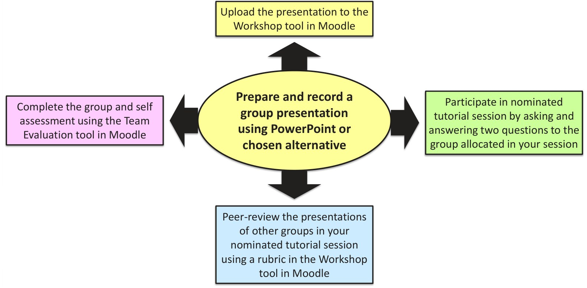
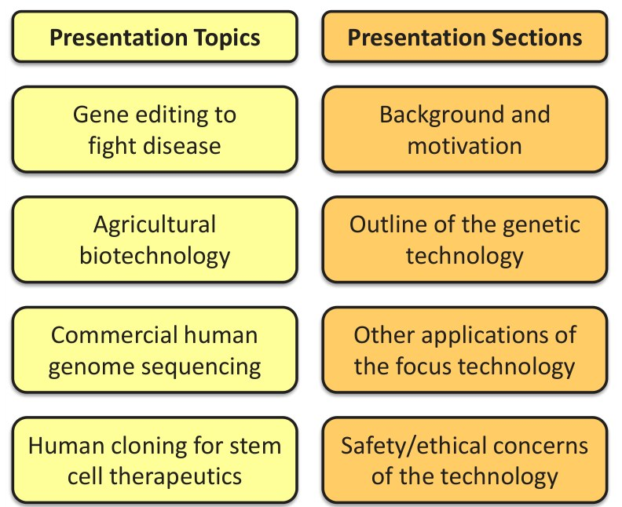
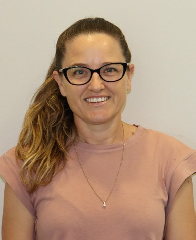

# Tutorial Presentation Redesign to Improve Engagement and Development of Core Skills

**Jody Gorman**  
*School of Chemistry and Molecular Bioscience, University of Wollongong*

> *Australian Biochemist* Vol 53 No 2, August 2022, pages 14–15

Presentation skills are key to communicating the sciences and a core skill for a wide range of graduate destinations. Teamwork is also a core skill valued by industry and applicable across disciplines. Group presentations of a research paper in a weekly tutorial had been the traditional method of developing these skills in a second-year introductory genetics subject with approximately 250 students. Students attended weekly tutorials with half their cohort, presenting a current research paper as a group in a designated week. The presentations aligned to and supported lecture content with current research examples but engagement by the audience majority was observably minimal despite ‘bonus marks’ being awarded to those asking questions. A redesign of this task has not only improved engagement but encourages critical thinking and active participation in discussion to additionally develop these skills in our young scientists.

Redesign came in the form of condensed and intense participation in one elected small group tutorial. The new task required students to do more than just present someone else’s research (**Fig. 1**). In addition to the presentation component, students were also required to peer-review other presentations using a rubric in the Workshop tool on Moodle, giving them the opportunity to assess strong and weak points and learn from other students’ work; complete a group and self-assessment using the Team Evaluation tool in Moodle to improve accountability, and participate in a small group tutorial where they would each ask and answer questions which encouraged discussion and even debate. All components contributed to their assessment mark and the assessment weighting for the task was increased accordingly. Changes to presentation structure meant student groups still had to identify a current research paper to base their presentation on but were limited to four key topic areas. Rather than presenting in traditional paper format (intro, methods, results and discussion), students were required to present in four sections that saw them focusing on the genetic technology of the research paper, other applications of that technology, and consideration of the safety/ethical concerns associated with the technology, see **Fig. 2**. This meant students had to go beyond the scope of their chosen paper and conduct additional research. This improved their knowledge of the technology and its potential applications. It also meant they had to apply some critical thought to the technology they were describing and its potential health and/or moral impact. This resulted in all students of the cohort being exposed to research examples and genetic technologies in four current and controversial topic areas.

***Fig. 1.** The redesigned tutorial task is more than just a group presentation, with each component contributing to the overall assessment.*

***Fig. 2.** Presentations were focused on four sections that required students to research beyond the scope of their chosen research paper.*

Feedback from the tutors facilitating the tutorials was very positive. One of the tutors, who had managed and marked presentations in the traditional format, commented that “The tutorials were organised in a way that encouraged the students to take the lead and autonomy with their own learning. In many instances, they required little facilitation. The vast majority of students were genuinely engaged, demonstrated sound understanding of the research discussed and were able to think critically when prompted on bigger questions.” Informal conversations with students also indicated a positive experience by the majority which was supported by feedback in the subject survey. One student commented, “it was engaging and I got to learn from marking and discussion”, another wrote “small group was good to engage better with the content,” and a third, “I really enjoyed the research group task. It was nice to have a task that really reflected the effort you put in.”

Despite student numbers in excess of 200, a migration back on campus post-COVID, and the level of back-end management required to run tutorials in this format, the redesign seemed to achieve its aim of improved engagement and core skill development and will be a fixture in Introductory Genetics at UOW into the future.

## About the author

Dr Jody Gorman is a teaching-intensive lecturer in the School of Chemistry and Molecular Bioscience at the University of Wollongong. <jwilton@uow.edu.au>
 

---

*This article first appeared in the ASBMB Education Feature of the [Australian Biochemist](https://www.asbmb.org.au/magazine) Vol 53 No 2, August 2022. © 2022 Australian Society for Biochemistry and Molecular Biology Inc.*

[← Back to the August 2022 issue](../README.md)
