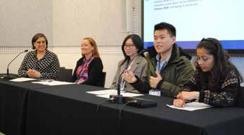

# The Student Perspective: Advice from Students on What Teaching Academics Should Take With Them From the Pandemic

**Amber Willems-Jones (University of Melbourne) and Tracey Kuit (University of Wollongong) talk to undergraduate Biochemistry students Ishika Jaitly, Marcus Go, Darlene Sentosa and Janelle Accheni.**  

> *Australian Biochemist* Vol 53 No 3, December 2022, pages 23–25

At the ComBio22 Education Symposium, a student panel discussion was held with undergraduate students from three universities, including: Marcus Go, a third year Bachelor of Science (BSc) student from Monash University, Ishika Jaitly a final year Bachelor of Medicinal Chemistry student from UNSW and Darlene Sentosa, a third year BSc student from the University of Melbourne. Along with Janelle Accheni, a second year BSc student from Deakin University, our amazing student panellists shared their perspectives on what has been learned during the pandemic and how teaching academics can take these learnings into the future to further advance teaching in conjunction with a positive student experience.

## What positive or negative learning experiences stand out in your time as an on-line learner during the pandemic?

**Ishika** – A distinct positive was the interactive engagement between teachers and students through live polling and quiz platforms (e.g., Slido or Kahoot). This strategy was mutually beneficial, allowing teachers to assess student understanding in real-time, while holding students’ attention to facilitate improved retention of the concepts being taught. As Benjamin Franklin said, “Tell me and I forget, teach me and I may remember, involve me and I learn.”

**Janelle** – As a mature-age student, a positive aspect of online learning was the opportunity to make social connections through study groups and discussion forums. Being able to go back over recorded content was also beneficial to cement understanding. However, a downside was the lack of physical practicals. Most of my cohort had very little or no hands-on experience during the pandemic, so by the time we returned on-campus, much of our practical class time was spent learning how to use equipment, rather than exploring content. This was frustrating not only to us, but also our demonstrators. Even now, I still feel very behind in my practical skills.

**Darlene** – One of the downsides I found was the lack of interaction between academics and students, and more importantly between students in the online space (i.e., in breakout groups). I found this hindered effective learning, such that it had the potential to negatively impact mental health and academic performance. In support of Janelle’s comments, I also found lack of hands-on experience in practical classes to be a negative experience, because it was difficult to picture the experiments without directly seeing or being involved in them.

**Marcus** – One of the negatives from my perspective was not being able to bond with my peers in physical lectures, as online learning placed a digital wall between us. Losing the opportunity to build face-to-face support groups, both for study and mental wellbeing, was a significant disadvantage during my time online.

*Student panel discussion at ComBio2022.*

## Can you describe what you learned about yourself through the online learning experience during the pandemic?

*Biochemistry students, from left: Janelle Accheni, Marcus Go, Ishika Jaitly and Darlene Sentosa.*

**Darlene** – As an international student, far from home, I found the rapid move to online learning challenging and it affected my physical and mental health. But after returning home to Indonesia to study online for a semester, I found online learning changed for me and it forced me to be more independent. I also learned to be more prepared and to understand topics in more detail rather than plainly regurgitating material. I think that was very valuable. Online learning gave me the opportunity of self-exploration to find out how to study efficiently, and to identify what I want to pursue in my career. Ultimately, the experiences during the pandemic shaped me to be the person I am now.

**Marcus** – In my first year of university, my approach to learning was memorisation: if the topic stuck in my brain for the exams, that was all I needed. But during the pandemic though, I found it more difficult; I managed to shift from rote memorisation to comprehension of the underlying concepts to achieve a deeper understanding. Once I adapted my approach, I understood, I listened and I questioned. Ultimately, when the exams came around, I thrived.

**Ishika** – Looking back now, my online learning experience through the pandemic really was a series of opportunities for me to prove to myself that I had what it took to not just survive at university but to thrive in the face of adversity. Having juggled acclimatising to independent learning, adjusting to online exams, managing home-sickness and social isolation, I now feel more resilient because I know that no matter what curveballs life throws at me, I can handle it.

**Janelle** – During the pandemic, I learned the critical importance of taking care of my mental health and of being adaptable. While I initially thought I was managing, as time progressed, it became increasingly difficult to balance everything (studying online, working remotely, caring responsibilities and staying sane). Acknowledging these challenges and taking time out from university through a leave of absence meant I was able to mentally refresh and to reevaluate my approach to study; and return as a more confident, focussed and balanced student.

## Is there a piece of advice you would like to give your teaching academics as they move into the ‘post-pandemic’ future?

**Ishika** – It’s important to establish a sense of community amongst students who are studying online to support the more social aspects of learning, and therefore, match the effectiveness of traditional in-person learning. A sense of community can be achieved through group projects or weekly tutorial breakout room discussions. Another important consideration is to ensure there are clear lines of communication between academics and the student cohort. This could be using virtual office hours to replace in-person drop-in sessions, posting weekly to-do lists of lectures/assignments to watch/complete and periodic check-in surveys to see how students are progressing. These small initiatives can in turn help to create a sense of student accountability and effective time management, and to facilitate insight in how students allocate their time towards various tasks.

**Darlene** – Embrace that aspects of online learning are here to stay, but caution must be exercised when augmenting in-person activities with online activities. It’s important not to simply replace teaching the content and engaging students with online self-learning activities and assignments. Online activities should not be the centrepiece, but rather, they should be used to complement and scaffold the main teaching material.

**Marcus** – Establishing a community within the student cohort is very important. Where possible, facilitating weekly tutorial sessions with peer interactions will enhance the learning experience, serving to help not only student learning but to also help foster networking between students.

**Janelle** – My advice: university is not a one-size-fits-all experience. Online learning offers many benefits including flexibility. However, it is important that online learning quality is retained, and that there is a balance (and equity) between online and on-campus work. Online classes should not simply rely on self-directed online learning modules and worksheets. Some students will need scaffolding and direction. Continue to be flexible and don’t dismiss students’ requests/needs because the pandemic is ‘over’ – many students are still struggling mentally, and some have no experience outside of online learning. The return to campus requires a considered transition because an abrupt move back could have just as negative an effect as the rapid transition online did for some.

## Is there a piece of advice you would like to give a fellow student as they transition into a ‘post-pandemic’ future?

**Marcus** – Be aware of the kinds of subjects/units you can take across your degree. Subjects like research projects or internships will help you understand and develop transferrable skills, whilst ensuring that you can apply theory within the discipline to real life situations. They say, ‘variety is the spice of life’, so it’s also important to consider taking electives from different subjects outside your major. Not only will you come to understand what you enjoy and what you don’t, but you may also establish new approaches to tackle life’s challenges. The pandemic took a significant portion of the learning process and the transition from university to employment has only become more complicated with the changing world and the shifting paradigm. Practical skills and a broad understanding can be very beneficial in these changing times.

**Darlene** – While it can be scary and daunting to ask questions, be sure to engage with your tutors and lecturers, even if your questions aren’t related to the material for that week. Build your timetable to maximise in-person learning where possible because it is a completely different experience to online learning. However, remain flexible and remember that some online classes are great if you can’t make it on campus, particularly if the subject isn’t a practical or a hands-on subject.

**Ishika** – Be adaptable! If there’s anything the sudden transition to online learning because of the pandemic has taught me, it is that the world is capricious, and circumstances can change on a dime. So, aim to be the Play-Doh that never hardens – mould yourself through hard work, dedication and passion into a student who accepts the exciting challenges university has to offer.

**Janelle** – Always put yourself and your mental health first. If you are struggling, utilise the services offered by your university and ensure you have a strong external support network. Find what works best for you – in terms of studying – then structure your degree around that. Choose classes that suit your study methods but still meet the criteria needed for your degree. Don’t be scared to reach out to lecturers for support, they’re not gods. Try to incorporate practical classes, they really do provide fundamental transferrable skills. But above all, do your best and enjoy your university experience.

*Responses to questions have been paraphrased and condensed with permission.*

## About the authors

Dr Amber Willems-Jones is a Senior Lecturer in the Department of Biochemistry and Pharmacology, University of Melbourne. <amber.willems@unimelb.edu.au>
 

Tracey Kuit is an Education-Focused Associate Professor in the School of Chemistry and Molecular Bioscience, University of Wollongong. <tracey_kuit@uow.edu.au>
 

---

*This article first appeared in the ASBMB Education Feature of the [Australian Biochemist](https://www.asbmb.org.au/magazine) Vol 53 No 3, December 2022. © 2022 Australian Society for Biochemistry and Molecular Biology Inc.*

[← Back to the December 2022 issue](../README.md)
