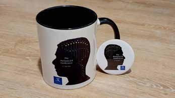
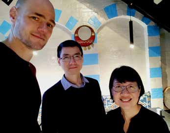

# Trafficking the Interdisciplinary Mindset Beyond the Intracurricular Space

**Saw Hoon Lim, Jiangli Tan and Ger Post**  
*University of Melbourne*

> *Australian Biochemist* Vol 53 No 3, December 2022, pages 25–26

‘Designer Humans: Prospects and Perils’ was launched as a University Breadth subject at the University of Melbourne in 2021. A central question in this ‘Unibreadth’, as they are affectionately known, is: How should biomedical innovations be critically evaluated for their impact on human life, culture and society? Such a question would be best interrogated through interdisciplinary lenses, with perspectives derived from the sciences, social sciences and humanities.

In this subject, students must engage with concepts and peers from other disciplinary backgrounds. Initially, it was daunting for some to be exposed to wide-ranging concepts and viewpoints. However, as the subject unfolded, students learnt to integrate disparate concepts to form interdisciplinary perspectives on technologies they were passionate about. This was seen from the lively discussions during tutorials and critical evaluations in assessments. The staff, who themselves come from diverse disciplines, found excitement in learning new concepts from each other and from the students! Evidenced by student feedback last year, “Love the subject but can the lecturers stop asking each other questions and give us a chance?”

Anything this good should be shared widely. With the help of a University of Melbourne Learning and Teaching Initiatives grant, we established a student-led interdisciplinary journal for students to publish interdisciplinary essays, reflections and artworks focusing on our future. This journal, called Humans 2.0, was also the launchpad for its namesake conference.

The Humans 2.0 conference was organised by students and staff to engage the university community and the wider public on the importance of tackling complex issues through an interdisciplinary mindset.

*The Humans 2.0 conference was held on 1 July 2022 to promote the interdisciplinary student-led journal. Pictured are the Humans 2.0 designed souvenirs for speakers (mugs) and attendees (badges).*

The conference program featured fantastic speakers who connect disparate fields in their work and students who brilliantly shared their thoughts and hopes for biomedical technologies. The conference also featured a captivating storyline that complemented the talks – a family’s plight, when their young child is found to carry the gene for early onset Huntington’s disease, a rare autosomal dominant inherited disorder. Issues arise when the family makes decisions that question the ethics of advancing technologies and what it means to be human. The narrative was strategically punctuated by speaker presentations and panel discussions in the areas of art, science and ethics so that the audience was further prompted to think deeper on emerging issues as they interacted with speakers and voted on decisions as if they were family members in the scenario. In a way, the audience drove the conference as much as the speakers and panellists. An audience member remarked, “The combination of art and science was fabulous. The provocations through the case study which was woven through the conference enabled the audience to reflect and interact with the information.”

This was a conference where the audience did not need to be ushered back to the lecture theatre after lunch – as much as they were eager to cast their interdisciplinary lenses on the issues, they were keen to find out the ending of the story. No spoilers allowed!

*From left: Ger Post, Jiangli Tan and Saw Hoon Lim.*

## About the authors

Dr Saw Hoon Lim is a Senior Lecturer in the Department of Biochemistry and Pharmacology, University of Melbourne. <sawhoon.lim@unimelb.edu.au>

Dr Jiangli Tan is a Teaching Specialist in the Department of Medical Education, University of Melbourne. <tanjl@unimelb.edu.au>

Ger Post is an Online Teaching Delivery Tutor in the Department of Anatomy and Physiology, University of Melbourne. <ger.post@unimelb.edu.au>

---

*This article first appeared in the ASBMB Education Feature of the [Australian Biochemist](https://www.asbmb.org.au/magazine) Vol 53 No 3, December 2022. © 2022 Australian Society for Biochemistry and Molecular Biology Inc.*

[← Back to the December 2022 issue](../README.md)
