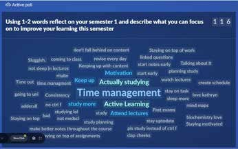

# Development of a Metacognitive Mindset to Improve Student Learning in Biochemistry

**Kathryn Jones**  
*University of Auckland, New Zealand*

> *Australian Biochemist* Vol 54 No 1, April 2023, pages 12–13

Metacognition is the ability to plan, monitor and assess one’s understanding and performance; it is a driver of success in university-level study (1). The COVID-19 pivot online led to widespread changes in teaching and assessment, resulting in students having to quickly adapt to learning in a digital environment. The University of Auckland biology curriculum historically included little metacognitive teaching. Therefore, we decided to promote metacognitive thinking across the upper level curriculum, starting with the 400-student second year biochemistry course.

Since 2020, reflective questions designed to encourage metacognitive thinking were added to existing formative, fortnightly module quizzes worth 1%. A written reflective question was added to an H5P module containing ten interactive biochemistry questions. These reflective questions encouraged students to consider their current methods of **learning** (e.g. *what strategies are you using to study for the test?*), **monitoring** (e.g. *did your strategies allow you to achieve your goals?*), **planning** (e.g. *what’s one thing you can start doing today to better manage your time?*), **performance** (e.g. *what could you do differently to better prepare for the exam?*) and **motivation** (e.g. *what is motivating you to learn?*). Questions were key word automarked, thereby reducing marking time for staff. By linking questions to existing weighted content-based module quizzes, completion rates averaged 94% and students understood their reflections were important and valued.

## How did we introduce such questions?

To set the scene, we used a Slido poll on Day 1 to ask students to reflect on what they could do to improve their **learning**, based on their experiences in previous semesters. Student answers were populated ***live*** into a word cloud (see **Fig. 1**), with themes such as time management consistently appearing as a challenge for students. With large classes this is a fun, eye-opening, but potentially risky activity as you must trust your students to keep responses appropriate. Before this initial poll, I was unaware of how many students played video games well into the night!

In Week 2, the **monitoring** quiz followed up on the reflection by asking students what they will do to action what they wrote on Day 1. Anonymised quiz feedback was collected and themes discussed in class. This student-led approach proved to be a great tool for discovering new approaches students use (e.g., apps for time management and productivity, flash cards). Sharing feedback across the class allowed all to benefit. In Week 4, students were asked about their **planning** and study strategies for the upcoming test. Once grades were released, the Week 6 **performance**-themed quiz enabled students to reflect on the success of their strategies. High-achieving student strategies were anonymously shared with the class through Canvas to promote thought. Interestingly, almost all students suggested clear ways to improve their study, irrespective of their test grade. Reflecting on **motivation** to study in Week 8 aimed to refocus students on their own reasons to continue ‘showing up’ and meet their goals.

***Fig. 1.** Word cloud generated in Slido showing student responses for how they can improve their learning. Larger words represent more common responses.*

## What did students learn from their reflections?

Through these processes, students learnt the differences between high and low power study strategies (e.g., mind mapping and testing themselves versus re-reading highlighted notes). Many students realised that deeper conceptual understanding was more valuable than rote memorisation, and for some students, this coincided with a change in revision strategies to include concept mapping. The emerging themes students identified included the need for increased self-regulation (and their struggle to achieve this), the realisation that learning is a social activity (which was lost online), the desire to find new online tools to facilitate social learning, plus a shift from paper to digital, text-based revision notes.

The students also provided thoughtful advice for future cohorts, with selected comments recorded as audio messages for the following year’s students, like a kind of ‘message in a bottle’.

Through this work, we have shown that developing metacognitive thinking can enable students to be better learners who can monitor their learning in ways other than grades.

## Reference

1. Tanner KD (2012) *CBE Life Sci Educ* 11(2):113–120.
## About the author

Dr Kathryn Jones is an education-focused academic in the School of Biological Sciences, University of Auckland, New Zealand. <ks.jones@auckland.ac.nz>
 

---

*This article first appeared in the ASBMB Education Feature of the [Australian Biochemist](https://www.asbmb.org.au/magazine) Vol 54 No 1, April 2023. © 2023 Australian Society for Biochemistry and Molecular Biology Inc.*

[← Back to the April 2023 issue](../README.md)
