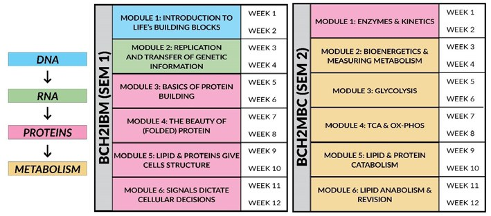
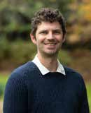
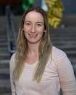

# Refreshing a Biochemistry Curriculum: A Pinch of Problem-Based Learning, a Dash of Peer-Mentoring, Blended Together with Online Interactive Modules

**James Tsatsaronis, Katrina Binger, Julian Pakay, Lakshmi Wijeyewickrema, Fiona Durand, Fiona Carroll and Noni Frankenberg**  
*La Trobe University*

> *Australian Biochemist* Vol 54 No 1, April 2023, pages 13–15

Biochemistry curricula are influenced by the landscape of higher education in Australia, which includes an increasing shift towards online and blended learning. In 2019, in response to student feedback received from subject feedback surveys, we instigated a complete revision of the biochemistry curriculum. The major goals of this revision were to improve scaffolding of subject content and optimise the blended mode of delivery to improve student experience and learning outcomes.

At La Trobe University in Victoria, second-year biochemistry is taught across two subjects, BCH2IBM (Introductory Biochemistry) and BCH2MBC (Metabolic Biochemistry). Both subjects are taught across three onshore campuses, as well as online through partnerships with Open Universities Australia (OUA), and transnationally at the PSB Academy in Singapore. Both subjects are core for more than ten courses taught across the university, including Biomedicine, Animal and Veterinary Biosciences, Agriculture and Human Nutrition.

## Redevelopment through thematic analysis

To identify frequently expressed student concerns, we analysed subject surveys from previous years through thematic analysis of qualitative student feedback data using NVivo. We identified concerns across four main themes: class format, delivery mode, assessments and content quality. Using these data alongside application of the ASBMB (USA) biochemistry threshold concepts (1), we formed a framework for the redevelopment of BCH2IBM and BCH2MBC. As shown in **Fig. 1**, we designed a transformed biochemistry curriculum that scaffolds lecture, workshop and practical content across both subjects.

The redeveloped subject content incrementally builds student mastery of the biochemistry discipline through online delivery of lecture material in the form of short lecture snippets (5–7 minute), designed to deconstruct complex biochemistry concepts and to ease excessive cognitive burden. Using Moodle Lesson modules, short lecture snippets are embedded alongside formative quiz questions and interactive H5P activities. Subject content is grouped into six two-week modules, covering the flow of genetic information through the central dogma, protein structure, enzyme kinetics, metabolism and cell biology. Each module is assessed in a problem-based learning (PBL) class that requires students to apply online lecture material to authentic biochemistry research and industry scenarios. Led by students, the PBL classes are run in small group workshops with academic facilitators rather than didactic teachers, supported by near-peer mentors – high-achieving students from previous cohorts who have volunteered as helpers during PBL workshops. Assessment of student performance in the PBL class is conducted using participation scoring, whereby individual communication and contribution to PBLs are assessed by both peers and academics in each session. This approach was taken in order to foster teamwork, communication, critical thinking and information processing skills.

## Redevelopment yields improvement

***Fig. 1.** A blended transformed biochemistry curriculum.*

Following delivery of the redeveloped curriculum in 2020, numerical scores of overall student satisfaction in both subjects has improved overall from ~3.5 to >4 on a 5-point scale. Student qualitative feedback specifically identifies online lesson modules as being effective. Blended learning, identified through student comments, is now overwhelmingly framed as one of the ‘best aspects’ of the subject rather than an area for improvement. A separate survey of student satisfaction with PBL classes found that >80% of students agreed that the workshops helped them to apply concepts covered in lectures, and >85% agreed that they had enjoyed group-work with their peers. The involvement of student near-peer mentors in PBLs has not yet been formally evaluated, however anecdotally we believe this has benefits for helping address chemistry and maths ‘anxieties’ in biochemistry students. Furthermore, the opportunity to participate as a peer mentor provides our former high achieving students a chance to both foster and improve their communication and leadership skills.

We plan to iteratively continue to improve these subjects through implementation of new technologies, such as 3D printing and VR-led protein structure tutorials into the two-week module plus PBL framework.

## Reference

1. Loertscher J, Green D, Lewis JE, Lin S, Minderhout V (2014). *CBE Life Sci Educ* 13(3):516–528.
## About the authors

Dr James Tsatsaronis is a Senior Lecturer in the Department of Biochemistry and Chemistry, La Trobe University. <j.tsatsaronis@latrobe.edu.au>
 

Dr Katrina Binger is a Senior Lecturer in the Department of Biochemistry and Chemistry, La Trobe University. <k.binger@latrobe.edu.au>
 

Dr Julian Pakay is a Senior Lecturer in the Department of Biochemistry and Chemistry, La Trobe University. <j.pakay@latrobe.edu.au>
 

Dr Lakshmi Wijeyewickrema is a Senior Lecturer in the Department of Biochemistry and Chemistry, La Trobe University. <l.wijeyewickrema@latrobe.edu.au>
 

Dr Fiona Durand is a Lecturer in the Department of Biochemistry and Chemistry, La Trobe University. <f.durand@latrobe.edu.au>
 

Dr Fiona Carroll is a Lecturer in the Department of Biochemistry and Chemistry, La Trobe University. <f.carroll@latrobe.edu.au>
 

Dr Noni Frankenberg is an Academic Coordinator for the PSB Partnership in the Department of Biochemistry and Chemistry, La Trobe University. <n.frankenberg@latrobe.edu.au>
 

---

*This article first appeared in the ASBMB Education Feature of the [Australian Biochemist](https://www.asbmb.org.au/magazine) Vol 54 No 1, April 2023. © 2023 Australian Society for Biochemistry and Molecular Biology Inc.*

[← Back to the April 2023 issue](../README.md)
