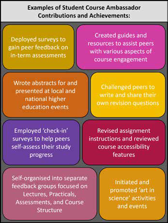
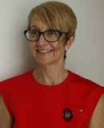
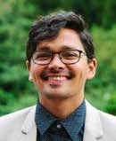

# Student Partners: Strengthening Staff–Student Connections Beyond the Pandemic

**Anne Galea, Kristin Turnbull and Collins Fleischner**  
*University of New South Wales*

> *Australian Biochemist* Vol 54 No 1, April 2023, pages 15–16

Positioning and preparing students to work in collaboration with staff to design, implement and evaluate programs and initiatives can facilitate beneficial impacts on learning and significantly improve both student and staff experiences (1). By inviting students to be active participants and co-creators in their course, students can have a more engaging and rewarding learning journey. This approach nurtures the potential of students as ‘change agents’ who can contribute valuable skills, perspectives and experiences to enhance their higher education and benefit the broader university learning community. Here, we describe a simple model for embedding student–staff partnerships in undergraduate courses and the development of a framework for delivering this initiative more broadly across an institution.

Throughout the COVID pandemic, large second year biochemistry and molecular biology courses at the University of New South Wales (UNSW) enlisted ‘Student Course Ambassadors’ to enhance engagement, collaboration and communication between students and staff. The framework saw students self-nominate into an ambassador role at the start of term for regular meetings/communications with staff to identify strengths and weaknesses of different aspects of course content, assessment and delivery. To acknowledge service and contribution, Student Course Ambassadors were presented with a digital certificate at the completion of their role.

Initially introduced to better facilitate real-time responses to feedback on courses, the Student Course Ambassador Program quickly broadened its scope to provide students with leadership and professional development opportunities, as well as avenues for creative and strategic input into the development of course resources and new directions. Examples of Student Course Ambassador contributions and achievements are detailed in **Fig. 1**.

***Fig. 1.** Examples of Student Course Ambassador Contributions and Achievements.*

The success of the Student Course Ambassador Program has been measured through consistent positive student feedback with high course satisfaction ratings. Furthermore, the Ambassador Program was a contributing factor in the design and development of an institution-wide Student Partner Program pilot run by the Academic and Education Focussed Development team within the Pro Vice-Chancellor Education and Student Experience Portfolio at UNSW. Centrally supported and available to all UNSW course convenors, the university-wide program includes a general introduction to student partnerships in higher education and provides regular workshops and support for course staff as they design and implement their own student partnerships.

In 2022, the Student Partner Program pilot involved 22 cross-Faculty convenors and 175 students. The diversity of courses and participants in the Student Partner Program pilot led to a range of student–staff meeting patterns, from weekly to ‘on-demand’ and fully flexible online communications. Evaluation of the pilot program was guided by the SPELT (Small Project Evaluation in Learning and Teaching) framework (2) and involved end of term surveys, focus groups and interviews with students and staff. An end of term survey completed by 54 of the students who participated in the pilot provided insights into the impacts of the program on both the student partners and other students in their course. Some of the most common responses from the student participants indicated that the program: (a) helped build better connections within and between staff and peer communities, (b) increased confidence in learning and communicating at university and (c) was successful in facilitating timely adjustments (such as changes to assessment timing, improvements to content delivery and development of supportive course resources and revision materials). When surveyed, most staff participants similarly indicated that they saw improved connections with students and developed a greater understanding of their needs within a timeframe where changes could still be executed. Staff and students in the program occasionally acknowledged tension points relating to effective and inclusive communication strategies, as well as the need for careful consideration and planning relating to workloads for staff and students alike.

As described, the collective outcomes and feedback from the Student Partner Program pilot offered valuable insights into the scope of student partnerships across different disciplines and courses. Armed with these insights, the program coordinators also worked alongside student partners from the Term 1 pilot to further develop Student Partner Program support guides, training workshops, drop-in sessions and a resource-sharing site for both students and staff in the next iterations of the program. Future goals include increasing our suite of student partnership opportunities and engaging with national and international ‘Students as Partners’ initiatives and events.

## References

1. Mercer-Mapstone L, Dvorakova SL, Matthews KE, Abbot S, Cheng B, Felten P, Knorr K, Marquis E, Shammas R, Swaim K (2017) *Int J Students Partners* 1(1).
2. Huber E (2017) *J Univ Teach Learn Pract* 14(1).
## About the authors

Dr Anne Galea is a Senior Education-Focussed Lecturer in the School of Biotechnology and Biomolecular Sciences, University of New South Wales, Sydney. <a.galea@unsw.edu.au>
 

Kristin Turnbull (SFHEA) is the Manager of Academic Program Development, University of New South Wales, Sydney. <k.turnbull@unsw.edu.au>
 

Collins Fleischner is the Lead for Academic and Education Focussed Development, University of New South Wales, Sydney. <c.fleischner@unsw.edu.au>
 

---

*This article first appeared in the ASBMB Education Feature of the [Australian Biochemist](https://www.asbmb.org.au/magazine) Vol 54 No 1, April 2023. © 2023 Australian Society for Biochemistry and Molecular Biology Inc.*

[← Back to the April 2023 issue](../README.md)
