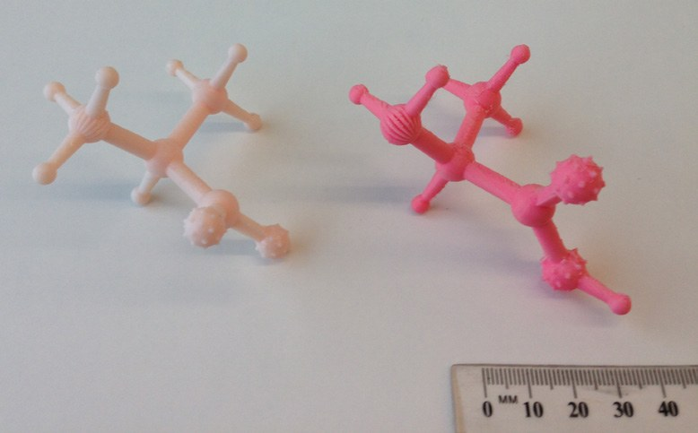
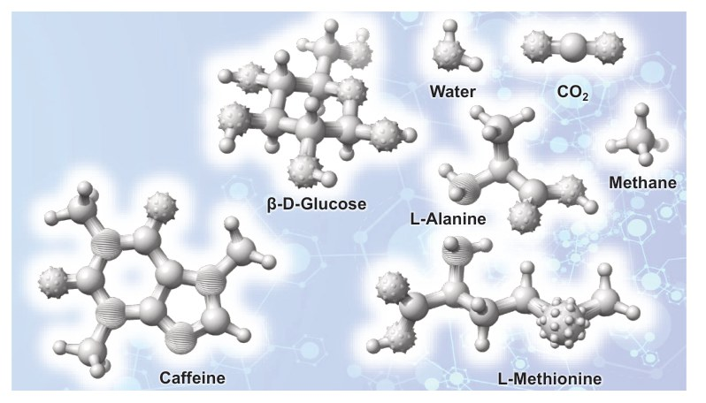
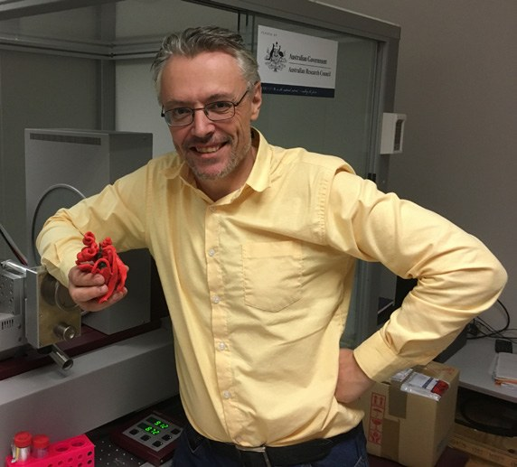

# ChemBraille: 3D Chemical Models for the Vision Impaired

**Aaron Oakley**  
*University of Wollongong*

> *Australian Biochemist* Vol 54 No 2, August 2023, page 19

In 1865, German chemist August Kekulé famously described a dream about a snake eating its own tail as the inspiration for the now-accepted hexagonal ring structure of benzene. This emphasises the importance of visuospatial thinking in chemistry. Molecular models can be used to inform visuospatial thinking and represent an important learning aid for students. While commercially available chemical models typically use colour to represent different elements, this visual stimulus is not accessible to those who are visually impaired. To further enhance accessibility of chemistry models to the blind and vision impaired, I developed ‘ChemBraille’ – tactile chemistry models inspired by my involvement with two visually impaired students in second-year university chemistry subjects I taught.

***Fig. 1.** Printed ChemBraille models of L-alanine. Ruler shown for scale.*

***Fig. 2.** Computer rendering of ChemBraille models of biologically relevant compounds.*

Using widely available chemical structure files, the ChemBraille system is flexible in that any organic compound can, in principle, be converted to an inexpensive tactile 3D molecular model. Chemical data in the form of ‘chemical table files’ (a family of text-based chemical files) is used as a starting point for the generation of models. These files contain information about atoms, bonds, connectivity and the coordinates of molecules. Using a newly developed Python script, sdf2scad, to convert chemical table files to OpenSCAD scripts, the OpenSCAD then acts as a 3D compiler that takes the script generated by sdf2scad and renders the model. The model is output as a STL file, which is widely used in computer aided design (CAD) and can be imported by 3D-printer software for model production.

In the physical ChemBraille models, spheres represent atoms and rods represent bonds. For the elements boron, carbon, nitrogen, oxygen, fluorine, phosphorus, sulfur, chlorine, bromine and iodine, distinctly textured atoms are produced, each with their own unique ‘feel’. Bond order is encoded by the profile of the connecting bridges between atoms. Single bonds have a circular profile, double bonds a square profile and triple bonds a hexagonal profile. Thus, through touch alone, a ChemBraille model conveys information about elements, molecular shape and bonding. An example of a 3D-printed model for L-alanine is shown in **Fig. 1**.

For biochemical education, I have produced models of relevant molecules including amino acids, nucleic acid bases and simple sugars. Some designs are shown below in **Fig. 2**.

I have produced a set of ChemBraille models for high school and university teaching. The ‘functional group set’, available from the [Harvard Dataverse](https://doi.org/10.7910/DVN/HNE12J), contains model compounds comprising common functional groups of organic chemistry (aldehyde, ketone, ester, amines, etc).

Feedback from students has been positive. One visually impaired second year student noted, “I wish I’d had these in first year.” It should be noted that the use of ChemBraille models is not necessarily restricted to blind students; the tactile information encoded in such models is readily apparent to sighted chemistry students and can be used for the same learning purposes. A natural advantage of the ChemBraille system is that models can be printed on the most common (and economical) 3D printers, which are invariably restricted to one colour. An advantage over systems based on fixed sets of bonds and atoms (as exemplified by most available chemistry model sets) is that the number of models is not limited to what can be created by the number of parts provided.

## About the author

Associate Professor Aaron Oakley is a structural biologist in the School of Chemistry and Molecular Bioscience at the University of Wollongong. <aarono@uow.edu.au>
 

---

*This article first appeared in the ASBMB Education Feature of the [Australian Biochemist](https://www.asbmb.org.au/magazine) Vol 54 No 2, August 2023. © 2023 Australian Society for Biochemistry and Molecular Biology Inc.*

[← Back to the August 2023 issue](../README.md)
