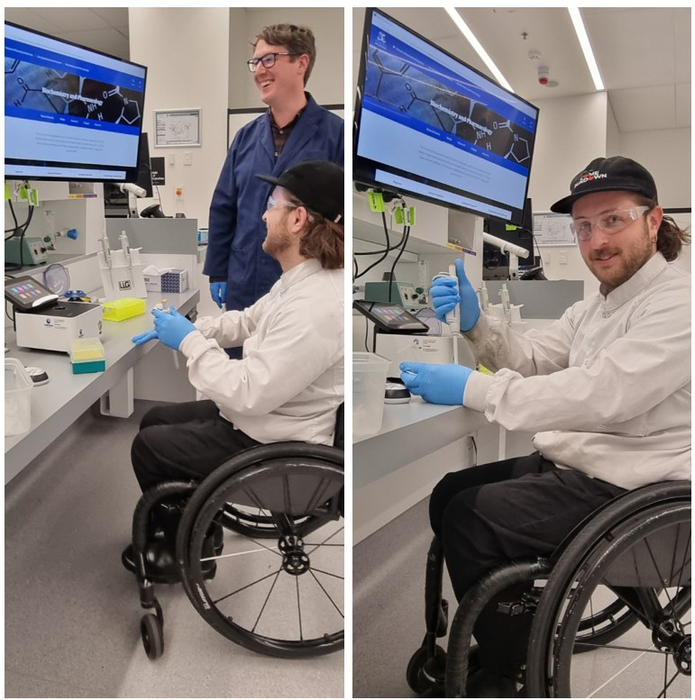
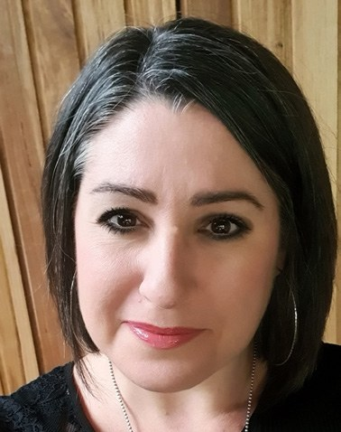
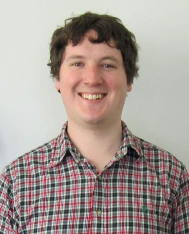
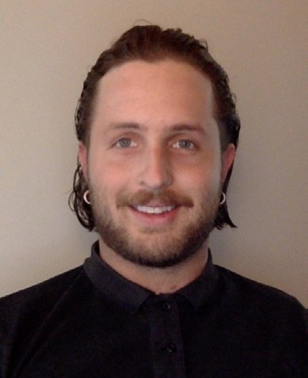

# Inclusive Laboratory Practice: Perspectives of a Second-year Undergraduate Student

**Amber Willems-Jones and Alexander Rey (University of Melbourne) talk to undergraduate Biochemistry student Michael Blyth**  

> *Australian Biochemist* Vol 54 No 2, August 2023, pages 16–18

Universities nationwide affirm that students experience education opportunities equally and inclusively. At the University of Melbourne, the Diversity and Inclusion Strategy 2030 states, “Diversity and inclusion… is about opening the intellectual enterprise to people who may be prevented from attending because of broader social inequities, by creating space, opportunities, ….. and support for underrepresented students and staff.” Furthermore, the university’s Disability Inclusion Action Plan indicates that the university aspires to “become a champion and an exemplar of disability inclusion and accessibility” through the removal of “barriers to participation in university life that are faced by people with disability.”

To this end, when designing the state-of-the-art teaching facility of the Western Edge Biosciences precinct, teaching spaces were tailored to be suitable for all students irrespective of accessibility needs. Wet lab teaching facilities were designed with adjustable height laboratory benches and height appropriate handwash stations to facilitate the needs of wheelchair-user students. We had anticipated that we met the needs of our students, but did we really get the balance right?

Amber Willems-Jones and Alex Rey recently sat down with second year Bachelor of Science student, Michael Blyth, to get his insights into the Techniques in Molecular Science laboratory class in the Department of Biochemistry and Pharmacology at the University of Melbourne.

## Can you tell us a little about yourself and your history with disability?

My name is Mike, I’m 28 years old, I’m a mature age student. I am a manual wheelchair user, the result of a mountain biking injury in 2013. Following my injury, I spent a couple of months in rehab at the Austin Hospital, followed by a few years in a bit of a mental rut. It took me some time, but I eventually got my license, a job –all that type of stuff – which in time, led to enrolling into university.

While study currently takes up most of my free time, I have outside interests including music/sound production. I’m also a disability advocate and I help local music venues around Melbourne improve the accessibility experience.

## What made you choose to come to university?

After getting my license, I managed to tee up employment at a disability equipment supplier. Prior to my injury, I was employed as a bike mechanic, so the skillset carried over pretty naturally. At the disability equipment supplier, I worked with wheelchair users, their physios and OTs, an experience that led to my current job at the Royal Children’s Hospital. I now support kids in rehab with assistive technologies to enable them to use everyday consumer devices, such as eye and head-tracking for iPads, laptops, Xbox, etc (i.e. for kids that don’t have the hand dexterity for keyboards, touch screens). Being in a medical environment as a person with a disability, interacting and helping these kids learn to adjust to their disabilities is a profound experience. This provided me with the motivation to pursue medicine, which meant enrolment in a science degree first.

*Michael Blyth performing a practical experiment in the second year subject, Techniques in Molecular Science.*

## Given your accessibility needs, did you have concerns about choosing to study a science degree?

There was some hesitancy. I firstly had to wrap my head around whether studying medicine was something viable I could do from the chair (I do realise there are certain fields that are logistically more complex than others). Because I finished high school in 2012 and had never been to university, I had to go through alternative application routes. I was aware that there would be hands-on practical classes, and I wasn’t sure how that would work out, but I felt well-supported from the start. It was a matter of asking the right questions and finding support groups, but I managed to find my way around and I reached out to the right people, for example, the SEDS (Student Equity and Disability Support) team.

## What has your experience been like so far at university, in terms of inclusivity?

Really good. When I started with SEDS, I was set up with an academic adjustment plan that meant I had access to academic support workers (third year or Masters students) in practical classes to assist me. For example, if I needed to move any large bits of glassware around etc, which happened quite a bit in first year Chemistry.

I’ve always felt I have had a choice of how much I want to be involved in my practical classes, with teaching staff being flexible and supportive. Though it has been on me to reach out for support, to contact subject coordinators and to arrange times to discuss my needs. While this is acceptable for me as I’m pretty comfortable advocating for myself, I think this could be an area of improvement to help students make those first connections with subject coordinators.

## How have you found your experience in the wet lab biochemistry space this semester?

It has been great. When I first came in to discuss my requirements with the subject coordinator, Amber, and the technical team before semester started, seeing the height adjustable benches built into the laboratory was pretty cool. In my first year in other subjects, there were height adjustable tables that were slid into/tacked onto the benches, but they protruded out, which made it a bit difficult to move around. Whereas in this space, the built-in design is so neat, it fits into the rest of the lab. I’m a big believer that accessibility shouldn’t stick out like a sore thumb, and the way that accessibility is designed into this space just smoothly blends in with everything else in the lab.

I have felt really supported in this class, by both staff and students. The lab bench has been well set up with items I need easily accessible; and fellow students have been happy to help out whenever I have needed assistance. My demonstrator, Alex, was always aware of what was going on around our group and made sure I got to participate in everything we were doing. For instance, a few times he moved shared equipment (e.g. gel tanks, etc) to my lower bench, as well as ensuring I got to have the best look I could at some other elevated immovable equipment (e.g. centrifuges). Having a lowered hand washbasin in the lab, plus accessible toilets on the same floor, has also been great.

## Did you find it difficult to learn the practical aspects of biochemistry in this class?

Not really. Although there were some instruments that were used that were elevated (e.g. large centrifuges), I didn’t feel like I was missing out because there were smaller microfuges that the demonstrator used to explain the underlying principles.

While this next point wasn’t really an issue (but rather something I became aware of in the practical exam) I realised I needed to be more vocal when working with a lab partner. In terms of challenges, I found that sometimes we were working at different speeds and on different parts of experimental protocols. A recommendation to others with a disability working with a lab partner: make sure you clearly verbalise what your needs are.

## Would you recommend taking a lab class to others with the same accessibility requirements as you?

For sure. Absolutely. After my first year lab class experience, I anticipated that there would be more moving around of large items which would mean I would be extremely reliant on my lab partner or support worker, but it wasn’t like that. It was all molecular biology and biochemistry experiments at the bench, and I had everything I needed with enough space to perform the experiments myself (with all my equipment accessible and clearly laid out) without a support worker. I felt comfortable to work independently and found it to be a great experience.

Without doubt, the lab space is exceptional. For me though, the most important part of accessibility is ensuring people with disabilities are included in the conversations, and that their concerns are listened and responded to.

## About the authors

Dr Amber Willems-Jones is a teaching specialist, Senior Lecturer and subject coordinator of Techniques in Molecular Science in the Department of Biochemistry and Pharmacology at the University of Melbourne. <amber.willems@unimelb.edu.au>
 

Dr Alexander Rey is a Senior Tutor in second- and third-year practical classes in the Department of Biochemistry and Pharmacology at the University of Melbourne. <rey.a@unimelb.edu.au>
 

Michael Blyth is a second-year Bachelor of Science student at the University of Melbourne. <mbbly@student.unimelb.edu.au>
 

---

*This article first appeared in the ASBMB Education Feature of the [Australian Biochemist](https://www.asbmb.org.au/magazine) Vol 54 No 2, August 2023. © 2023 Australian Society for Biochemistry and Molecular Biology Inc.*

[← Back to the August 2023 issue](../README.md)
