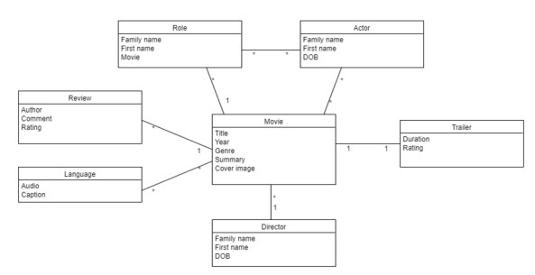

# Open-book and Open-AI Mindset: Strategies to Redesign Final Exams in Response to Generative AI and the Potential for Academic Misconduct

**Eduardo Araujo Oliveira and Sarah Frankland**  
*University of Melbourne*

> *Australian Biochemist* Vol 54 No 2, August 2023, pages 20–21

During the COVID-19 pandemic, the potential for academic misconduct was heightened when final exams had to be held online rather than in invigilated in-person settings. More specifically, being able to complete exams in a largely unsupervised online form afforded students the opportunity to cheat by using search engines and other online tools to seek answers to questions (1,2). In addition, the emergence of ChatGPT in 2022 raised concerns in academia due to the platform’s ability to generate largely accurate, well-structured and original texts in response to simple prompts that can be submitted by students as their own work (3). In this article, we reflect on an example of how an online final exam worth 60% of the overall grade was modified to reduce the risk that students would engage in cheating and plagiarism using online tools.

## Redesign of Software Design and Architecture final exam

Software Design and Architecture is a core subject in the Master of Software Engineering degree at the University of Melbourne with 80–100 enrolments. Between 2012–2019, the final exam was an invigilated in-person written exam worth 60% of the subject grade (4). The exam, 2-hours in length, featured several short answer and open-ended questions predominantly related to definitions and concepts covered in the subject, but was not really designed to challenge students to apply their knowledge in authentic ways (5). Motivated to improve the design of the exam due to the transition to an open-book online exam format during COVID, and to focus more on authentic assessments rather than the memorisation of facts, the teaching team reimagined and refined the exam to encourage knowledge application while also minimising problems involving academic misconduct. A practice exam was delivered through Gradescope in Week 11 to better prepare students for the new final exam format (and for them to become familiar with Gradescope).

As shown in Table 1, the original exam questions asked students about well-known software engineering principles that can be easily memorised or found through search engines on the internet. In similar contexts, generative AI technologies like ChatGPT would have no difficulty in creating answers for these types of questions as these large language models were trained with huge data available on the internet. In contrast, the refined exam questions made it difficult for students to cheat using AI or the internet because questions were based around subject-specific (and sometimes imaginary) scenarios with unique problems that did not exist online or in ChatGPT’s training material (**Table 1**). In the new questions, students were asked to evaluate, synthesise, or apply concepts to solve novel real-world problems, limiting the potential use of AI or internet -based search tools for cheating or plagiarism. The new final exam was fully aligned with topics and scenarios covered in the students’ projects (worth 40% of subject grade), which they received feedback on as part of four deliverables between weeks 1 and 11.

The new exam format proved difficult for ChatGPT to generate high scoring answers and allayed the teaching teams’ concerns that students would be able to use online tools or generative AI to construct their answers.

Though it is an investment of time to craft the new application and higher-order-thinking questions, the consequential advantages of evaluating student learning in a deeper way than the previous recall-based questions, as well as security of exam assessment outweigh such negatives. Moreover, there were no significant changes in overall student results between this exam and previous years, showing similar distributions. While foundational knowledge is fundamentally important to all disciplines and underlying principles and facts must still be remembered and recalled, testing the understanding of this knowledge through evaluation/synthesis style questions is more applicable to high-stakes final assessment.

While this example is of a particular discipline-based exam, the design process is applicable and adaptable to educators in other disciplines, and is one novel approach to ensuring academic integrity, and encouraging students not to cheat.

**Table 1.** Example of a question about software performance in the original and new final exam.

| | |
|---|---|
| **Original exam** Question on software performance (focus on memorisation) *ChatGPT score: 8.5/10* | Content Delivery Networks (CDNs) are distributed networks of servers that host data and allow for local caching. Describe two important properties of data that make it beneficial to be cached, and why poor caching algorithms may have negative consequences on performance. *In this question format, we ask students to describe well-known concepts in software engineering. And we name them to students.* |
| **New exam** Explanation of new scenario for question on performance | You have been hired as an enterprise architect for a new company that develops software for an online movie streaming service called Flix. Flix reached 100,000 users in its first month, and the number of subscribers continues to increase. Users can browse a large selection of movies. The domain model diagram of Flix is shown below.  Flix is looking to improve its user experience as subscribers are complaining of extremely slow response times when loading and browsing through the selection of movies. After looking into the system’s implementation, architects have identified the following issues: 1. The details of each movie in the selection list are loaded sequentially (i.e. one at a time). 2. Multiple fine-grained requests are made over the network to retrieve all the details related to each movie and display them. 3. The current implementation loads all the trailers in the displayed list, which is inefficient as users don’t necessarily watch them all. Subscribers’ behaviour has also been studied and Flix has found that users are more likely to watch movies that are popular in their area and in their language. The company wants to take advantage of this information to improve performance. |
| **New exam** Question on performance (focus on analysis, evaluation, and application of related knowledge) *ChatGPT score: 2/10* | Identify four design principles or patterns discussed in the subject that could help in improving the performance of this system. Justify your answer by explaining how each principle/pattern can improve performance in the context of the system. Support your explanations with diagrams when appropriate. *In this question format, we ask students to identify four design principles or patterns discussed in the subject. They also need to justify their answers and to support explanations with diagrams when appropriate (in this case, it would be very hard to explain their answers without the support of diagrams).* |

## References

1. Dawson P, Sutherland-Smith W, Ricksen M (2020). *Assess Eval High Educ* 45(4):473–482.
2. Foltýnek T, Meuschke N, Gipp B (2019). *ACM Comput. Surv* 52(6):1–42.
3. Kasneci E, Seßler K, Küchemann S, *et al.* (2023) *Learn Individ Differ* 103:102274.
4. Oliveira EA, Valentine A. Redesigning software architecture and design curriculum to promote professional skills among software engineering students: an experience report. *Proc AAEE 2022.* Western Sydney University, NSW.
5. Koh KH (2017). Authentic assessment. In: *Oxford Research Encyclopedia of Education.* Oxford University Press.
## About the authors

Dr Eduardo Oliveira is a Senior Lecturer in the School of Computing and Information Systems, University of Melbourne. <eduardo.oliveira@unimelb.edu.au>
 

Dr Sarah Frankland is an Associate Professor in the School of Agriculture, Food and Ecosystem Sciences, University of Melbourne. <sarah.frankland@unimelb.edu.au>
 

---

*This article first appeared in the ASBMB Education Feature of the [Australian Biochemist](https://www.asbmb.org.au/magazine) Vol 54 No 2, August 2023. © 2023 Australian Society for Biochemistry and Molecular Biology Inc.*

[← Back to the August 2023 issue](../README.md)
