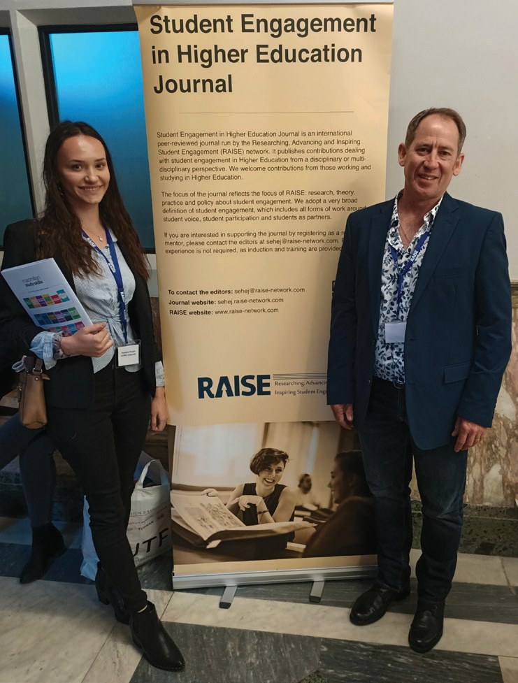

# Empowering Students Through Curriculum Choices and Assessment Design: A Students as Partners Approach That Enhances Engagement and Assessment Literacy

**Chris Love**  
*Griffith University*

> *Australian Biochemist* Vol 54 No 3, December 2023, pages 22–23

I have been teaching biochemistry and molecular biology for more than 18 years and, in more recent times, have observed an unwillingness of students to participate in classroom based problem-solving in biochemistry. Students have anecdotally mentioned that they “feel embarrassed” or “fear being ridiculed” if they answer questions incorrectly which had led to their silence. While I was trying to grapple with this student engagement issue, I attended a workshop at Griffith University on Students as Partners (SaP) facilitated by Mick Healey, a higher education consultant. Prior to this workshop, I had not heard of the concept of Students as Partners, which is based on the principle of engaging students as active collaborators and co-creators in the teaching and learning process (1,2). I became fascinated with how this teaching approach empowered students and at some point, in this workshop, I stopped participating in the activities and in my scribblings, had created a plan to transform my second year Protein Science course (Advanced Biochemistry, approximately 120 students), providing students with curriculum choices and co-creation of assessment. This is where my foray into Students as Partners began.

*Chris and student partner, Natalyha Phister, at the RAISE Conference.*

## Students as Partners strategy and considerations

The implementation of my SaP teaching approach aimed to foster a genuine partnership that was inclusive, empowering and transformative. The process was guided by the five principles for genuine partnerships (3) to ensure that partnership activities were active-learning tasks and nurtured power-sharing relationships through dialogue and reflection. The main goal was getting buy-in from students and therefore, increased engagement. I hoped that empowering students to collaborate in partnership activities would lead to increasing participation and engagement in the course. The strategy to partner with students in the curricula was threefold:

1. Allow students to select a topic from a list to learn for part of the course (proteomics, protein therapies, protein–DNA interactions and protein engineering).

2. Create an opportunity for students to design multiple choice questions, with scaffolding, and negotiate the number of student-generated questions that would appear in the assessment.

3. Provide a ‘safe’ environment (PebblePad, Personal Learning Environment) for students to complete the partnership activities and reflect on their experiences.

## Partnership outcomes

I was surprised at the level of engagement by students in the partnership and, in particular, the positive reflections provided. Of the students who participated, 80.5% indicated that they were engaged (32%) or more engaged (48.5%) because of being involved in the course design and assessment co-creation. Student reflections provided direct insight into students’ perceptions of the partnership. Most of the reflections on topic selection related to their future courses or degree programs or topics that they thought would be interesting, for example, “I believe these topics could be of use in my future as a researcher,” and “I chose protein therapeutics because I find it fascinating how proteins can be used to treat medical conditions.” Another student stated, “I liked that I got to study a topic I chose for once.” With respect to designing multiple choice questions for assessment, the emerging themes included: the difficulty of the task, particularly designing feasible incorrect answers; the need to have a good understanding of the topic; and that understanding how questions are designed could improve their ability to correctly answer questions. Student comments such as “Activities like these make me feel more involved in the course and increases my interest” suggested the partnership was genuine and inclusive (3). Other reflections supported Deeley and Bovill’s (4) notion that developing assessment improves assessment literacy, “I think this process will help us in choosing the correct answer when doing other multiple choice questions”. This student comment sums up the success of this student–staff partnership, “Choosing a topic meant an increase in engagement and interest, and choosing questions for assessment meant I had to filter through what I know, didn’t know and what gaps I had in my knowledge.”

I collaborated with undergraduate student partners in research projects on my SaP approach and supported them to secure funding to attend and copresent our findings at an international conference, Researching, Advancing & Inspiring Student Engagement (RAISE) 2019, held in Newcastle, UK. During the COVID pandemic, this teaching approach helped me maintain a connection with students and I continue to be amazed by their engagement in the partnership.

## References

1. Healey M, Flint A, Harrington K. [Engagement Through Partnership: Students as Partners in Learning and Teaching in Higher Education](https://www.advance-he.ac.uk/knowledge-hub/engagement-through-partnership-students-partners-learning-and-teaching-higher). 2014, Advance HE.
2. Cook-Sather A, Bovill C, Felten P. *Engaging Students as Partners in Learning and Teaching: a Guide for Faculty.* 2014, Josey-Bass.
3. Matthews KE. *Int J Students Partners*, 2017;(2):1–9.
4. Deeley S, Bovill C. *Assess Eval High Educ* 2015; 42(3):463–477.
## About the author

Dr Chris Love is an Associate Professor in the School of Environment and Science at Griffith University. <c.love@griffith.edu.au>
 

---

*This article first appeared in the ASBMB Education Feature of the [Australian Biochemist](https://www.asbmb.org.au/magazine) Vol 54 No 3, December 2023. © 2023 Australian Society for Biochemistry and Molecular Biology Inc.*

[← Back to the December 2023 issue](../README.md)
