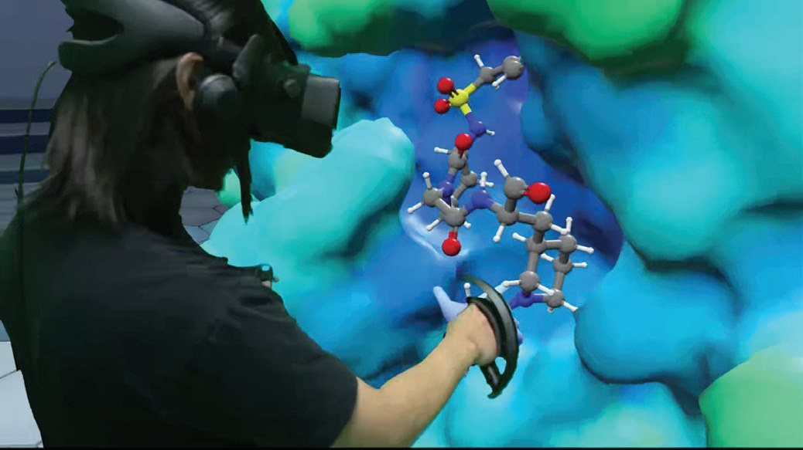
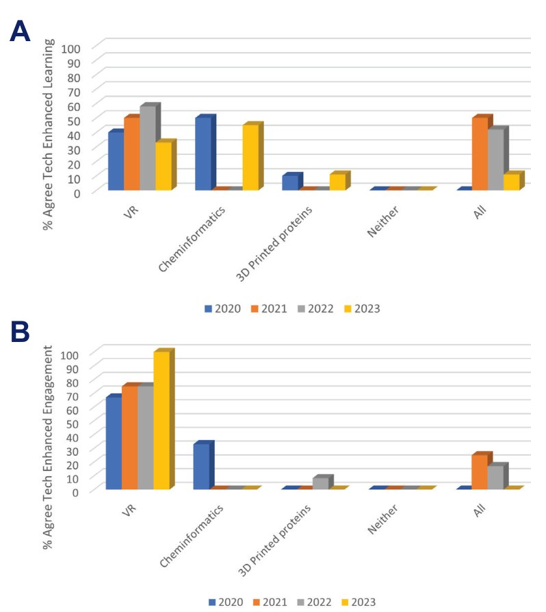
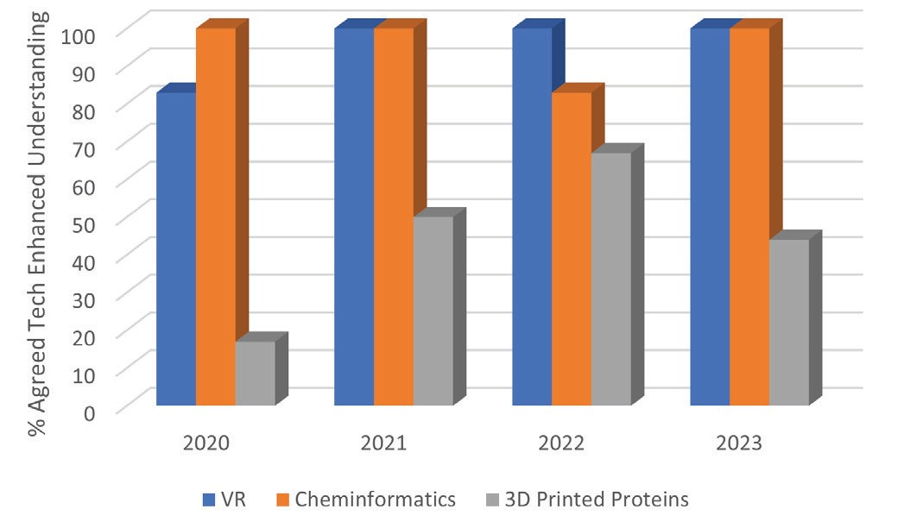
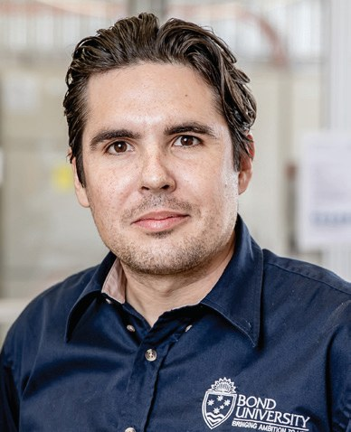

# Getting the ‘VIBE’ in Biochemistry Education (Virtual Reality In Biochemistry Education)

**Anna Lohningᵃ, Susan Hallᵇ, Oladayo Folasireᵃ, Ryan Wirthᵃ and Shai Anoopkumar-Dukieᵇ**  
*ᵃBond University*  
*ᵇGriffith University, Queensland*

> *Australian Biochemist* Vol 54 No 3, December 2023, pages 23–25

Adapting to the recent changes in the educational landscape has provided unique opportunities for educators to explore emerging technologies and modalities, with the aim of improving engagement and understanding. In this article, we share our experience of incorporating 3D technologies, including virtual reality (VR), into a second year undergraduate biochemistry course. Our research, conducted over four years, between 2020–2023, focused on a key learning objective – the interrelationship between biomolecular structure and function.

In our experience, the gap in abilities within each student cohort is widening, especially in terms of prior learning in chemistry, mathematics and visual literacy, yet little time is available for knowledge catch up. Visual representations of molecules must be manipulated mentally to form an accurate 3D conceptual understanding of molecular structure and characteristics. This is a fundamental skill in biochemistry, yet can pose significant hurdles for some students (1,2,3). Such abilities can enhance understanding the biomolecular structure–function relationship (4). The challenge for educators in this space is finding engaging ways which efficiently showcase these concepts. We sought to promote student engagement and learning by incorporating a series of guided workshops harnessing a range of 3D technologies.

***Fig. 1.** Student probing the drug–protein interaction using Nanome (5) and Oculus headset.*

***Fig. 2.** Student responses to level of agreement with the statement ‘This activity helped the most to A. learn or B. engage with protein–ligand interactions’.*

Our ethically-approved research involved inviting students to participate in a one-hour workshop –the content of which was relevant to a summative subject assessment on protein structure. Despite this, participation was low (7 in 2020 (9%), 4 in 2021 (7%), 12 in 2022 (16%), 9 in 2023 (10%)). The activity was based on investigating a therapeutically interesting protein–drug model (human sialidase, 4ncs.pdb, bound to 2,3-difluorosialic acid), adapted for either 3D printing, virtual modelling or VR. Our VIBE (**V**irtual Reality **I**n **B**iochemistry **E**ducation) sessions involved allowing students to either physically hold the model (3D printed proteins), manipulate it in real time on-screen (FirstGlance in JMol) or ‘step inside’ a protein using Oculus headsets (VR, Nanome software). Firstglance in JMol is a free online tool providing guided macromolecular visualisation, though somewhat limited in functionality. Although relatively easy to use, we provided students with step-by-step instructions to expedite progress. For the VR activity, we purchased educational licenses for Nanome (5) and Oculus Quest or Quest2 headsets (**Fig 1**). Nanome is an advanced VR software package used in pharmaceutical research. Both virtual modelling and VR enable students to interact with the protein/drug system, using different renders and colouring to highlight specific structural characteristics.

During the sessions, students completed a workbook designed to probe their understanding of key non-covalent interactions underpinning binding affinity. Afterwards, students were invited to participate in a Qualtrics feedback survey on their experience, perceived learning and engagement. The survey consisted of three main 5-point Likert scale questions as well as a provision for an open-ended response. Qualitative data was analysed thematically while quantitative data comparing students’ preferences and perceptions was represented graphically as percentage of participant pool (**Fig 2 and 3**).

Notwithstanding the challenges imposed by COVID-19 over the past four years, we’ve managed to maintain deployment of the VIBE workshop, and found consistently that the student data supports continual incorporation of these technologies into the curriculum. Results showed that for each iteration of the activity, 80 to 100% of participants (n=31) agreed that both VR and 3D modelling improved understanding of protein – ligand interactions. One reason for this is that, compared to 3D printed proteins, both VR and 3D modelling enable students to probe different features of molecular structure in a manner that was meaningful to them. Thematic analysis open-ended feedback also demonstrated increased engagement using both VR and virtual 3D modelling platforms. 3D printed proteins were less useful due to print quality limitations. Improving the quality of 3D printing, for example by adding colour or texture in chemically meaningful ways, as can be done with the other technologies, would level the playing field considerably since some students enjoy the tactile approach or, importantly, may offer a unique experience for visually challenged students (6). Additional challenges identified for deployment of these workshops included cost, preparation time, timetabling, university Wi-Fi security and other technical aspects. Thus, these workshops are best limited to small groups. Deployment of this type of hands-on workshop requires sufficient staffing to ensure students are safe and comfortable with the equipment. Despite this, our results have provided valuable feedback which will help guide future deployment of 3D technology supported activities. Our group would be pleased to hear from anyone interested in collaborating on future projects in this space and to share our experiences.

***Fig. 3.** Student responses when asked the degree to which they agreed that this technology helped them understand how ligands interact with proteins.*

## References

1. Linenberger KJ, Bretz SL. *Biochem Mol Biol Educ* 2015;43(4):213–222.
2. Hall S, Grant G, Arora D, Karaksha A, McFarland A, Lohning A, Anoopkumar-Dukie S. *Curr Pharm Teach Learn* 2017;9(4):723–728.
3. Lohning AE, Hall S, Dukie S. *J Chem Educ* 2019; 96(11):2497-2502.
4. Ainsworth S, Prain V, Tytler R. *Science* 2011;333(6046):1096–1097.
5. Bennie S, Maritan M, Gast J, Loschen M, Gruffat D, Bartolotta R, Hessenauer S, Leija E, McCloskey S. A Virtual and Mixed Reality Platform for Molecular Design & Drug Discovery – Nanome Version 1.24. 5th Workshop on Molecular Graphics and Visual Analysis of Molecular Data, 2023, The Eurographics Association.
6. Oakley A. *Australian Biochemist* 2023;54(2):19.
## About the authors

Dr Anna Elizabeth Lohning is an Associate Professor in the Faculty of Health Sciences & Medicine, Bond University. <alohning@bond.edu.au>
 

Dr Oladayo Folasire is a Senior Teaching Fellow in the Faculty of Health Sciences & Medicine, Bond University. <ofolasir@bond.edu.au>
 

Dr Susan Hall is a Lecturer in the School of Pharmacy and Medical Sciences, Griffith University. <s.hall@griffith.edu.au>
 

Dr Shailandra Dukie is Head of School in the School of Pharmacy and Medical Sciences, Griffith University. <s.dukie@griffith.edu.au>
 

Ryan Wirth is Fabrication Laboratory Manager in the School of Architecture, Bond University. <rwirth@bond.edu.au>
 

---

*This article first appeared in the ASBMB Education Feature of the [Australian Biochemist](https://www.asbmb.org.au/magazine) Vol 54 No 3, December 2023. © 2023 Australian Society for Biochemistry and Molecular Biology Inc.*

[← Back to the December 2023 issue](../README.md)
