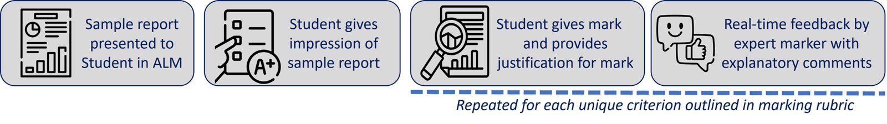

# Using an Assessment Literacy Module to Improve Scientific Report Writing

**Amber Willems-Jones**  
*University of Melbourne*

> *Australian Biochemist* Vol 55 No 1, April 2024, pages 18–19

In 2020, a Melbourne School of Psychological Sciences team developed an Assessment Literacy Module (ALM) (1) to respond to tension experienced between academics and students over the clarity of instructions provided for assessments. Many academics would agree that the disparity in outcome expectations often results in complaints by students indicating that while they followed the assignment task brief and marking criteria, their scores were not as anticipated. Since 2021, the ALM has been implemented across many subjects at the University of Melbourne – including my second-year laboratory-based subject, Techniques in Molecular Science – and it has been shown to aid in the development of evaluative judgement skills (2). At ASBMB 2023 in Canberra, I presented on the benefits of using the ALM, and encouraged academics of all disciplines to consider implementing a similar tool if their students struggle in the development of assessment literacy skills.

The ALM is an interactive sequential e-module embedded into a subject’s Learning Management System – in this case, Canvas – that allows students to evaluate sample assignments as an assessor (**Fig. 1**). Utilising the assignment marking rubric to guide their application of marks for each criterion, students also provide a written justification for their mark.

During the process, students receive real-time feedback (pre-populated in the module) illustrating how their assigned grade compares to the expert marker with additional comments on why that specific grade was given by the marker, enabling calibration of the student’s interpretation of the marking rubric. This is the essence of how students learn and develop judgement (3) through the e-module. Student perceptions of the module indicate students have better understanding of assessment criteria (89%) and that the ALM was helpful in preparing subsequent assessments (89%) (2). Interestingly, only 47% of students reported that they looked at assignment rubrics prior to using the ALM (2). Staff (69%) also felt the ALM both increased students’ understanding of marking criteria and their confidence in the execution of assessments (2).

In Techniques in Molecular Science, students who completed assessment evaluations using the ALM were observed to have improved grades in subsequent scientific report assessments in the subject (**Table 1**), supporting the finding that students perceived an academic literacy benefit from using the ALM (2).

Across all three written scientific reports submitted in Techniques in Molecular Science, students who completed the ALM for evaluation of at least one example assignment achieved 4–7% higher grades compared to students who did not use the ALM at all. It is likely that higher grades are due to increased awareness of the marking rubric and a degree of self-assessment and reflection (3) when writing their reports, developed through the practice of evaluation when using the ALM. Table 1 data are further supported by the literature illustrating that student achievement can be improved through the use of rubrics (4,5) and self-assessment (3), and this is reinforced by student comments:

*“[The ALM] gave me an opportunity to critically analyse academic work and insight into how our assessments are marked using the given rubric” and “[The ALM] forced me to perform the task that a marker would do on my work which in turn strengthened my ability to self asses my own work… This in turn helped me to look at my work critically.”*

***Fig. 1.** Activities completed by the student within the Assessment Literacy Module. Icons created by Freepik, Flaticon.*

However, there are distinct limitations that are likely to have an impact on the data. Firstly, while it is clear that some students actively complete the ALM in order to improve their academic literacy skills, it is unclear from the e-module’s completion metrics whether ‘use’ of the ALM actually equates to authentic engagement for all students. It may be that some students only step through the e-module without truly considering how to apply the rubric and/or without providing valid justifications. Further investigation through interrogation of student comments given at each criterion is required to check for valid/reflective justifications as opposed to nil/gibberish answers. Secondly, as use of the ALM is self-selected and non-compulsory, the data presented likely reflects a bias towards students who are proactive in their studies, and thus the improved grades may not actually correspond to benefit from ‘use’ of the ALM *per se*, but rather, simply reflect high-achieving students. In any case, comments from students reveal those who actively utilised the ALM were able to reflect on what makes a good scientific report: *“[The ALM] showed me what was relevant and irrelevant. What made for a concise aim, sentences. What made for an adequate report and what was lacking.”*

Furthermore, students indicated that the ALM will change the way they approach future assessments for the better: *“[I will] leave more time for editing, as the overall flow of a piece of writing has more of an effect than I thought it did”* and *“[I will have] far more focus on the rubric and rereading to see if what I have written is actually of a high quality.”*

**Table 1.** Comparison of average written scientific report grades (%) in Techniques in Molecular Science for students who did and did not use the ALM prior to completing associated written assessment items. Data from 2023, Semester 1 and Semester 2, N=238.

| **ALM completion^** | **N** | **Report 1** | **p\*** | **Report 2** | **p\*** | **Report 3** | **p\*** |
|---|---|---|---|---|---|---|---|
| Students who did not use the ALM to evaluate either sample | 58 | 64.9 | NA | 75.7 | NA | 70.5 | NA |
| Students who only used the ALM to evaluate Sample A (the ‘poor’ report) | 30 | 70.2 | 0.063 | 79.5 | 0.086 | 77.5 | 0.028 |
| Students who only used the ALM to evaluate Sample B (the ‘very good’ report) | 18 | 73.0 | 0.018 | 75.7 | 0.499 | 76.3 | 0.088 |
| Students who used the ALM to evaluate both sample reports | 177 | 72.0 | 0.008 | 79.7 | 0.035 | 76.3 | 0.024 |

^Data obtained from metrics in Canvas.

\**p* value from Student’s t-test comparing student report grades in row 1 with those from each other category.

While further research is required, the findings presented indicate that an Assessment Literacy Module can be an effective pedagogical tool to (a) set expectations about assessments by providing clear guidelines and criteria to students, and (b) potentially facilitate improved assessment outcomes for students, not just in biochemistry, but across many different disciplines.

## References

1. Siveges B, Moneer S, Blunden AG, Brooker A, McKague M, Howe PDL. *Assessment reform in the Melbourne School of Psychological Sciences, 2019–2020.* 2021. University of Melbourne.
2. Willems-Jones AJ, Rivera Munoz CA, Frankland S, Saligari MJ, Lim SH, Fox J, McCarty R, Fong A, Howe PDL. *Proceedings of the Australian Conference on Science and Mathematics Education* 2023;83–90.
3. Boud D, Lawson R, Thompson DG. *Assess Eval High Educ* 2013;38(8):941–956.
4. Ragupathi K, Lee A. Beyond fairness and consistency in grading: the role of rubrics in higher education. In: Sanger C, Gleason N (eds). *Diversity and Inclusion in Global Higher Education.* 2020. Palgrave Macmillan, Singapore.
5. Reddy YM, Andrade H. *Assess Eval High Educ* 2010;35(4):435–448.
## About the author

Dr Amber Willems-Jones is a teaching specialist, Senior Lecturer and subject coordinator of Techniques in Molecular Science in the Department of Biochemistry and Pharmacology at the University of Melbourne. <amber.willems@unimelb.edu.au>
 

---

*This article first appeared in the ASBMB Education Feature of the [Australian Biochemist](https://www.asbmb.org.au/magazine) Vol 55 No 1, April 2024. © 2024 Australian Society for Biochemistry and Molecular Biology Inc.*

[← Back to the April 2024 issue](../README.md)
