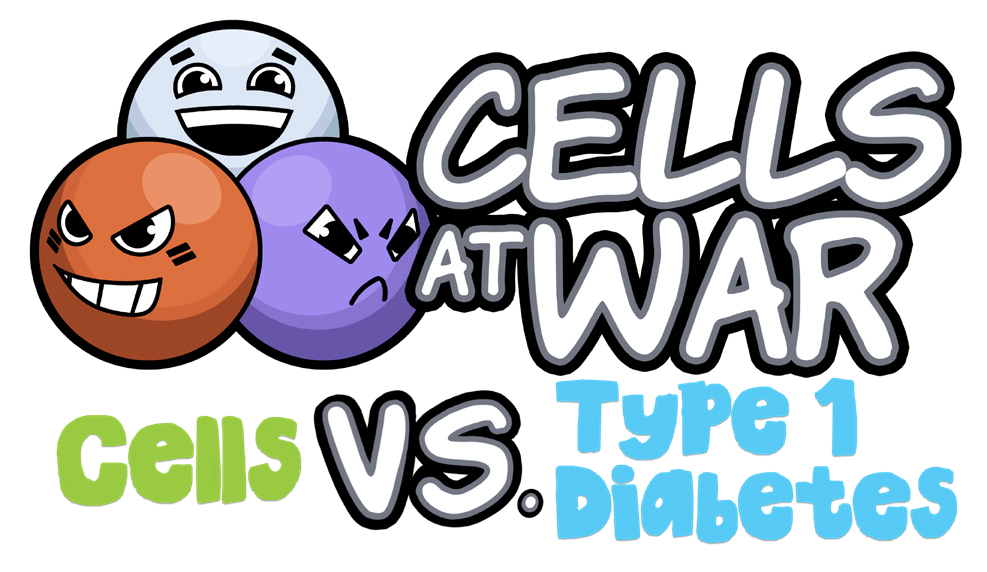

# Cells at War: A Game-based Approach to Learning Biochemistry

**Reece Sophocleous¹, Danielle Warren¹, Jean-Paul Amore², Rosa Da Silva³ and Tracey Kuit¹**  
*¹University of Wollongong*  
*²George Brown College, Toronto, Ontario, Canada*  
*³McMaster University, Hamilton, Ontario, Canada*

> *Australian Biochemist* Vol 55 No 1, April 2024, pages 20–21

Game-based learning, while not a new concept (1), faces fresh challenges in today’s digital era. Integrating biochemistry education with gaming requires a delicate balance to be both effective and engaging. Traditional teaching models in Australian STEM education have yet to fully capitalise on the benefits of this approach, possibly hindered by issues such as limited resources and insufficient R&D funding (2).

In undergraduate science courses, which are expanding both in size and diversity, educators must navigate limited resources, a variety of delivery modes, and the rapid advancement of educational technologies like generative artificial intelligence (GenAI). These pressures are compounded by financial constraints and the need to adapt to varied learning modes, from face-to-face to online and blended environments. Game-based learning emerges as a compelling solution to these challenges, offering a way to motivate students and prepare them for uncertainty (3), as well as allowing for diversified learning paths, focusing on incremental achievements to handle varied student backgrounds and learning styles (4). Such approaches can align with and enhance traditional teaching methods, providing an immersive, engaging learning experience.

The ‘Cells at War: Cells vs. Type 1 Diabetes’ project, born from an international collaboration, sought to address some of the challenges faced by game-based learning approaches in undergraduate education. By developing a game that doubles as a pedagogical tool, the project aimed to complement traditional teaching, enhance employability skills, and solicit student feedback on game-based learning’s effectiveness in biochemistry and molecular biology.

The game’s development utilised the PEAR (Pedagogy, Experience, Assessment, Reflection) model and a work-integrated learning (WIL) framework, utilising a students-as-partners approach to bridge the gap between educational theory and practical, professional development. The game offers an innovative approach to studying molecular biology by engaging students directly with the biochemical interactions involved in Type 1 diabetes. Design and development of the game were led by university and college student partners from a range of relevant disciplines, including biochemistry and molecular biology, science education, programming, art and digital design.

Focus groups with student partners involved in game development revealed that the project played a key role in the development of professional skills such as time management, effective communication and collaboration. However, student partners also indicated a need for clearer communication regarding their individual roles and expected contributions. Initially, there was uncertainty among participants about how to engage effectively with the project. The situation improved markedly when specific tasks, such as research compilation and summary card creation, were assigned, highlighting the importance of project management and academic oversight.

The game, in its alpha phase of development, was trialled with first year biology students at the University of Wollongong. Data on student learning habits, their engagement with coursework and student perceptions of game-based learning and the impact of the Cells at War game were also collected. Feedback from 45 participating students revealed half of the respondents as non-gamers, highlighting the need for educational games like Cells at War to engage a broad audience. Students generally perceived game-based learning positively, recognising its potential to connect coursework with prior experiences and deepen conceptual understanding. However, the data did not show a correlation between students’ gaming habits and increased motivation to engage with coursework through game-based learning.

The survey data from students involved in either the design and development, or initial playtesting of Cells at War gave a compelling snapshot of current attitudes towards game-based learning in the biochemistry and molecular biology disciplines. Students highlighted the importance of careful game design and curriculum integration to meet diverse student needs and maximise the educational impact of such tools. As proponents of this approach in STEMM education, we will continue research and development, with the aim to set new standards for effective teaching methods which not only incorporate the use of game-based learning in curricula but also apply a students as partners approach for their sustainable design, development and implementation.

*This project is funded in part by CEWIL Canada’s iHUB. This funding supported work integrated learning for Canadian students who were engaged in the project.*

## References

1. Prensky M. *Digital Game-Based Learning*. 2001. McGraw-Hill, USA.
2. Van Eck R. *Educause Rev* 2015;50:12–28.
3. Jääskä E, Lehtinen J, Kujala J, Kauppila O. *Proj Leadersh Soc* 2022;3:100055.
4. Ding D, Guan C, Yu Y. *Int J Inf Educ Technol* 2017; 7:148–152.
## About the authors

Dr Reece Sophocleous is a Lecturer and Scholarly Teaching Fellow in the School of Chemistry and Molecular Bioscience at the University of Wollongong. <reeces@uow.edu.au>
 

Dr Tracey Kuit is an Education-Focused Professor in the School of Chemistry and Molecular Bioscience at the University of Wollongong. <tracey_kuit@uow.edu.au>
 

Danielle Warren is a PhD candidate and Teaching Assistant in the School of Chemistry and Molecular Bioscience at the University of Wollongong. <warrend@uow.edu.au>
 

Dr Rosa da Silva is an Associate Professor in the Department of Biology, and Associate Dean, Undergraduate Studies, in the Faculty of Science at McMaster University, Canada. <rosa.dasilva@mcmaster.ca>
 

Jean-Paul Amore is the Program Coordinator, Design, in the Centre for Arts, Design & Information Technology at George Brown College, Canada. <jamore@georgebrown.ca>
 

---

*This article first appeared in the ASBMB Education Feature of the [Australian Biochemist](https://www.asbmb.org.au/magazine) Vol 55 No 1, April 2024. © 2024 Australian Society for Biochemistry and Molecular Biology Inc.*

[← Back to the April 2024 issue](../README.md)
