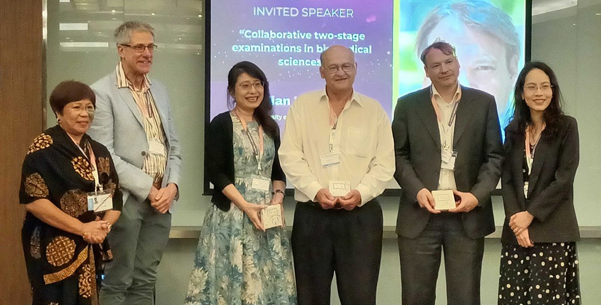
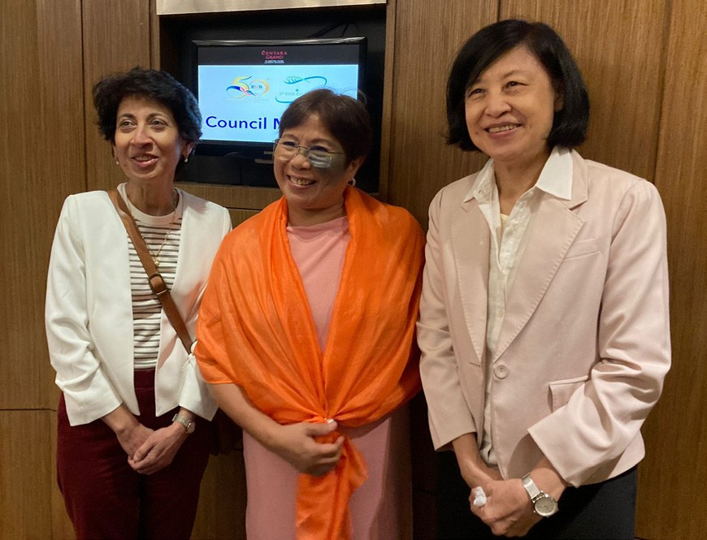
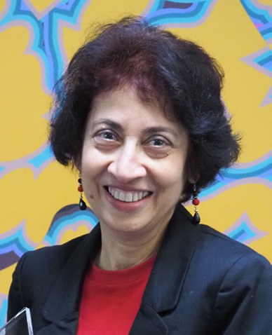

# IUBMB–FAOBMB Education Symposium at the 30th FAOBMB Conference

**Nirma Samarawickrema**  
*Monash University*

> *Australian Biochemist* Vol 55 No 1, April 2024, pages 22–23

The IUBMB–FAOBMB Education Symposium was a highlight of the 30th FAOBMB Conference (reported on page 45 in this issue of the *Australian Biochemist*). Held on 23 November 2023 at the conference venue, Centara Grand at Central Plaza, Ladprao, Bangkok, Thailand, the symposium was hosted by the BMB Thailand, the Departments of Biochemistry of Chulalongkorn University, Mahidol University and Kasetsart University, and supported by the IUBMB and the FAOBMB.

*Chairs and speakers of the Education Symposium, from left: Gracia Fe Yu, Peter Arthur, Annabel Chen, Terry Piva, Julian Tanner and Danaya Pakotiprapha.*

The symposium’s theme, Lifelong Learning for a Changing World in Biochemistry, was the perfect springboard to successfully bring together researchers and educators in biochemistry and molecular biology to share practices, ideas and innovative ways of teaching and the scholarship of learning and teaching. The symposium was chaired by Professor Gracia Fe Yu (Philippines) and Associate Professor Danaya Pakotiprapha (Thailand), with a plenary session, four talks by invited speakers and a concluding workshop, Tools and Applications for Class Engagement and Formative Assessments, which was run by Nuttee Suree, Suthida Chamrat and Panuakdet Suwannatat (all from Chiangmai University, Thailand).

The plenary address titled New Paradigm for Grooming the Next Generation of Biochemists was originally intended to be delivered by Professor Uri Alon (Weizmann Institute of Science, Israel). However, given the current geopolitical tensions in the region, Uri could not travel. As the incoming Chair of Education of the FAOBMB, Associate Professor Nirma Samarawickrema (Monash University) delivered the keynote address. Nirma talked about the benefits of using contemporary case studies that involved real-world problems, which she embedded within an engaging narrative. Delivered in collaborative learning spaces, this teaching approach required resolution by students in workshops as the learning design compelled students to problem-solve in their groups. The learning design purposefully combined the power of case studies and active learning facilitated through small group learning workshops. Nirma demonstrated how this proved to be a powerful learning strategy to encourage collaboration, communication and critical thinking, thereby making confident student learners – the next generation of biochemists – who were developing lifelong skills necessary to thrive in a changing, uncertain world.

*Chairs of Education: past, present and future! From left: Nirma Samarawickrema (incoming Chair), Gracia Fe Yu (current Chair) and Siok Im (past Chair).*

Professor Annabel Chen (Nanyang Technological University, Singapore) started the afternoon session by sharing her findings on the science of learning. Annabel highlighted discoveries from brain research on efficient learning and teaching strategies, the influence of mindsets on learning behaviour, and evidence-based practices to promote brain health and general wellbeing. Associate Professor Peter Arthur (University of Western Australia) shared his experience of using LabArchives (electronic laboratory notebooks) in his classes. He demonstrated their value to students because they provided an electronic copy of their work, which could be readily accessed and provided as evidence of student work to potential employers. From a teaching perspective, LabArchives reduced the administrative load enabling easy access for review and marking. Professor Julian Tanner (University of Hong Kong) presented his work on collaborative two-stage examinations in Biomedical Science. In this two-stage examination, students initially attempt a challenging examination paper. In the second stage, students repeat the examination in teams and collaboratively find the best answer to the challenging questions. The final presentation of the afternoon was delivered by Associate Professor Terry Piva (RMIT). Terry showcased his design of industry-relevant practicals using Labster to contextualise theory in virtual labs. His new practical design stimulated students to solve real-world problems through assessments that were authentic and fun and with the added benefit of transforming the student learning experience, made evident by student evaluations.

The Education symposium was well attended and at the end of the sessions, the room was buzzing with discussions, questions and the sharing of information. The presentations provided all participants with insights, strategies and tips on how best to foster lifelong learning in a changing world.

## About the author

Associate Professor Nirma Samarawickrema is the Co-Head of Teaching in Biochemistry and Molecular Biology at Monash University, and Chair of the FAOBMB Education Committee. <nirma.samarawickrema@monash.edu>
 

---

*This article first appeared in the ASBMB Education Feature of the [Australian Biochemist](https://www.asbmb.org.au/magazine) Vol 55 No 1, April 2024. © 2024 Australian Society for Biochemistry and Molecular Biology Inc.*

[← Back to the April 2024 issue](../README.md)
