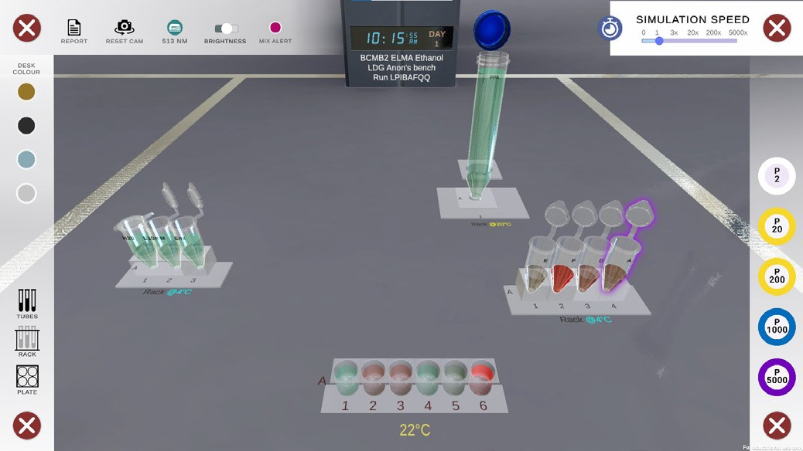
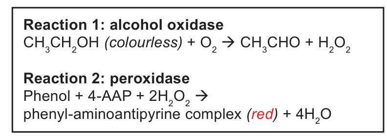
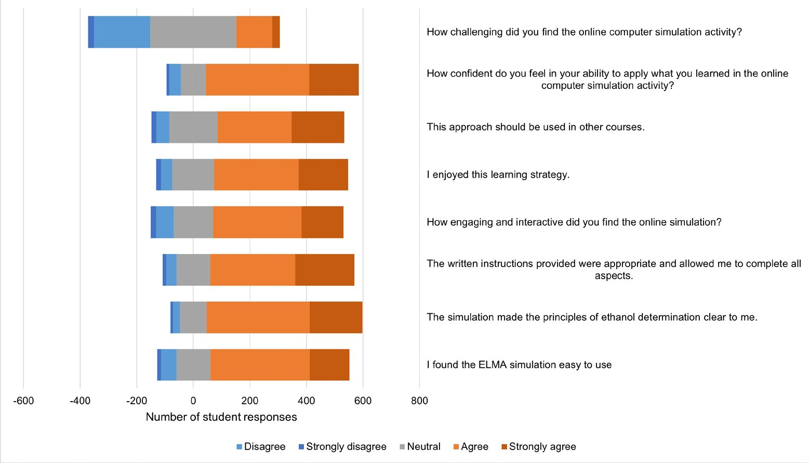

# Laboratory Data Generators: Extending the Teaching Lab Online with Real Results

**Matthew Clemson, Alice Huang and Gareth Denyer**  
*University of Sydney*

> *Australian Biochemist* Vol 55 No 1, April 2024, pages 15–16

The teaching laboratory is a busy space. Students and instructors have limited time and resources to work through a set of well-defined protocols, to learn techniques, become familiar with equipment, record and analyse data, and interpret results. Not surprisingly, this leads to students focusing on following the step-by-step protocol carefully, avoiding making any ‘mistakes’ without considering the underlying theory as deeply as intended. And whenever the planets don’t align –absences, pandemics, extreme weather events, or that essential reagent was forgotten – pre-prepared data is distributed for the analysis and write-up.

An ideal learning laboratory would not be limited by time, space, cost or availability of reagents or equipment. It would provide a safe environment for students to deviate from protocols and observe the consequences. It would allow them to generate their own unique data and engage in unlimited cycles of prediction, action, feedback and reflection until they are confident with their laboratory technique.

Online laboratory simulations have been observed to lead to similar increases in student disciplinary knowledge (1,2), and similar performance in final exams covering lab-related concepts (3,4) when compared to traditional wet labs. Enter the Laboratory Data Generator (LDG, **Fig. 1**). Built within the gaming engine Unity, we have designed a program to provide 24/7 access to an online lab bench that adheres to scientific principles and produces data that are a direct consequence of the biochemical reactions and procedural steps that students undertake within the program.

The LDG approach also provides an ideal platform for large-class assessments that are personalised, whilst still allowing students to work collaboratively. Each time a student begins an experiment, they are provided with a set of samples unique to the student and experiment. Students can work with their peers or seek assistance from AI, but they ultimately need to ‘perform’ the experimental steps, gather and analyse their own unique data, and report their own results.

Second year Biochemistry and Molecular Biology students (n=765) completed a practical assignment in which they were challenged to estimate the blood alcohol concentration in several unique samples using the LDG. The experiment was based on a spectrophotometric, enzyme-catalysed assay in which colourless ethanol is converted to a red product (**Fig. 2**).

***Fig. 1.** Screenshot of the Laboratory Data Generator with an experiment in progress.*

***Fig. 2.** Experiment reactions performed and analysed by students in second year Biochemistry and Molecular Biology.*

Students were given time in class to complete the activities, with instructors available to guide them through the procedures. Student evaluations (**Fig. 3**) indicate that the activity was helpful in learning the principles of the technique and that students were confident they could apply the skills learned in the wet laboratory.

*“I liked that the simulation was still sensitive to human error, just like in a real lab setting (e.g. if you didn’t change a pipette tip you would contaminate your results). It was also helpful to be able to repeat experiments multiple times without worrying about time pressure or wasting resources. I could experiment with different dilutions and volumes to find the best proportions for the experiment, which was very helpful.”*

Given the success of this approach, we are working to integrate the LDG more broadly across biochemistry learning and teaching at the University of Sydney. If you would like to learn how these tools can be integrated into your own learning and teaching context, please contact Gareth Denyer or Matthew Clemson.

***Fig. 3.** Student evaluation of the Laboratory Data Generator assignment.*

## References

1. Crisp KM. *J Undergrad Neurosci Educ* 2012;11(1): A132.
2. Cunningham SC, McNear B, Pearlman RS, Kern SE. *CBE Life Sci Educ* 2006;5(3):281–286.
3. Gibbons NJ, Evans C, Payne A, Shah K, Griffin DK. *Cell Biol Educ* 2004;3(4):263–269.
4. Dobson JL. *Adv Physiol Educ* 2009;33(4):335–342.
## About the authors

Dr Matthew Clemson is a Senior Lecturer in the School of Life and Environmental Sciences at the University of Sydney. <matthew.clemson@sydney.edu.au>
 

Dr Alice Huang is a Lecturer in the School of Life and Environmental Sciences at the University of Sydney. <alice.huang@sydney.edu.au>
 

Professor Gareth Denyer is an Educational Designer in the School of Life and Environmental Sciences at the University of Sydney. <gareth.denyer@sydney.edu.au>
 

---

*This article first appeared in the ASBMB Education Feature of the [Australian Biochemist](https://www.asbmb.org.au/magazine) Vol 55 No 1, April 2024. © 2024 Australian Society for Biochemistry and Molecular Biology Inc.*

[← Back to the April 2024 issue](../README.md)
