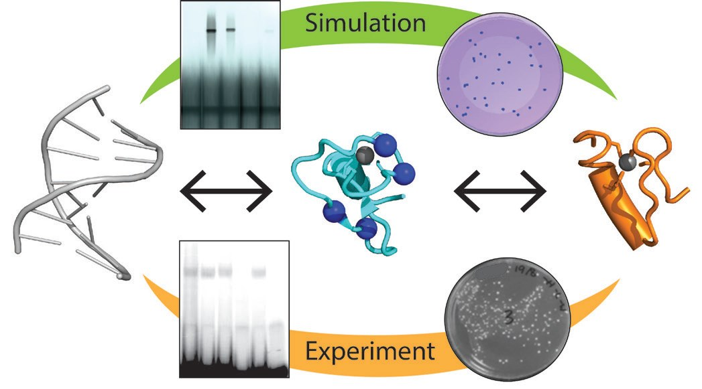

# Learning by Design: Combining Experiment and Data Generation for Senior Undergraduate Biochemistry Student Research Projects

**Jacqueline Matthews and Gareth Denyer**  
*University of Sydney*

> *Australian Biochemist* Vol 55 No 1, April 2024, pages 16–17

We wanted to develop a cost-effective and time efficient research task for senior biochemistry students that would allow them to design their own experiments, generate and interpret their own data and thereby attain student learning outcomes. To do this, we created Laboratory Data Generator (LDG) modules to supplement well-established practical laboratory experiments.

The LDG¹ is a web-based program written using Unity, originally developed during COVID to fill gaps left by lack of access to laboratory classrooms. The LDG allows productive struggle by incorporating a decision/consequence moderator. That is, the data generated reflects both the experimental design and implementation, in proportion to the importance of each step. There are no predefined experimental outcomes. Rather, relationships between components and the outcomes are defined, along with how that will be reflected in the readout (e.g., how many colony forming units post transformation, or the migration and appearance of bands following gel electrophoresis).

The aim of the practical laboratory experiment is to determine the molecular basis of human disease caused by a series of mutations in the transcription factor gene, *GATA1*. The experiment uses yeast-two hybrid analysis (Y2H) to determine if the mutations in the encoded protein affect binding to a GATA1 protein partner (FOG), and electrophoretic mobility shift assays (EMSAs) establish if GATA1–DNA interactions are perturbed. Across the three laboratory sessions, students learn the theory and perform the experiments, as well as analyse and interpret the structural consequences of mutations.

¹ <https://labdatagen.com>

***Fig. 1.** Overview of data generated through simulation and experiment to investigate the DNA- and protein-binding effects of mutation of a transcription factor.*

In a subsequent assessment task, pairs of students are challenged to develop a research project to explore any aspect of GATA1–FOG or GATA1–DNA binding using the Y2H and EMSA modules in the LDG. Students can select from a wide range of GATA1 mutants (or propose other mutants), carry out the experiments to generate data, and present their findings. A distinct advantage of the LDG is that the number of possible mutants is virtually limitless, provided somebody with experience in protein structure and biomolecular interactions can predict the outcome. The addition of mutants has been made straightforward by linking a simple database to the LDG, through which a non-coding-savvy academic can quickly add mutants and values for interaction based on a percentage of the wildtype interaction. This database of virtual mutants bypasses the need to generate and maintain a vast pool of experimental resources. Carrying out experiments in the LDG is relatively fast (e.g., less than 20 minutes to run the Y2H and EMSA modules for four mutants), and students can easily access the LDG via a web-based server. Not only do students get the satisfaction of generating their own research data, as the simulated experimental stage is not time consuming, they can focus more on design, analysis and interpretation.

Feedback from students is that most prefer to do the hands-on class experiments, and then use the LDG for the project so that they have a good understanding of the experimental approaches and have had training in how to analyse and interpret data. As students have used the LDG in earlier years, they are quick to adapt those skills to the new modules. It is evident from presentations and student feedback that generating data (rather than simply analysing pre-existing data) gives students a sense of ownership. While many students selected mutants already in the database, about 20% of groups requested additional mutants to explore their hypothesis.

From an academic perspective, marking presentations is now more interesting compared to previous presentation assignments due to the variety in student projects, yet the projects remain on an equal footing. We note that there is additional capacity built into the LDG that students have not yet tapped into (e.g., estimating binding affinities in the EMSA module), but several students implemented additional tools (such as introducing mutations and/or making movies with PyMol, or Blendr) to communicate their findings.

Overall, the combination of hands-on experimentation and implementation of a data generator has been a very positive experience that blends traditional and modern teaching tools.

## About the authors

Professor Jacqui Matthews is Deputy Head of School in the School of Life and Environmental Sciences at the University of Sydney. <jacqueline.matthews@sydney.edu.au>
 

Professor Gareth Denyer is an Educational Designer in the School of Life and Environmental Sciences at the University of Sydney. <gareth.denyer@sydney.edu.au>
 

---

*This article first appeared in the ASBMB Education Feature of the [Australian Biochemist](https://www.asbmb.org.au/magazine) Vol 55 No 1, April 2024. © 2024 Australian Society for Biochemistry and Molecular Biology Inc.*

[← Back to the April 2024 issue](../README.md)
