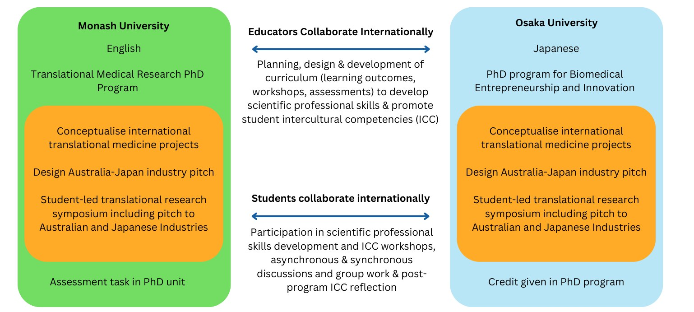
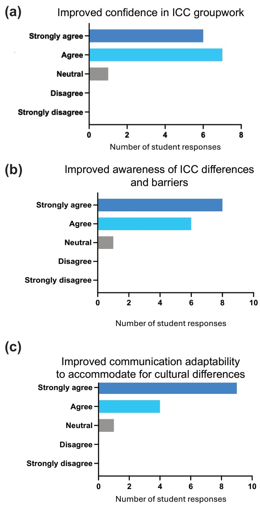
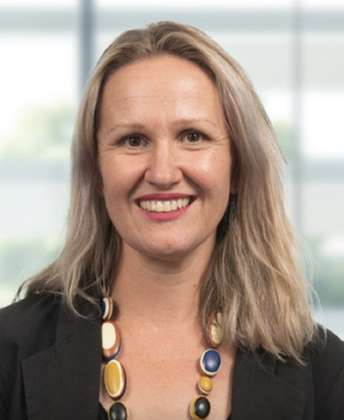
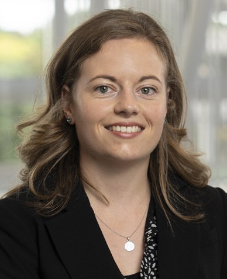
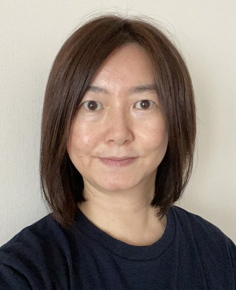

# Fixing the Kinks in the COIL of Work Integrated Learning

**Jessica Borger¹,²,³, Megan Taylor¹,² and Kyoko Hombo⁴**  
*¹Walter and Eliza Hall Institute of Medical Research*  
*²Department of Medical Biology, University of Melbourne*  
*³Central Clinical School, Monash University*  
*⁴Osaka University, Osaka, Japan*

> *Australian Biochemist* Vol 55 No 2, August 2024, pages 21–23

Ensuring real-world relevance in the curriculum not only equips students with practical skills, it also nurtures global citizenship among graduates, enabling them to thrive beyond the classroom. Job readiness often relies on pedagogical approaches like problem-based learning and authentic assessment to integrate real-world scenarios into learning to foster critical thinking, problem-solving, and intercultural competencies (ICC) (1,2,3,4). Open pedagogy (including work integrated learning (WIL)) involves authentic student engagement, which amplifies this real-world teaching (5). WIL provides the means to ‘do in context’, rather than developing practical skills isolated from the situations in which the student will be expected to use them, yet many WIL programs overlook global teamwork.

The COVID-19 pandemic accelerated the use of digital technologies in education, expanding curriculum possibilities to include global perspectives. Consequently, employers now seek graduates proficient in their fields and capable of thriving in cross-cultural environments, valuing intercultural communication and virtual teamwork skills. Collaborative Online International Learning (COIL) programs offer opportunities for active academic and professional skills development across borders, fostering intercultural competencies.

Our joint Translational Medicine and Biomedical Entrepreneurship (TMedBiomE)-COIL PhD program between Monash University and Osaka University demonstrates how the development of international knowledge, pedagogical knowledge and the linkage between the two is key for successful WIL and internationalisation of the curriculum.

***Fig. 1.** TMedBiomE-COIL pilot program between Monash University and Osaka University. A shared syllabus was developed within the COIL program of the Translational Medical Research PhD program at Monash University and the PhD program for Biomedical Entrepreneurship and Innovation at Osaka University (TMedBiomE-COIL) to support both educators and students in international collaboration, development of skills and enhancement of intercultural competencies.*

The TMedBiomE-COIL program facilitated comparative learning between Translational Research PhD students at Monash University and students in Osaka University’s Biomedical Entrepreneurship and Innovation program (**Fig. 1**), with the aim to foster global scientific exchange through synchronous and asynchronous online group work. COIL was embedded as a course requirement for Monash students, with corresponding credit awarded to Osaka students. A shared syllabus was developed with COIL workshops including a Monash-run session focusing on poster design and presentation, and an Osaka-run session on pitching scientific concepts to industry. Small groups conceptualised translational medicine projects, pitching them to pharmaceutical industries in Australia and Japan. Students compared healthcare needs and pharmaceutical industries between Australia and Japan, presenting their projects in a student-led symposium focusing on research enterprise and market considerations. The program aligned with WIL outcomes, ensuring graduate students actively contributed to global medical practice and professional development, which is also reflective of internationalisation of the curriculum.

In addition to developing scientific research skills, the development of ICC was critical, an aspect often overlooked in conventional WIL initiatives. ICC encompasses one’s “ability to interact effectively and appropriately in cross-cultural situations based on his or her intercultural attitudes, knowledge, comprehension, and skills” (6), an essential attribute in a COIL classroom for both students and academics. Recognising its significance, we integrated three ICC activities before students engaged in scientific WIL.

First, a ‘Where were you?’ icebreaker activity fostered discussion around meaningful years in our lives, revealing diverse perspectives shaped by cultural, geographical and religious backgrounds. The DISC® leadership test and intercultural conflict style inventory prompted students to reflect on their leadership and conflict resolution styles, as well as consider those of all members of the group, through a cultural lens.

The purpose of the embedded activities was to build leadership skills with an intercultural focus, mirroring real-world global research teams. Post-survey data indicated that students had enhanced confidence in ICC groupwork (**Fig. 2a**) resulting from synchronous and asynchronous online international groupwork, as well as leadership training and intercultural competency workshops. Furthermore, students reported improved awareness of ICC differences and barriers (**Fig. 2b**), and improved communication adaptability to accommodate cultural differences (**Fig. 2c**). These results, and other unpublished data, suggest that COIL programs are valuable additions to the curriculum, to provide students with the training and tools required to work inclusively and equitably in intercultural settings.

The TMedBiomE-COIL program enhanced students’ scientific expertise and cultivated essential interpersonal skills required to thrive in diverse, cross-cultural environments within the global community. By introducing an international virtual dimension to partnered translational biomedical PhD programs through a shared syllabus, the TMedBiomE-COIL program fostered academic learning experiences that developed intercultural competence.

***Fig. 2.** COIL workshops to teach ICC improved students’ abilities to participate in group work within virtual global classrooms. Post-survey data from Monash and Osaka University demonstrated that following participation in the COIL program students had (a) improved confidence in approaching ICC groupwork, (b) improved student awareness of and ability to identify differences and barriers in intercultural group work and (c) improved communication adaptability to accommodate cultural differences.*

To effectively prepare science postgraduates for today’s global healthcare landscape, WIL strategies must raise awareness of cultural differences in communication, leadership and conflict resolution. This requires internationalising the curriculum through student mobility programs, international partnerships and embedding intercultural competency development (7,8,9). Merely diversifying student cohorts is insufficient, instead it is imperative to develop engagement strategies that foster intercultural competencies (7,10,11,12,13) whilst providing real-world academic learning situations. COIL programs, such as those described, are essential for advancing WIL and work-ready, inclusive and equitable global citizens.

## References

1. DeFillippi R, Wankel C. Real-world projects and project based pedagogies. In: DeFillippi R, Wankel C (eds). *Educating Managers Through Real-world Projects.* 2005. Information Age Publishing
2. Morley DA, Golam Md. Real world learning –recalibrating the higher education response towards application to lifelong learning and diverse career paths. In: Morley DA, Golam Md (eds). *Applied Pedagogies for Higher Education.* 2020. Palgrave Macmillan.
3. Slaviša R, Firssova O, Hummel HGK, Vermeulen M. *Stud High Educ* 2020;46(12):2710–2725.
4. Jopp R. *Teach High Educ* 2020;25(8):942–958.
5. Johnston S, Stewart B. *Int J Stud Partners* 2020;4(2):81–89.
6. Deardorff DK. *J Stud Int Educ* 2006;10(3):241–266.
7. Charles H, Plager KA. Internationalising nursing education from the ground up: the case of Northern Arizona University. In: Green W, Green C (eds). *Critical Perspectives on Internationalising the Curriculum in Disciplines*. 2015. Brill Sense.
8. Stütz A, Green W, McAllister L, Eley D. *J Stud Int Educ* 2015;19(1):28–45.
9. Pan A, Ryan M, Cain J. *Curr Pharm Teach Learn* 2015;7(4):551–555.
10. Bird EL. *J Int Stud* 2017;7(2):329–346.
11. Gemmell I, Harrison R, Clegg J, Reed K. *Innov Educ Teach Int* 2015;52(2):137–147.
12. Volet SE, Ang G. *High Educ Res Dev* 1998;17(1): 5–23.
13. Leask B. *J Stud Int Educ* 2013;17(2):103–118.
## About the authors

Dr Jess Borger is the Scientific Education Program Leader at WEHI and the Graduate Course Coordinator at the Department of Medical Biology, University of Melbourne. <borger.j@wehi.edu.au>
 

Dr Meg Taylor is the Scientific Education Specialist at WEHI and Masters Coordinator at the Department of Medical Biology, University of Melbourne. <taylor.me@wehi.edu.au>
 

Dr Kyoko Hombo is an Associate Professor in the Institute for Transdisciplinary Graduate Degree Programs, Osaka University, Japan. <hombo.itgp@osaka-u.ac.jp>
 

---

*This article first appeared in the ASBMB Education Feature of the [Australian Biochemist](https://www.asbmb.org.au/magazine) Vol 55 No 2, August 2024. © 2024 Australian Society for Biochemistry and Molecular Biology Inc.*

[← Back to the August 2024 issue](../README.md)
