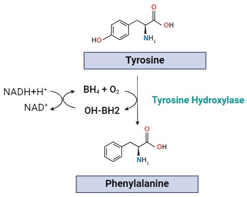
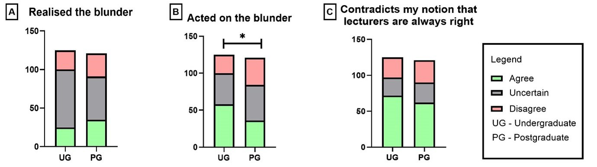
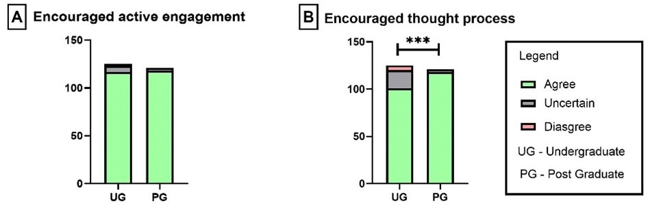
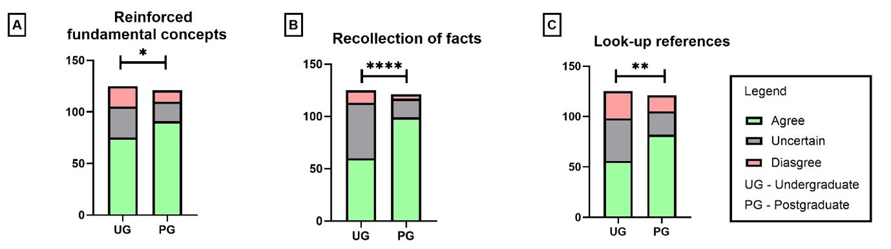

# Premeditated Blunders to Trigger Cognitive Learning in Biochemistry: Perceptions of Undergraduate and Postgraduate Students Pursuing Medical Sciences

**Sheethal Mohan¹, Chandrika Nayak² and Ullas Kamath²**  
*¹Department of Anatomy and Physiology, University of Melbourne*  
*²Department of Basic Medical Sciences, Manipal Academy of Higher Education, Manipal, India*

> *Australian Biochemist* Vol 55 No 2, August 2024, pages 18–20

Innovative teaching strategies in lectures that promote student active learning are of utmost importance. An effective strategy to enhance student engagement is to introduce cognitive conflict. Cognitive conflict is defined as a teaching strategy where students are presented with information that is contradictory to their understanding (1). Cognitive conflict can be introduced to students through ‘blunder lectures’ (BL), where the lecturer purposefully delivers incorrect information to students (2). BL have previously been introduced to first year undergraduate (UG) students studying medicine in tutorials in the field of physiology (1) and anatomy (2), and in small-group tutorials (3).

In biochemistry, BL have been successfully implemented to students by Dean and Professor of Biochemistry, Dr Ullas Kamath (Melaka Manipal Medical College), across all his lectures for the past three decades. Examples include usage of statements such as “glucagon is a storage polysaccharide,” “insulin is a steroid hormone,” “pyruvate in aerobic conditions is converted to lactose” and “lipoprotein that delivers cholesterol to extrahepatic tissues is LDH.” Another example of a ‘blunder’ stated in a lecture is provided in **Fig. 1**. The ‘blunders’ were made on fundamental concepts and were later clarified at the end of lecture as a method to reinforce concepts.

***Fig. 1.** Synthesis of phenylalanine from tyrosine in humans. Created in BioRender.*

***Fig. 2.** Domain 1: Student perceptions of BL as a learning experience. Questionnaire data in Domain 1 was analysed using chi-square test. UG n=125, PG n=123. (A) Realised the blunder, with uncertainty in UG (60.0%) being higher than PG (46.3%). (B) Acted on the blunder where overall there was agreement on acting on the blunder, but with UG students being more proactive (46.4%) than PG students (29.7%), (p<0.05). (C) Contradicts my notion that lecturers are always right with overall agreement among UG (57.6%) and PG (51.2%).*

***Fig. 3.** Domain 2: Perceptions of BL on learning during lecture. Questionnaire data in Domain 2 was analysed using chi-square test. UG n=125, PG n=123. (A) Encouraged active engagement with greatest overall agreement in both UG (93%) and PG (97.5%) (B) Encouraged thought process where UG agreed (80%) while PG were in greater agreement (97.5%), (p<0.001).*

***Fig. 4.** Domain 3: Perceptions of BL on learning post-lecture. Questionnaire data in Domain 3 was analysed using chi-square test. UG n=125, PG n=123. (A) Reinforced fundamental concepts with overall majority agreement among UG (60.0%) and PG (75.2%), (p<0.05). (B) Recollection of facts clearly establishes a difference in opinions with UG agreement (48.0%) while PG are in greater agreement (81.8%) (p<0.0001). (C) Look-up references with UG in lesser agreement (44.8%) than PG (67.77%) (p<0.001).*

In our current study, BL were delivered in various topics of medical biochemistry to first-year UG medical students from Melaka Manipal Medical College, Manipal, India, and first-year postgraduate (PG) students of Master of Medical Sciences from Kasturba Medical College, Manipal University, India. Both cohorts received at least ten hours of BL. Answers to a questionnaire were obtained from participants at the end of their first-year studies, with ethics obtained from the institutional Ethics Committee. The questionnaire was divided into three domains as described below with the results provided in **Fig. 2, 3 and 4**.

The overall acceptance of this teaching strategy has been heartening. The uncertainty in realising the blunder for UG students seems to be higher and maybe attributed to their lack of fundamental knowledge in the field compared to PG students. It is interesting to note that, although UG students were mostly uncertain about being able to identify the blunder, they were more proactive in acting upon the blunder by questioning the lecturer. PG students were less trusting of the lecturer’s knowledge, which could be attributed to more self-directed study requirements as a PG or familiarity with the Professor’s teaching strategy.

This current teaching strategy, as perceived by both UG and PG students, is an encouraging active engagement strategy and a thought process promoting session. Post-lecture, both UG and PG students agreed that BL helped reinforce their fundamental biochemistry knowledge, their recollection of facts and encouraged them to look at more reliable sources of information; though PG students seemed to benefit more post-lecture from BL as indicated in domain 3.

Of note, two of the co-authors of this article were PG students of this Professor and have been inspired to inculcate this approach to teaching effectively in their own teaching practice.

The concept of BL has the potential to be used in formative assessments to enhance metacognitive skills in students. Furthermore, the role of BL may be introduced in lectures to enhance student engagement in an age where recorded lectures are gaining popularity.

*Were you able to spot the blunder in Figure 1?*

## References

1. Sing S. *Adv Physiol Educ* 2014;38(3):265–267.
2. Nayak BS, Somayyaji NS, Komattil R. *Adv Physiol Educ* 2005;29(2):130–131.
3. Chauhan A, Mahajan N, Christian DS, Trigotra S. *Natl J Physiol Pharm Pharmacol* 2022;12(10): 1702–1708.
## About the authors

Sheethal Mohan is a Senior Tutor in the Department of Anatomy and Physiology, University of Melbourne. <sheethal.mohan@unimelb.edu.au>
 

Dr Chandrika Nayak is a Professor of Biochemistry, Department of Basic Medical Sciences, Manipal Academy of Higher Education, Manipal, India. <chandrika.nayak@manipal.edu>
 

Dr Ullas Kamath is Dean of Melaka Manipal Medical College and Head of Department of Basic Medical Sciences, Manipal Academy of Higher Education, Manipal, India. <ullas.kamath@manipal.edu>
 

---

*This article first appeared in the ASBMB Education Feature of the [Australian Biochemist](https://www.asbmb.org.au/magazine) Vol 55 No 2, August 2024. © 2024 Australian Society for Biochemistry and Molecular Biology Inc.*

[← Back to the August 2024 issue](../README.md)
