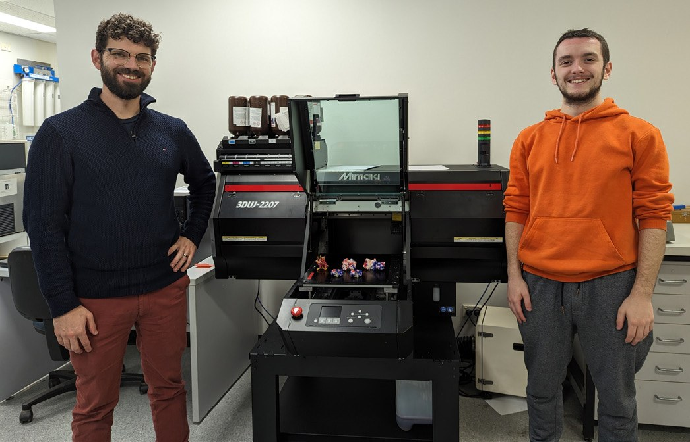
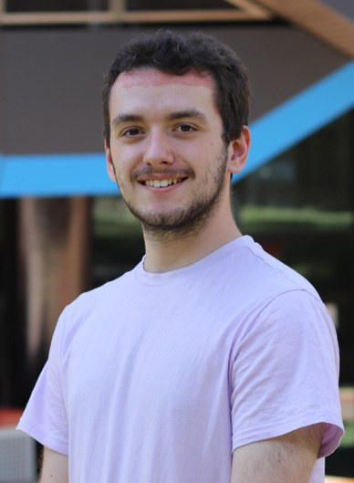
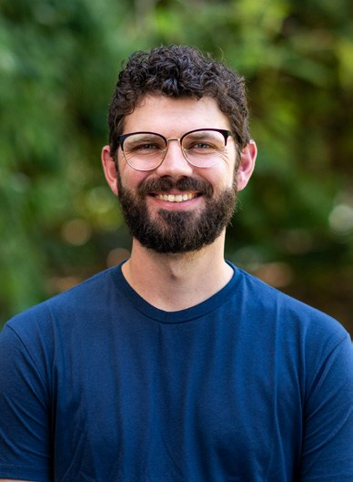

# Educator and Student Reflections on Supervising and Conducting Biochemistry Education-based Research

**Jordan Witchard and James Tsatsaronis**  
*Department of Biochemistry and Chemistry, La Trobe University*

> *Australian Biochemist* Vol 55 No 2, August 2024, pages 17–18

Universities across Australia and internationally increasingly employ academics in education-focussed (EF) positions that generally include a workload component for engaging in education-based research. However, distinct from the disciplinary research conducted by academics in teaching and research roles, research conducted by EF academics is less likely to be conducted as part of undergraduate Honours or graduate student research projects. The experiences of EF academics in supervising students, and the perspectives of students themselves, in conducting education research are also sparsely reported. As such, in this article we –an EF academic and undergraduate Science Honours student – describe our experiences of jointly conducting a biochemistry education research project. We frame these experiences as responses to three questions regarding our motivations in embarking on such a project, the challenges we have faced during the experience and advice we would give to others considering undertaking an education research project.

***Fig. 1.** James (left) and Jordan stand next to a 3D printer used in the education-based research project.*

## What motivated you to undertake/supervise an education project?

**Jordan** – After majoring in biochemistry and genetics, a project focused on education and theories behind teaching the concepts I had learned over my undergraduate studies seemed like a strange next step. As a high school student, I had poor grades and worse motivation. I then began studying biology where I encountered a teacher who was able to ignite a passion for biology, leading me to where I am today. I was further motivated by my continuing experience as a demonstrator for a first-year biology class where I saw students ‘get it’, reinforcing to me why education is so important.

**James** – Being an EF academic and conducting education research provides a means to probe student learning in more than just a quantitative sense (i.e. impacting grades). Despite having a quantitative, molecular background, I’ve become more interested in how and why certain learning approaches work, or don’t. Addressing these questions requires applying research approaches. Supervising a student researcher in this process means that I am not only accountable for this research for my own sake, but also for the sake of Jordan’s project.

## What challenges have you faced?

**Jordan** – I encountered a steep learning curve coming form an analytical background into a more qualitative data-oriented field. I felt deeply uncomfortable when reading science education focused literature. I found myself focusing on what I could immediately understand such as effect and sample sizes rather than the informative qualitative data. Now, I’m beginning to adjust to these new challenges instead of needlessly clinging to what I had previously learned. I have turned my focus to learning skills that are more pertinent to education research.

**James** – Supervising an education Honours project has been a welcome challenge. From a logistical perspective, getting the project advertised, the ethics application and other paperwork ready in time is a constant juggle with other teaching responsibilities. However, another aspect which has been both a challenge and great source of joy, is actually defining a project and specific research question in the first place. It took much longer than I expected to dive into the literature to craft a meaningful research question and framework that we could use as a starting point.

## What advice would you give to an EF academic or potential student considering an education project?

**Jordan** – Some general advice I would give to students transitioning from molecular science to science education would be to first get experience in teaching (in any capacity) so that you can learn and develop the skills relevant to an education project. Second, I encourage reading outside of your own field more often and getting used to different techniques and philosophies between fields. Finally, develop a good relationship with your supervisor – I would not have adjusted as well to this new field without the mentorship of my supervisor, James.

**James** – Following on from my earlier point on defining a research question, I’d advise EF academics and potential students to start early when trying to decide what your project will address. As Jordan said, read as widely and as deeply as you can from the literature, and find academics from disciplines outside your own who can provide input. On that point, don’t hesitate to collaborate with others or to invite colleagues to be a ‘critical friend’ for your project. Finally, be realistic in terms of what can be achieved in the scope of a student project but keep an open mind to what potential future projects could extend from it.

## About the authors

Jordan Witchard is an Honours student in the Department of Biochemistry and Chemistry, La Trobe University. <21017803@students.latrobe.edu.au>
 

Dr James Tsatsaronis is a Senior Lecturer in the Department of Biochemistry and Chemistry, La Trobe University. <j.tsatsaronis@latrobe.edu.au>
 

---

*This article first appeared in the ASBMB Education Feature of the [Australian Biochemist](https://www.asbmb.org.au/magazine) Vol 55 No 2, August 2024. © 2024 Australian Society for Biochemistry and Molecular Biology Inc.*

[← Back to the August 2024 issue](../README.md)
