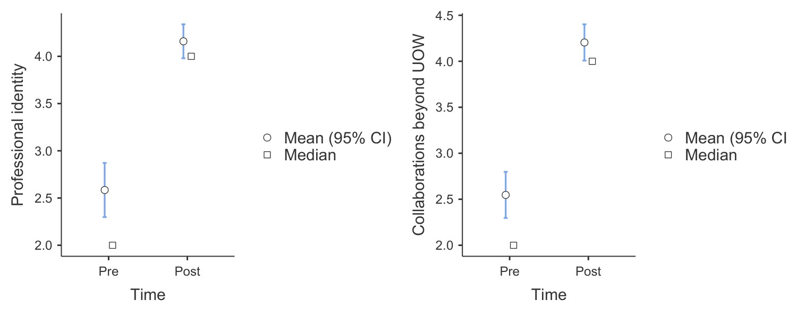
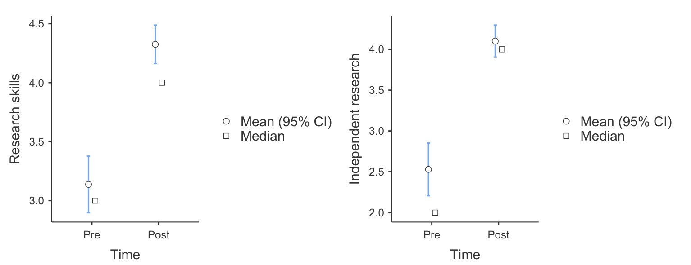

# Building Career-ready Scientists: Developing Transferable Skills in Science Education

**Jane AL Kouba and Tracey Kuit**  
*School of Chemistry and Molecular Bioscience, University of Wollongong*

> *Australian Biochemist* Vol 55 No 3, December 2024, pages 17–19

The transition from education to full-time employment is increasingly difficult, with many graduates struggling to secure jobs despite their qualifications (1). This issue is particularly pertinent in Australia, where the job market is influenced by global trends such as automation and flexible work arrangements (2,3). Further, embedding authentic research and collaboration with industry partners in university subjects serves as a powerful method of developing real-world research skills and core capabilities sought after by employers (4). As such, the importance of developing essential research and employability skills in undergraduate education cannot be overstated. By focusing on the development of these skills, BIOL342 addresses these challenges head-on, providing a model that could be replicated in other institutions.

BIOL342 is a 300-level subject at the University of Wollongong (UOW) designed for biomedical science students. The course, which has been running since 2019, involves approximately 30 students per year. It emphasises the development of research skills and core capabilities aligned with future employment. The curriculum is delivered through a collaboration between educators, career specialists, researchers and industry partners.

Within this subject, students complete individual research projects focused on core research skills, data integrity, electronic notebook record keeping, critical thinking, etc, followed by group projects on authentic industry problems with group presentations and reports back to industry. In addition to research, the students focus on a career development action plan throughout the semester. Students prioritise areas such as development of a career network, professional profile, job applications, informational interviewing, etc. At the end of the semester, students articulate and demonstrate learning gains through a peer-reviewed reflective ePortfolio, which serves as an exemplary model for presenting and effectively communicating research and employability skills to future employers.

Through a Qualtrics survey, we examined the impact of BIOL342 on students’ self-declared research (5) and employability skills (6,7), before and after completing the subject. We compared pre-subject survey responses (week 1) to post-subject survey responses (week 13) from 2019, 2021 and 2022. Statistical analysis using the Non-Parametric Mann-Whitney U-Test compared pre- and post-subject survey results from the combined data. Reliability analysis across all skill categories was checked, and analysis was conducted using jamovi.

***Fig. 1.** Boosting professional identity and collaboration: a pre–post journey. Scores of two key career skills compared before and after taking the BIOL342 subject on a scale from 0 to 5. The error bars indicate 95% confidence intervals (CIs) of the mean.*

## Results – Employability Skills

A comparison of the student survey results across 14 employability-related questions before undertaking the subject and upon the completion of the subject showed that students’ self-declared skills were improved across all areas of the employability skills analysed with statistically significant differences (p < 0.001). Students’ responses revealed increased development and awareness of their professional identity and the importance of networking and linkages and collaborations beyond UOW (**Fig. 1**). Importantly, the students developed confidence in their job search strategies and ability to integrate into the workforce after graduation. Students also showed an increased awareness of the development of generic non-discipline-specific skills that they were developing in their degree such as communication and teamwork. Furthermore, students’ indicated that after completing BIOL342 they were more aware of postgraduate research opportunities and had greater confidence in their career future.

## Results – Research Skills

A comparison of the student survey results across 19 research-related questions before undertaking the subject and upon the completion of the subject showed that students’ self-declared skills were improved across most areas of the employability skills analysed with statistically significant differences (p < 0.05) for 15 of the 19 questions. Students’ responses revealed an improvement in their research skills and increased confidence in undertaking independent research (**Fig. 2**). They also showed an increased ability to frame research questions and increased confidence in their ability to think critically to solve complex problems. Students also indicated increased confidence in managing themselves, whilst managing the needs of others. They also showed they could more effectively evaluate the credibility of their sources of information in research, were more aware of the importance of the rigorous experimental design within research, could better devise procedures in research to locate information relevant to their inquiry and were more confident in their ability to identify resources, technology and skills to generate information, data and ideas. Their responses also declared an increased ability to clearly communicate in writing their understanding of research, increased confidence to collaborate with others to solve complex problems, and an increased belief that research was important to their career. The areas that did not show a statistically significant difference were areas where the students had a strong response upfront including a desire for research and an understanding of the importance of ethics in research.

Students often state this subject as a highlight of their course, as shown in the student quotes from the class survey (2019–2022):

*“Glad that I was able to develop my independent research skills – as this will be important for Honours.”*

*“I have applied for jobs, developed my interview skills and utilised these skills for medical interviews.”*

*“I improved my CV which scored me an international job offer and a full-time job.”*

The survey results show that students declared learning gains in career skills, most notably in areas related to awareness of professional identity and collaborations beyond UOW. Students also declared learning gains in their research skill development, most notably their general research skills and capabilities in independent research. The data also shows that students asserted development of key transferrable skills in communication, teamwork, critical thinking and problem-solving.

***Fig. 2.** Transformative gains in research proficiency: a pre–post journey. Scores of two key research skills compared before and after undertaking the BIOL342 subject on a scale from 0 to 5. The error bars indicate 95% confidence intervals (CIs) of the mean.*

## Conclusions

Collectively, the results show that embedding authentic research and collaboration with industry partners in university subjects assists students to develop core capabilities sought after by employers.

The changing nature of work and perceived fluidity of careers requires university students to be able to reflect on their capabilities with confidence and a strong evidence base. A purposeful focus on career development learning assists students in developing their professional identity and confidence in their career futures. Through our subject design, we show that our biomedical science students can develop greater career confidence through a course focusing on research and career development learning.

## Acknowledgements

We acknowledge and thank all BIOL342 students, our student partners in the co-design, the entire teaching team, the UOW Careers Unit and our industry partners. We also thank Brad Wakefield (UOW) for assistance with the statistical analysis. This work was supported in part by a UOW Educational Strategies Development Fund Grant.

## References

1. Foundation for Young Australians. *The New Work Smarts: Thriving in the New Work Order.* 2017. <https://www.fya.org.au/app/uploads/2021/09/FYA_TheNewWorkSmarts_July2017.pdf>
2. Foundation for Young Australians. *The New Work Reality.* 2018. <https://www.fya.org.au/app/uploads/2021/09/TheNewWorkReality_2018.pdf>
3. Foundation for Young Australians. The New Work Standard: How Young People are Engaging with Flexible Work. 2020. <https://www.fya.org.au/app/uploads/2021/09/FYA-New-Work-Standard-2020.pdf>
4. Bandaranaike S. *J Univ Teach Learn Pract* 2018;15(4).
5. Bennett D. *Embedding employABILITY Thinking Across Higher Education.* 2020. Australian Government Department of Education, Skills and Employment. <https://ltr.edu.au/resources/FS16-0274_Bennett_Report_2020.pdf>
6. Bennett D, Richardson S, MacKinnon, P. *Enacting Strategies for Graduate Employability: How Universities Can Best Support Students to Develop Generic Skills.* 2015. Australian Government Office for Learning and Teaching.
7. Willison J, O’Regan K. *High Educ Res Dev* 2007;26(4):393–409.
## About the authors

Dr Jane AL Kouba is an Education-focused Lecturer in the School of Chemistry and Molecular Bioscience, University of Wollongong. <jalkouba@uow.edu.au>
 

Professor Tracey Kuit is an Education-focused Professor in the School of Chemistry and Molecular Bioscience, University of Wollongong. <tracey_kuit@uow.edu.au>
 

---

*This article first appeared in the ASBMB Education Feature of the [Australian Biochemist](https://www.asbmb.org.au/magazine) Vol 55 No 3, December 2024. © 2024 Australian Society for Biochemistry and Molecular Biology Inc.*

[← Back to the December 2024 issue](../README.md)
