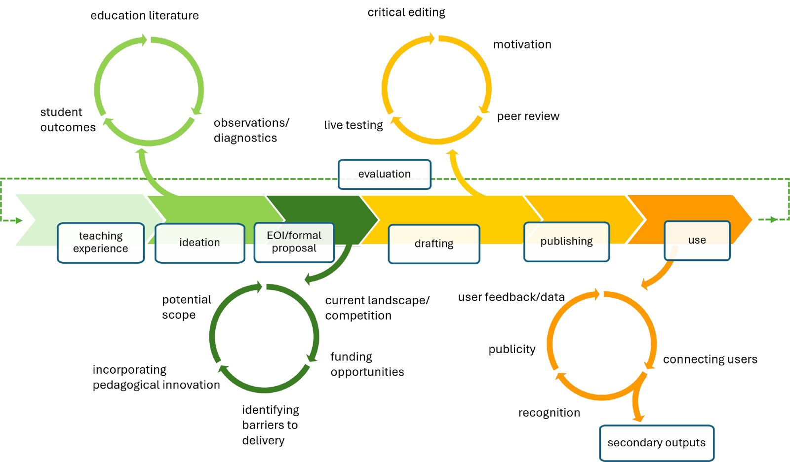
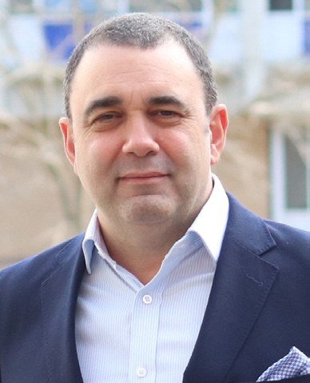

# Designing Open Education Resources: the Importance of the Third Space

**Julian Pakay¹ and Steven Chang²**  
*¹Department of Biochemistry and Chemistry, La Trobe University*  
*²La Trobe Library, La Trobe University*

> *Australian Biochemist* Vol 55 No 3, December 2024, pages 21–23

Traditional STEM textbooks often overwhelm students, who can feel intimidated by the content-heavy nature of their size, depth, level of detail, and the financial cost of purchasing them (1). There is a dearth of quality resources designed to tackle this and similar STEM education barriers, though one solution for educators is using open educational resource (OER). OERs are teaching and learning materials that are free and adaptable for local courses or teaching due to the benefits of open licensing. There has been rapid growth in OER development in Australian universities since 2022, exemplified by a national [grant program](https://oercollective.caul.edu.au/grants/) that has funded 33 projects, generating a [catalogue](https://oercollective.caul.edu.au/catalogue/) of 45 OERs.

The development of OERs for STEM education relies heavily on technical images and visual data, and furthermore, very little of this media is openly licensed and development *de novo* is costly (2). In addition, the current role of the classroom textbook is an open question given that basic information is more freely accessible online than ever before. Therefore, to get the most value out of new open textbooks generated by OER projects, educators must go beyond simply restating basic information in a new medium. Instead, educators need to ensure that open technologies fundamentally reshape and improve pedagogy for online environments.

Following and iterative development process (**Fig. 1**), we recently published two OERs:

- *[Foundations of Biomedical Science](https://oercollective.caul.edu.au/foundations-of-biomedical-science/)* – designed to improve mathematics skills in incoming biomedical/biology students.
- *[Threshold Concepts in Biochemistry](https://oercollective.caul.edu.au/threshold-concepts-in-biochemistry/)* – based on addressing the key concepts identified in studies (3,4) resulting from the AAAS Vision and Change in Undergraduate Biology Education Initiative.

## Benefits of Third Space collaboration

The two above OER projects have generated unexpected benefits beyond the usual gains associated with OER projects, such as access and equity. Benefits included embedded asynchronous teacher presence, interactive content, local and vocational context, as well as the potential for incorporating student-generated content. These resulted from our Third Space collaboration, a term which refers to mutually collaborative academic-professional partnerships that go beyond traditional university department boundaries (5). In our case, the collaboration is a cross-disciplinary one between a teaching-focused biochemist and a professional OER specialist librarian – acting as a ‘critical friend’ from outside the discipline to mediate reflective practice.

Our collaboration was powered by the [La Trobe eBureau](https://www.latrobe.edu.au/library/open-scholarship/ebureau) open education program. The program’s guidelines focus on designing the OER to address the limitations of existing learning resources and to solve classroom teaching problems. The Third Space partnership provided the opportunity for mutual knowledge and capability exchange across university departments that are typically siloed. The academic gained capabilities in OER publishing and open technologies, while the librarian became familiar with STEM classroom barriers to learning. This fusion of expertise enabled us to link organic classroom teaching reflections to OER ideation, which generated provocative questions like, “What can our OERs do that traditional textbooks and AI can’t?” This provided answers and impetus for adding creative enhancements to our OERs.

***Fig. 1.** The iterative process of developing an OER.*

*Publishing an OER as an educational intervention is initially informed by and eventually evaluated by teaching experience. However, all stages of OER development benefit greatly from collaboration between academics and librarians/learning designers to create a third space perspective. Ideas initiated from teaching experience can be refined in terms of scope and pedagogical innovation. The draft OER can be improved through critical editing, and peer review. Finally, collaboration can connect end users to the OER as well as facilitating the gathering of evaluative data to feedback to the teaching experience, improving student outcomes to create a virtuous loop.*

## How OERs enable student engagement

Engagement in the learning experience requires more than just knowledge acquisition – it is fundamentally facilitated by teacher presence. Students engage much better with content developed by their own locally present instructors. We introduced this element through the ‘living textbook’ medium by embedding the instructor’s presence into the text via video content and [screen capture](https://oercollective.caul.edu.au/foundations-of-biomedical-science/chapter/4-2-practice-problems-2/) of problem-solving processes.

Students also require context, motivation and personal relevance to engage with material. For example, students often struggle to see the relevance of maths to their careers – *Foundations of Biomedical Science* was created to tackle this. We leveraged the modular nature of OERs to incorporate support for students’ emerging professional identities so they could see their future selves represented in the text. For example, we embedded video interviews with diverse [professionals](https://oercollective.caul.edu.au/foundations-of-biomedical-science/chapter/3-4-a-focus-on-maths-in-clinical-practice/) representing students’ future careers via authentic practitioner voices. This demonstrates recommendations by open practitioners to ensure students see themselves reflected in open textbooks (6,7).

OERs also create possibilities for students to become open textbook co-creators. We used *Threshold Concepts in Biochemistry* as a basis for developing a lecture course and oral presentation assessment in a large cohort, 1st year biology subject. Our [OER Collective grant](https://oercollective.caul.edu.au/grants/grant-recipients-2022/) enabled us to film a curated selection of these student presentations we plan to embed as OER content for the next iteration of the text. This will showcase student work, create peer-to-peer asynchronous engagement, and will hopefully improve the standard of oral presentations – creating a virtuous loop.

Our project demonstrates how Third Space partnerships can generate the time, space, and collaboration to reflect on practice and organically connect teaching practices with ‘living textbook’ OERs. Our next steps are to formally evaluate our OERs as interventions and present our methods as [case studies](https://oercollective.caul.edu.au/openedaustralasia/front-matter/contributions/) to support the growth of Australasian open educational practices.

## Resources

- OER Collective guide on [getting started with creating OER](https://caul.libguides.com/oer-collective-publishing-workflow)
- Contact someone for OER expertise: Australasian [institutional contacts](https://caul.libguides.com/oer-collective-administration/contacts)
- [La Trobe University Library Open Educational Resources](https://www.latrobe.edu.au/library/teaching-support/oer)
- Julian Pakay’s presentation to BioMolecular Horizons 2024/ComBio2024: [Developing open educational resources as educational interventions](https://opal.latrobe.edu.au/articles/presentation/Julian_Pakay_Education_BioMolecular_Horizons_2024_OER_Presentation_pptx/27191310)

## References

1. White HB. *Biochem Educ* 1996;24:41–45.
2. Griffiths R, Mislevy J, Wang S, Ball A, Shear L, Desrochers D. *OER at Scale: The Academic and Economic Outcomes of Achieving the Dream’s OER Degree Initiative.* 2020. SRI International.
3. Loertscher J, Green D, Lewis JE, Lin S, Minderhout V. *CBE Life Sci Educ* 2014;13(3):516–528.
4. Tansey JT, Baird T Jr, Cox MM, Fox KM, Knight J, Sears D, Bell E. *Biochem Mol Biol Educ* 2013;41(5):289–296.
5. Whitchurch C. *Reconstructing Identities in Higher Education: the Rise of ‘Third Space’ Professionals.* 2012. Routledge.
6. Lambert SR, Fadel H. *Open Textbooks and Social Justice: a National Scoping Study.* 2022. Australian Centre for Student Equity and Success.
7. Andersen N. *Enhancing Inclusion, Diversity, Equity and Accessibility (IDEA) in Open Educational Resources (OER).* 2022. University of Southern Queensland.
## About the authors

Dr Julian Pakay is a Senior Lecturer in the Department of Biochemistry and Chemistry, La Trobe University. <j.pakay@latrobe.edu.au>
 

Steven Chang is the Coordinator of Open Education & Scholarship, La Trobe University Library. <s.chang@latrobe.edu.au>
 

---

*This article first appeared in the ASBMB Education Feature of the [Australian Biochemist](https://www.asbmb.org.au/magazine) Vol 55 No 3, December 2024. © 2024 Australian Society for Biochemistry and Molecular Biology Inc.*

[← Back to the December 2024 issue](../README.md)
