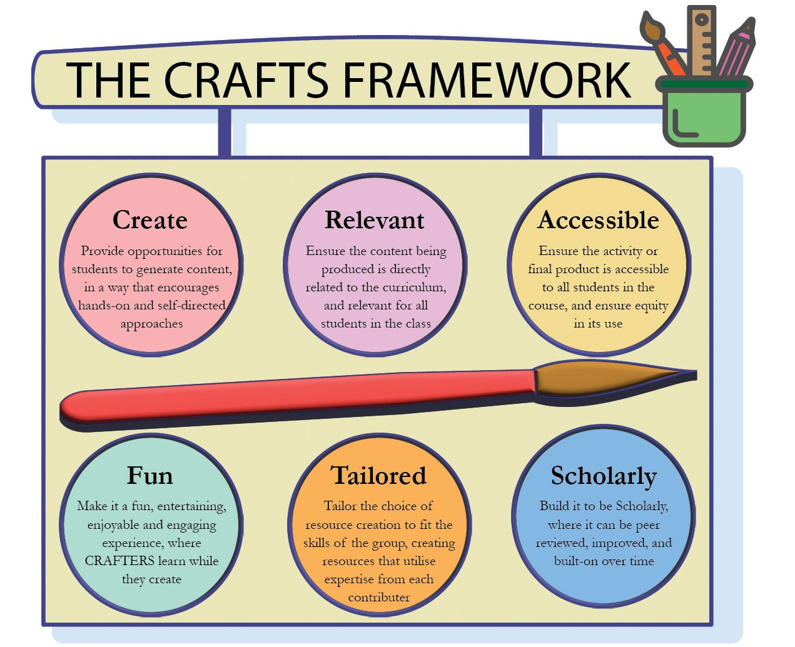
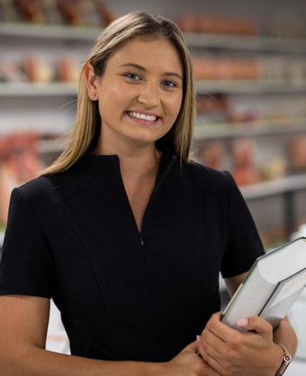

# Key Considerations for Effectively Engaging Students With Hands-on Learning Activities

**Christian Moro and Charlotte Phelps**  
*Faculty of Health Sciences and Medicine, Bond University, Gold Coast*

> *Australian Biochemist* Vol 55 No 3, December 2024, pages 20–21

In biochemistry teaching, while laboratories and practical workshops are hands-on focused, across many institutions, there is an increasing demand to provide active-learning opportunities for students across all sessions where on-campus delivery is an option. This presents some challenges. Very few current academics undertook courses that offered hands-on activities during lectures. This makes it easy to find oneself quite out of depth with the need to start from scratch. Often it can be difficult to know what to change and how to change it in a way that facilitates engaging and effective hands-on student activities. To address this, our team examined the literature to identify evidence-based best practices in active learning for undergraduate science students, resulting in the development, validation and evaluation of the CRAFTS Framework (**Fig. 1**). Information and strategies were drawn from a variety of literature, research methods and other pursuits to arrive at the initial framework, which has been evaluated in an undergraduate science classroom. Following the CRAFTS Framework enables academics to embed hands-on activities that encourage students to engage in relevant, accessible, fun and tailored learning that is both scholarly and effective (1).

***Fig. 1.** CRAFTS Framework for engaging students in hands-on learning (1).*

It is anticipated that this framework will serve as a helpful foundation for academics as they implement more hands-on and presence-teaching approaches into their classes, where they encourage ‘doing’ and facilitate learning through student engagement (1).

## Tips for making CRAFTS activities for student-active learning

***Create:*** **Create** and produce content through various interconnected multimodal platforms for collaborative online learning and other new socio-material networks (2).

***Relevant:*** Ensure the content created is **relevant** to all students in the class and directly aligned with the curriculum (3).

***Accessible:*** Learning materials should be **accessible** to all students in the course and ensure equitable use (4). This includes considering the sustainability, serviceability and scalability of the resource (5).

***Fun:*** Create a **fun**, entertaining, enjoyable, and engaging experience where CRAFTers learn as they create (6,7).

***Tailored:*** **Tailor** the resource creation to match the skills of the group, utilising the expertise of each contributing member (artistic abilities, computer skills, web development, content knowledge, etc.) (8).

***Scholarly:*** Design it to be **scholarly**, allowing for peer review, improvement and ongoing development. Ensure that every aspect of the content is accurate and proofread by an academic or expert (9).

A package of resources and example activities can be downloaded from <https://www.tandfonline.com/action/downloadSupplement?doi=10.1080%2F10494820.2024.2308100&file=nile_a_2308100_sm2313.pdf>

## References

1. Moro C, Mills KA, Phelps C. *Inter Learn Environ* 2024;1–12.
2. Saykılı A. *J Educ Technol Online Learn* 2019:2(1);1–15.
3. Barr RB, Tagg J. *Change: The Magazine of Higher Learning* 1995;27(6):12–26.
4. Owens B. *The Evolving Digital Divide Within Higher Education Institutions: a Quantitative Study.* 2019. University of Memphis.
5. Moro C, Mills KA, Phelps C, Birt J. *Int J Educ Technol High Educ* 2023;20(1):7.
6. Moro C, Phelps C, Stromberga Z. *Adv Physiol Educ* 2020;44(3):505–507.
7. Phelps C, Moro C. *J Univ Teach Learn Pract* 2022; 19(3):8.
8. Taddeo G, Tirocchi S. *Inf Commun Soc* 2021; 24(2):241–257.
9. Chen L, Howitt S, Higgins D, Murray S. *Assess Eval High Educ* 2022;7(4):493–506.
## About the authors

Dr Christian Moro is the Associate Dean of External Engagement and Associate Professor of Science and Medicine in the Faculty of Health Sciences and Medicine, Bond University. <cmoro@bond.edu.au>
 

Dr Charlotte Phelps is a Senior Teaching Fellow in the Medical Program, Faculty of Health Sciences and Medicine, Bond University. <cphelps@bond.edu.au>
 

---

*This article first appeared in the ASBMB Education Feature of the [Australian Biochemist](https://www.asbmb.org.au/magazine) Vol 55 No 3, December 2024. © 2024 Australian Society for Biochemistry and Molecular Biology Inc.*

[← Back to the December 2024 issue](../README.md)
