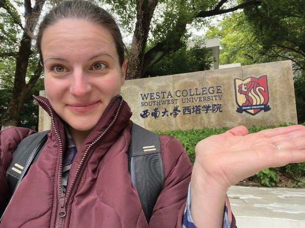
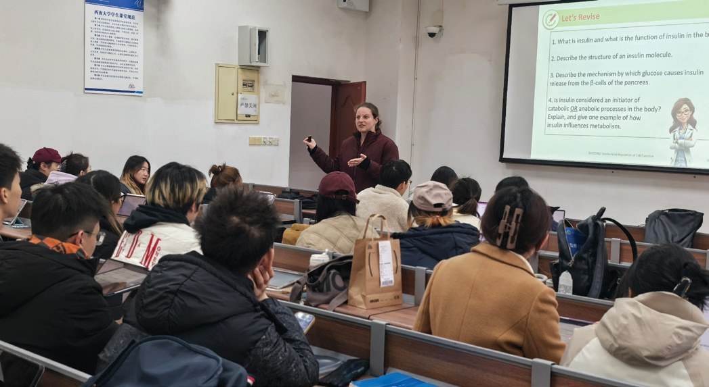
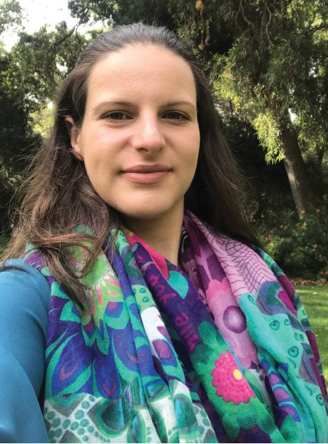

# Crossing the Pacific: an Academic’s Experience of Transnational Education

**Alyssa Van Dreumel**  
*School of Molecular Sciences, University of Western Australia*

> *Australian Biochemist* Vol 56 No 1, April 2025, pages 19–20

*Alyssa Van Dreumel, Senior Lecturer and International Program Coordinator in the School of Molecular Sciences, University of Western Australia (UWA), shares her experience of transnational education (TNE) as part of the Biotechnology/Biochemistry program at Westa College, Southwest University, Chongqing, China. Founded in 2016, Westa College is a tripartite partnership of UWA, University of Tasmania and Southwest University to educate high achieving Chinese students who receive undergraduate degrees from both China and Australia.*

My TNE experience has played an important part in my professional development as an educator. My position at UWA is a unique education-focused role which involves teaching undergraduate students in Australia and coordinating a TNE programme and teaching students at our partner university in China. Our agreement requires 24 hours of contact (32 x 45-minute classes) per subject.

In my first year in the role (2018–2019), I was a fly-in-fly-out (FIFO) lecturer, and in a single trip would typically spend two intense weeks delivering approximately 18 lectures in blocks of two to three classes, to cohorts of 30–60 students. My journey to our partner university took approximately 16–20 hours (ten hours total flight time, plus layover/transit), travelling four times for teaching visits and once for an Open Day event.

My suitcase is usually filled with a diverse mix of personal and professional items, such as the essentials: business attire, a range of black teas, Cadbury chocolate block, long-life lactose-free milk, collapsible camping bowls, plastic cutlery, as well as the laptop, a flash drive and laser pointer!

I usually have a day to settle in (thankfully, there is no time difference between China and Western Australia), to ensure my learning materials are ready before I start delivering classes. In between classes and meals at on-campus canteens, I mainly prepare for subsequent classes; some of my Australian colleagues use this time to write research manuscripts undisturbed!

From the beginning of 2020 to mid-2023, as the situation required, we taught our Chinese students online utilising a flipped classroom model. We supplied lecture recordings via an external learning management system and assumed students were engaging with these for study. Hosting online workshops was incredibly challenging, with students only engaging via the chat function, resulting in long silent pauses and very little feedback overall on how the cohort was grasping the content.

***Fig. 1.** Alyssa Van Dreumel visits Westa College, Southwest University campus in Chongqing, China, in December 2024 after a 4.5-year travel hiatus.*

Academic mobility resumed in the Autumn semester in September 2023. However, it wasn’t until December 2024, after four and a half years, that I finally made it back on campus in China! (**Fig. 1**). Our teaching model continued using a flipped approach with a series of workshops delivered online, as well as a series taught face-to-face during on-campus visits spread throughout the semester (**Fig. 2**). In my most recent visit, as I walked around my classrooms observing, listening to and speaking with my Chinese students… what did I learn? I learned that the students were primarily relying on the PDF lecture notes as their study resource, that they were not engaged with lecture recordings, and they were expectant that the ‘teacher’ would tell them exactly what parts of the curriculum they needed to know for the examination.

***Fig. 2.** Alyssa Van Dreumel facilitates learning activities during a workshop session for a cohort of approximately 55 juniors (third year) biochemistry students at Westa College.*

I observed students reviewing lecture notes from previous topics during our classes or completing tasks set for other subjects entirely. Some students commented they were apprehensive they would learn all the material using a flipped learning model due to limited private study time. This is understandable as our Chinese students study five to ten subjects per semester, requiring anywhere between 5–20 hours of study per week; subjects include compulsory Physical Education, Political and English Language subjects, as well as our – exclusively taught in English – discipline-specific Biochemistry subjects. A common challenge encountered by educators using a flipped approach is a lack of students’ motivation to watch the recorded lectures or to study content outside of class time (1), however I believe ‘study load pressure’ is a prominent factor preventing some of my Chinese students’ preparation for class. As we race towards the Spring semester 2025, I am considering reducing the volume of pre-class content, as well as the implementation of gamified learning strategy for the review the pre-class materials and peer competition during in-class activities (e.g. a polling tool with leaderboard) as suggested by Zainuddin *et al.* (2019). I’ll be monitoring student engagement analytics within the polling tool and be seeking student feedback regarding the adjusted study load.

Being a transnational educator continues to influence my teaching practise in both my Chinese and Australian classrooms. It reminds me to constantly put my students first when considering teaching pedagogy and ask – what is this experience like for them? – from their perspective, and how is it influenced by their culture and context. While demanding on time, being physically in the classroom on campus enables me to foster positive relationships with my students and Chinese colleagues. Switching focus between my Australian and Chinese classrooms encourages my engagement in regular critical reflection to enhance my practise, and the need to be creative, resourceful and most importantly, adaptable. Ultimately, this experience has enabled me to continue to become a better facilitator of learning. Smith (2) argues a powerful professional development opportunity is gained by a novel experience that transforms one’s perspective, such as in TNE – I agree. Though my experience working within a different cultural context as a transnational educator has been challenging in numerous ways – both professionally and personally – the reward is ultimately improving my teaching practise, not just for students in my international classroom but also in Australia.

## References

1. Zainuddin Z, Haruna H, Li X, Zhang Y, Chu SKW. *On the Horizon* 2019;27(2):72–86.
2. Smith K. *Int J Acad Dev* 2009;14(2):111–122.
## About the author

Dr Alyssa Van Dreumel is a Senior Lecturer and International Program Coordinator in the School of Molecular Sciences, University of Western Australia. <alyssa.vandreumel@uwa.edu.au>
 

---

*This article first appeared in the ASBMB Education Feature of the [Australian Biochemist](https://www.asbmb.org.au/magazine) Vol 56 No 1, April 2025. © 2025 Australian Society for Biochemistry and Molecular Biology Inc.*

[← Back to the April 2025 issue](../README.md)
