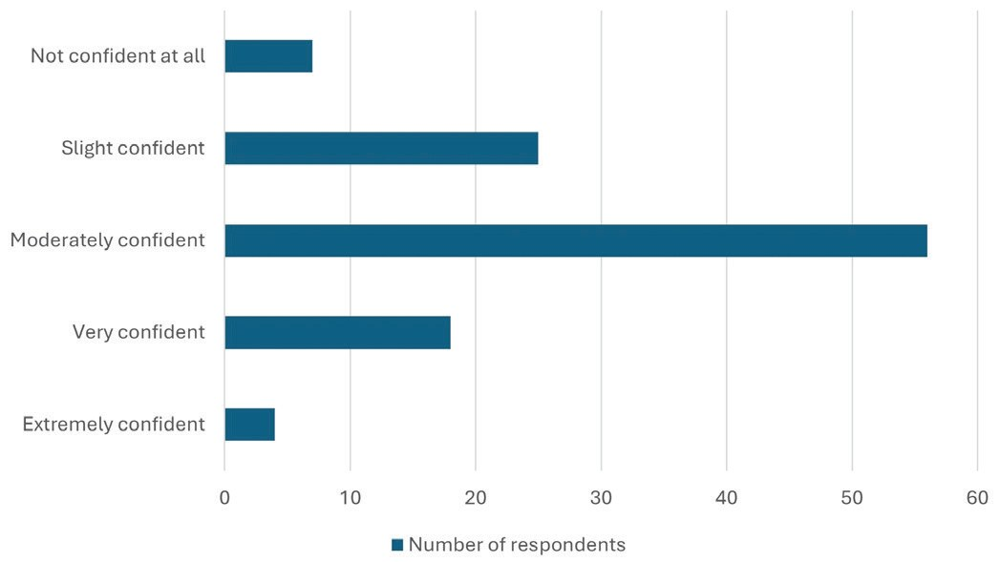
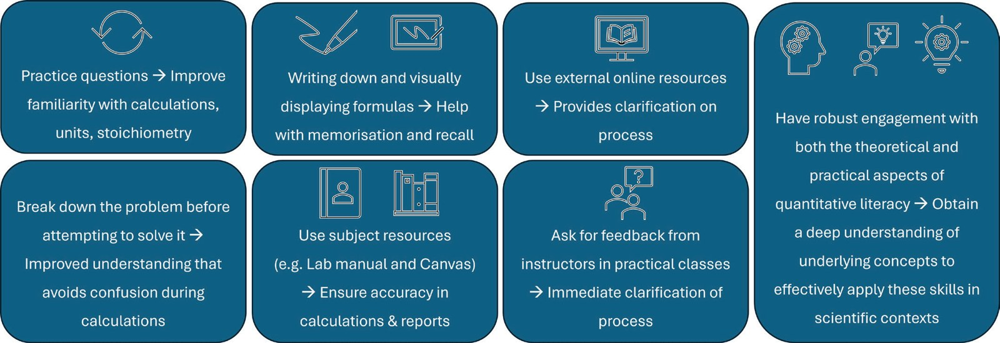
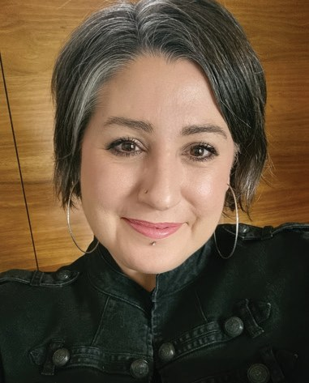
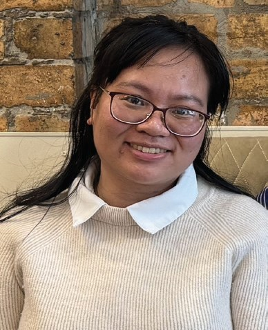

# The Challenges Students Experience When Applying Quantitative Literacy Skills in a Practical Biochemistry Context

**Amber Willems-Jones¹, Thi Thu Giang Tran² and Jan van Driel²**  
*¹School of Biomedical Sciences, University of Melbourne*  
*²Faculty of Education, University of Melbourne*

> *Australian Biochemist* Vol 56 No 1, April 2025, pages 16–18

Quantitative literacy skills (QLS) are crucial in biomedical science education and have been linked to academic achievement in this field (1), with students who excel in these skills generally achieving higher academic success as their confidence boosts their belief in success (2).

Despite the critical role QLS plays in education, competence and confidence in this area have been declining for some time, exacerbated by maths anxiety and a lack of basic foundational knowledge in mathematics (3,4). In science courses, a key barrier students encounter when applying QLS is their lack of foundational QLS (4). Furthermore, students’ abilities to transfer their mathematical knowledge and skill beyond secondary education are also lacking (5), though research suggests that students with strong QLS are better equipped to transfer these skills effectively (6). Additional challenges to successfully apply mathematics knowledge include language barriers (7) and the presumption by science educators that students are adequately prepared in QLS.

The aim of our mixed methods research study was to identify the key challenges students perceive associated with their application of QLS, and to thereby provide suggestions for curriculum revision and targeted educational support. We explored the challenges experienced by students in Techniques in Molecular Science, BCMB20005, a second-year practical biochemistry and molecular biology elective in the Science and Biomedicine Bachelor degrees at the University of Melbourne.

Students in BCMB20005 were invited to participate in a concise online quick-poll and a semi-structured interview. The quick-poll was a preliminary tool to identify specific areas in quantitative literacy that students found challenging or difficult, and to obtain a measure of perceived confidence in QLS, drawing on the link between self-confidence and mathematical competence. Next, semi-structured interviews were conducted which were informed by insights from the quick-poll. The study design was approved by the Faculty of MDHS HREC (#30171).

A total of 110 students completed the quick-poll, while 12 students also took part in the interview. In the quick-poll, students were asked, “How confident are you in your quantitative literacy abilities?” **Fig. 1** indicates the predominant confidence level among the students is ‘moderately confident’, as reported by 50.91% of respondents, with 29.09% rating their confidence less than this. Notably, this reduced level in confidence is larger than those who express higher levels of confidence (very confident plus extremely confident, totaling 20%).

***Fig. 1.** Confidence levels in quantitative literacy skills (QLS) of students in BCMB20005 in response to the question, “How confident are you in your quantitative literacy abilities” (n=110 from 171 enrolled students).*

In the quick-poll, students identified four specific areas of quantitative literacy that they found difficult/challenging, with each achieving ≥30% respondent selection, including (1) Explaining simple statistical measurements such as p values, means, medians, standard deviations: 38%, (2) Converting units of measurement: 37%, (3) Calculating dilution factors: 32%, and (4) Stoichiometry measurements: 30%. Interestingly, only 8% students selected the ‘I don’t find any of these areas difficult’ option for the 13 areas presented.

When asked in interview, “What aspects of quantitative literacy do you find most challenging and why?”, students highlighted five main challenges associated with application, knowledge retention and confidence. These included performing unit conversion and stoichiometry calculations, applying theoretical mathematical knowledge in practical situations due to the significant gap between theory and practice, encountering complex calculations where understanding the theoretical basis is crucial for application (yet lacking), forgetting past mathematics knowledge, and a decrease in confidence in their mathematical abilities attributed to the gap in time between high school and university. Furthermore, the interview participants elaborated on the reasons for their perceived difficulties including: (i) the fast-paced nature of the practical class environment leading to errors not reflective of actual capabilities, (ii) lack of specific resources outlining how to perform specific calculations (despite students being provided with such resources in the form of a lab manual and online resources), and (iii) a lack of adequate contextualisation of mathematical concepts in biomedical science, along with (iv) finding it difficult to see the relevance and application of the mathematics they learned in high school. In addition, students identified reasons for their difficulties including having English as a second language, not actually having the assumed prior knowledge of QLS, and the cognitive load involved in understanding and applying molar relationships.

Strategies students developed and put into place to overcome the challenges they experienced when using QLS were also shared by participants (**Fig. 2**).

In addition, interviewed students proposed valuable suggestions to further enhance a student’s proficiency in QLS that could be adopted by subject coordinators, including:

- Additional text-based resources to provide a better understanding of how to work through calculation-based problems independently.
- Additional supportive teaching methods, including drop-in sessions where students can ask questions and clarify their understanding in person.
- Introductory sessions (either online or in-person) on basic quantitative concepts at the start of semester for those transitioning from a purely biological background into quantitative fields, to help bridge any gaps in understanding and provide a smoother transition into the mathematical demands of biomedical studies.

***Fig. 2.** Student-developed strategies used to overcome the quantitative literacy skills (QLS) challenges (n=12).*

In summary, the study illustrates that the challenges students face in applying QLS to university-level biomedical science subjects arise from adapting to new teaching methods, their ability to integrate interdisciplinary (i.e. maths and science) knowledge, and rebuilding confidence in a new context – all of which are a natural part of the educational journey. Recognising these challenges allows educators to provide appropriate support, helping students to further develop their skills and succeed in their studies. If students are given access to *targeted resources* and clear direct instruction on how to *transfer and apply* their mathematics knowledge to university subjects, they will be better equipped to apply their quantitative literacy skills, reinforcing the foundations laid during their secondary education.

## References

1. Watters DJ, Johnston PR, Brown CL, Loughlin WA. *J Biol Educ* 2022;56(2):130–146.
2. Britton S, New PB, Sharma MD, Yardley D. *Int J Math Educ Sci Technol* 2005;36(1):1–13.
3. Tariq VN. *J Biol Educ* 2002;36(2):76–83.
4. Wilkins, JLM. *Journal of Exp Educ* 2016;84(4):639– 665.
5. Office of the Chief Scientist. 2014. <https://www.chiefscientist.gov.au/sites/default/files/Quantitative-Skills-of-21st-Century-Workers-Summary.pdf>
6. Roberts AL, Sharma MD, Britton S, New PB. *Int J Math Educ Sci Technol* 2007;38(4):429–448.
7. Haag N, Heppt B, Stanat P, Kuhl P, Pant HA. *Learn Instr* 2013;28:24–34.
## About the authors

Associate Professor Amber Willems-Jones is an education-focussed academic in the Department of Biochemistry and Pharmacology in the School of Biomedical Sciences, University of Melbourne. <amber.willems@unimelb.edu.au>
 

Professor Jan van Driel co-leads the Mathematics, Science & Technology Education Group in the Faculty of Education, University of Melbourne. <j.vandriel@unimelb.edu.au>
 

Thi Thu Giang (Ginny) Tran recently completed a Master of Education at the University of Melbourne. Her research project was titled ‘Exploring student challenges in transferring quantitative literacy to biomedical science subjects’. <thithugiangt@student.unimelb.edu.au>
 

---

*This article first appeared in the ASBMB Education Feature of the [Australian Biochemist](https://www.asbmb.org.au/magazine) Vol 56 No 1, April 2025. © 2025 Australian Society for Biochemistry and Molecular Biology Inc.*

[← Back to the April 2025 issue](../README.md)
