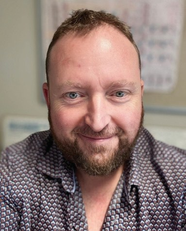

# Two Lanes Forward: the Concept of Trust and the University of Sydney’s Response to Generative AI and Assessment

**Matthew Clemson**  
*School of Life and Environmental Sciences and Office of PVC (Educational Innovation), University of Sydney*

> *Australian Biochemist* Vol 56 No 1, April 2025, pages 15–16

The landscape within which we teach and assess our students has changed significantly since the widespread release of generative artificial intelligence (GenAI) tools, such as ChatGPT.

At the core of the issue, and institutional responses to the risks imposed by GenAI, is *trust*. Students need to *trust* that their university education is something that will be valued and recognised. Employers and the public need to *trust* that graduates have gained the necessary disciplinary knowledge, skills and experience required to navigate future complex professional environments. And finally, educators must *trust* that their work remains relevant and impactful, by developing assessment practices that promote learning, are valid, fair, transparent and regularly reviewed.

The University of Sydney has introduced a ‘two-lane approach’ to assessment, addressing the challenges and opportunities presented by GenAI in higher education. The approach is intentionally binary, making it clear to students that they can use GenAI tools for all tasks unless they are completing a secure, in-person, supervised assessment. For these ‘open’ or ‘unsecured’ assessment tasks, students need to be assisted and guided by their educators in how they should use GenAI and other technologies, with their use fully allowed. This approach is designed to ensure that graduates are equipped for a future where GenAI is ubiquitous.

The first lane, secured assessments, validates students’ attainment of program learning outcomes (PLOs) through in-person, supervised tasks like exams and practical tests, where GenAI use is either controlled or completely restricted. This ensures assessments rigorously measure individual competencies. Secured assessments can be considered as summative tasks, or *assessment of learning*.

The second lane, open assessments, focuses on fostering learning and preparing students for AI-integrated workplaces by allowing and guiding the use of GenAI tools in assignments like case studies and creative projects. Open assessments can be considered as formative tasks, or *assessment for learning*.

Students will have more confidence, more *trust*, in an assessment schedule that either permits or prohibits the use of GenAI for specific tasks. Educators and institutions should not set assessments with rules that are likely to be broken by students, such as prohibiting the use of GenAI for take home assignments or unsupervised tasks. Doing so damages student *trust* and undermines the validity of the assessment, as judgements of student performance are made with the incorrect assumption that the rules were obeyed by every student (1).

At this juncture, it is critical that we revisit the concepts of assessment validity and constructive alignment.

Assessment validity: educators must ensure that an assessment task measures what it was intended to measure. A task designed to measure students’ understanding of a concept will require a secure, in-person activity. Open assessment tasks serve to motivate students and drive learning, but educators must be mindful that their validity is limited to measuring student achievement working with the available technology, including GenAI. It requires equitable access to the latest models, student training and guidance in their responsible and ethical use.

Constructive alignment: Educators may need to reconsider their intended learning outcomes (ILOs) in terms of a GenAI-assisted cohort, and design assessment tasks that permit a valid judgement of student performance within this context. For example, in an AI-enabled world, does a perfectly scripted laboratory report demonstrate that the student has mastered the experimental process, data analysis, interpretation of results and formation of conclusions? Can the task be redesigned to measure these intended learning outcomes? Or are these ILOs no longer relevant *with the help of AI?*

Many current assessments need to be entirely redesigned to ensure their relevance and validity within this new AI-enabled world. At the University of Sydney, this process is underway through the adoption of the two-lane approach to assessment. Without any clear existing model of best practice, the journey in 2025 has been described by Professor Danny Liu as “building the plane while flying it” (**Fig. 1**).

***Fig. 1.** Building the plane while flying it. Image created with Adobe Firefly.*

Finally, learning is achieved through the activities that students undertake, and the cognitive processes elicited. Humans will take shortcuts where there is little or no perceived benefit in taking the long road. As educators, we may need to refocus on the human elements of learning – inspiration, curiosity, belonging, community, empathy, self-determination, growth and motivation. After all, none of us applied to get into university to collect marks or grades; we went there to learn.

## References

1. Dawson P, Bearman M, Dollinger M, Boud D. *Assess Eval High Educ* 2024;49(7):1005–1016.

## Additional references of interest

- [Student-developed resource site to help students and educators use AI responsibly](https://canvas.sydney.edu.au/courses/51655)
- [How we aim to align our assessments for generative AI](https://educational-innovation.sydney.edu.au/teaching@sydney/aligning-our-assessments-to-the-age-of-generative-ai/)
- [White paper setting out the landscape and pathways to success](https://www.apru.org/resources_report/whitepaper-generative-ai-in-higher-education-current-practices-and-ways-forward/)
## About the author

Dr Matthew Clemson is a Senior Lecturer in Biochemistry in the School of Life and Environmental Sciences and a Senior Lecturer in Academic Development in the Office of PVC (Educational Innovation), University of Sydney. <matthew.clemson@sydney.edu.au>
 

---

*This article first appeared in the ASBMB Education Feature of the [Australian Biochemist](https://www.asbmb.org.au/magazine) Vol 56 No 1, April 2025. © 2025 Australian Society for Biochemistry and Molecular Biology Inc.*

[← Back to the April 2025 issue](../README.md)
