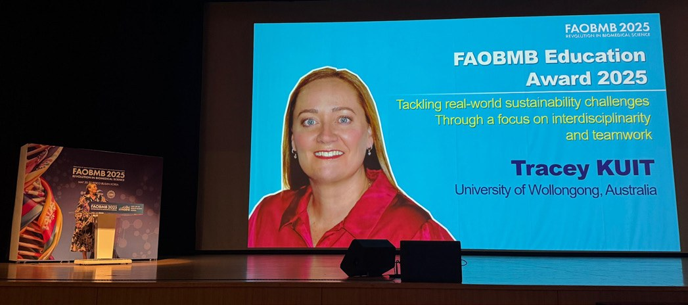
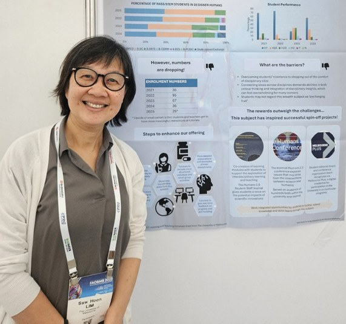
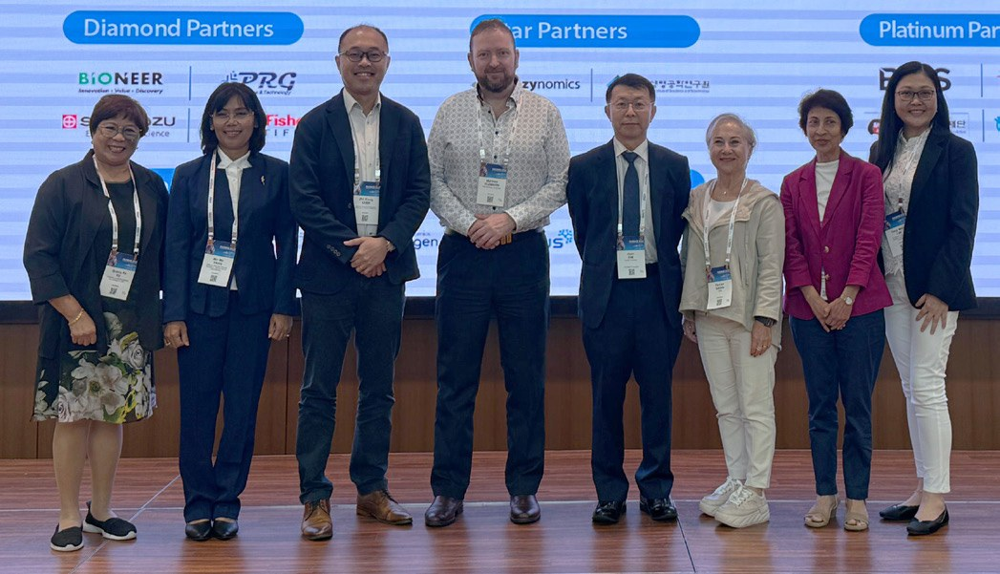
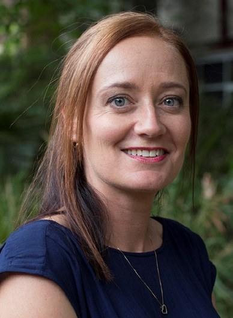

# Education Activities at the 31st FAOBMB Conference in Busan, Korea

**Tracey Kuit**  
*School of Science, University of Wollongong*

> *Australian Biochemist* Vol 56 No 2, August 2025, pages 19–20

*Tracey Kuit presents the 2025 FAOBMB Education Award Plenary.*

FAOBMB 2025 provided a space for education enthusiasts across the globe to gather, share ideas and explore future opportunities in a relaxed atmosphere, supported by a great location, venue and wonderful hosts. The Education activities started with three fantastic presentations in a session chaired by [Professor Yang Mooi Lim](https://www2.utar.edu.my/cv/index.jsp?cv=ymlim&reqPageId=aboutMe) (Universiti Tunku Abdul Rahman, Malaysia) and [Professor Gracia Fe Yu](https://scholar.google.com.ph/citations?user=cMlVbtIAAAAJ&hl=en) (University of the Philippines). [Associate Professor Zhi Xiong Chen](https://discovery.nus.edu.sg/2111-zhi-xiong-chen) (National University of Singapore), who is involved in the education of medical, dental, pharmacy and life sciences students, shared with us how he is exploring ways to broaden education for health professionals and promote transdisciplinary learning. Zhi Xiong shared his specific interests of the role of medical sciences in health professions practice, faculty development, student affairs and medical education technology. Zhi Xiong also shared the importance of medical education focussing on pressing global health challenges, such as unhealthy aging, metabolic disorders and mental health. He shared his experiences in creating a common curriculum across diverse courses in medicine, pharmacy, dentistry and nursing using a systems-based approach and pedagogical reform to integrate disciplines and use of supportive GenAI technology.

[Dr Matthew Clemson](https://www.sydney.edu.au/science/about/our-people/academic-staff/matthew-clemson.html) (University of Sydney) was next to present on approaches to assessment and the creation and utilisation of a GenAI tool using the Cogniti platform to create a Socratic Tutor – Dr MattTabolism. Matt took the audience through the journey of creation of the GenAI-driven tutor, the affordances to make learning biochemistry more accessible and enjoyable for students, but also the space it creates for the teaching team. Dr MattTabolism helps the students think critically and clarify their understanding through a prompted conversation. Matt took us through various ways the student conversations with the GenAI-driven tutor can be used to understand emerging themes of confusion for students, increasing student use of technical terms or higher levels of learning, whilst also understanding the AI’s pedagogical approaches. These are a few of the areas Matthew has explored in his groundbreaking AI-based approach to biochemical education.

[Professor Mo Mo Than](https://dsm-academy.academia.edu/MoMoThan) (Defence Services Medical Academy (DSMA), Myanmar) shared with us the journey of transitioning DSMA, one of Myanmar’s medical universities, to an outcome-based integrated program in line with the World Federation for Medical Education Basic Medical Education Standards. She shared the team’s approach and subsequent evaluation that shows significant progression towards a quality culture. Concluding that structural improvements, regular training programs and ongoing evaluation are essential to strengthening the internal quality assurance framework and fostering a quality culture at DSMA. The successful implementation of quality assurance program depends on teamwork amongst leadership, academics and all stakeholders. This presentation was supported by a poster during the Education poster session.

Following these presentations, [Associate Professor Nirma Samarawickrema](https://research.monash.edu/en/persons/nirma-samarawickrema) (Monash University) and [Professor Ferhan Sağın](https://network.febs.org/users/58783-ferhan-sagin) (Ege University, Turkey) facilitated a joint FAOBMB–FEBS interactive session on active learning strategies in constrained spaces. In the workshop, attendees explored the importance of active learning strategies, reflecting on how this could be achieved within their differing contexts. Participants joined in Kahoot games, IF-AT scratch cards, videos, team discussions and sharing. Much fun (and chocolate) were had by all.

*Saw Hoon Lim presents her poster.*

[Associate Professor Saw Hoon Lim](https://findanexpert.unimelb.edu.au/profile/839013-saw-hoon-lim) (University of Melbourne) presented a poster on the roadblocks and rewards of interdisciplinary teaching through an exploration of the subject Designer Humans: Prospects and Perils. This subject, taught by a team from the School of Biomedical Sciences and the School of Historical and Philosophical Studies, has students explore challenging topics through the lens of scientific, technical, ethical, legal and social implications. An ongoing challenge is supporting students to step out of the comfort of their disciplinary silos.

[Professor Tracey Kuit](https://scholars.uow.edu.au/tracey-kuit/) (University of Wollongong) gave the FAOBMB Education Award Plenary Lecture. Tracey focussed on how modern science education can support students to tackle real-world sustainability challenges through a focus on interdisciplinarity and teamwork. Tracey shared examples of how she has scaffolded learning within and outside formal curriculum to bring interdisciplinary teams of students together to tackle the targets of the United Nations Sustainable Development Goals. Using the principles of Universal Design for Learning to support student choice and creative problem-solving, Tracey has teamed with academics, industry, community and students in this design and delivery, ultimately showing the development of key transferrable skills in critical thinking, creative problem-solving, communication and teamwork.

The next major conference on Education in Biochemistry and Molecular Biology in the FAOBMB region is the [IUBMB Education Symposium 2025](https://msbmb2010.wixsite.com/iubmbedu2025) in Kuala Lumpur, Malaysia, from 25–26 August 2025.

*Education presenters and chairs, from left: Gracia Fe Yu, Mo Mo Than, Zhi Xiong Chen, Matthew Clemson, Joon Kim (FAOBMB President), Ferhan Sağın, Nirma Samarawickrema and Yang Mooi Lim.*

## About the author

Professor Tracey Kuit is an Education-focused Professor in the School of Science, University of Wollongong. Tracey is Chair of the ASBMB Education Special Interest Group. <tracey_kuit@uow.edu.au>
 

---

*This article first appeared in the ASBMB Education Feature of the [Australian Biochemist](https://www.asbmb.org.au/magazine) Vol 56 No 2, August 2025. © 2025 Australian Society for Biochemistry and Molecular Biology Inc.*

[← Back to the August 2025 issue](../README.md)
