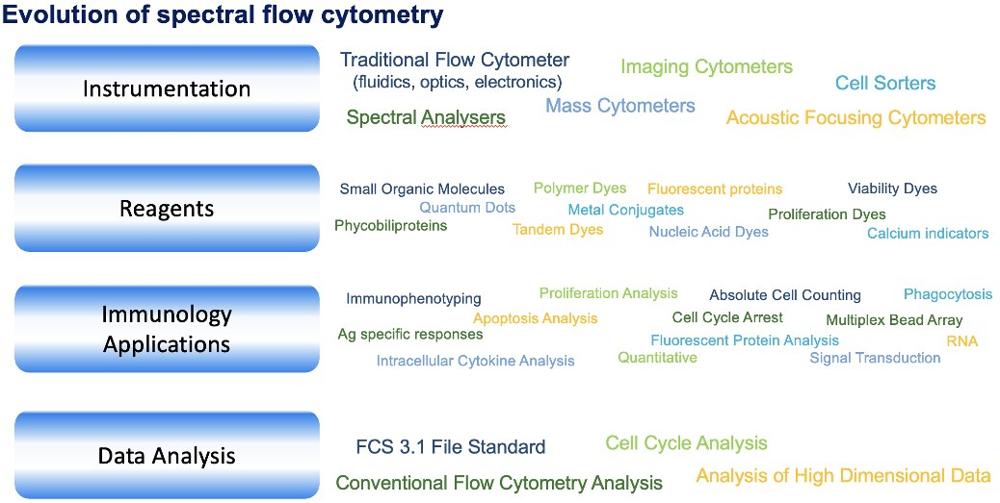
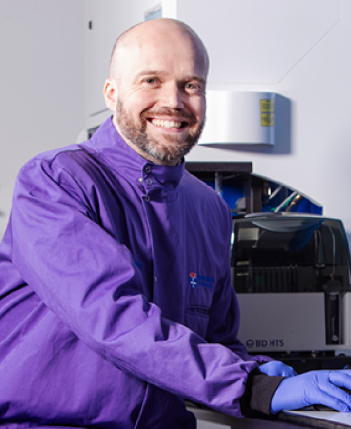

# Getting to the CoRe of Flow Cytometry: a New Teaching Framework

**Jessica Borger¹ and Andrew Filby²**  
*¹School of Translational Medicine, Monash University*  
*²Biosciences Institute, Newcastle University, UK*

> *Australian Biochemist* Vol 56 No 2, August 2025, pages 13–16

Flow cytometry is a cornerstone technique across many disciplines including biochemistry, immunology and microbiology, providing the ability to analyse thousands of cells within seconds while simultaneously measuring multiple markers on a single cell. Despite its importance, the complexity of flow cytometry has grown from simple three-colour machines to instruments capable of measuring over 30 parameters, presenting significant challenges in teaching and learning. As part of a large team of renowned experts, we contributed to the first collection of protocols for the correct use of cytometric techniques in the field of immunology, published in the *European Journal of Immunology* community guidelines (1,2). However, these guidelines lack specific recommendations on how to effectively teach these key topics and core concepts.

In response to this challenge, we propose a novel application of the conceptual tool, CoRe-Flow-Matrix, an adaptation of the content representation (CoRe) matrix (3,4), originally designed to support science educators in developing their pedagogical content knowledge (PCK) – that is, the integration of subject matter expertise with effective teaching strategies.

## The need for a structured teaching framework

To effectively use flow cytometry in academic teaching and research settings, undergraduate and graduate students must develop competency in three fundamental areas:

1. Conceptualisation and preparation: experimental design, reagent selection and sample preparation.

2. Operations: machine setup, calibration and data acquisition.

3. Data analysis: gating strategies, compensation and statistical interpretation.

Currently, these components are often taught in isolation, with students, researchers and facility staff acquiring knowledge at varying levels and through different pedagogical approaches and research training. This fragmented learning can lead to incorrect result acquisition, uninformed analysis and misinterpretation of data creating significant ethical dilemmas and can also lead to expensive machine repair or waste of costly resources. Few studies have explored the effectiveness of flow cytometry education (5,6). One study showed that even an eight-week intensive course is insufficient to fully grasp the technique, with students requesting extended learning opportunities (7). A lack of comprehensive education not only affects experimental outcomes but also presents ethical dilemmas when misinterpreted data leads to incorrect scientific conclusions.

***Fig. 1.** Main skills required for graduate research students to learn in flow cytometry. As an expert group, we have started to identify the main skills categories and associated tasks that are required for graduate research students to learn flow cytometry.*

## The role of pedagogical content knowledge

A major factor influencing the effectiveness of flow cytometry education is the PCK of instructors (8). An individual’s PCK is influenced by their experience, developed through their teaching practice, subject mastery and engagement with student learning behaviours. Three key dimensions of PCK for science educators include (9):

1. Suitable subject matter knowledge.

2. Practical teaching and classroom experience.

3. Understanding of student learning behaviours and attributes.

For flow cytometry, PCK is not limited to university educators; postdoctoral researchers, graduate students and technical staff also play a crucial role in teaching the technique. However, due to the technical complexity of flow cytometry, few have a sufficient PCK framework for effectively teaching this topic.

## Introducing the CoRe-Flow-Matrix tool

With the evolution of flow cytometry becoming increasingly broad and exquisitely technical (**Fig. 1**), as an expert group, we have started to identify the main skill categories and associated tasks required for graduate research students to learn flow cytometry (**Table 1**). We propose a universal framework is required for students to effectively acquire competency in all three fundamental areas of flow cytometry, and for educators, researchers and facility staff to share their PCK together in a community of practice through the CoRe-Flow-Matrix.

**Table 1.** Flow cytometry topics should be developed through identifying underlying associated core concepts. The CoRe-Flow-Matrix requires a topic (first column) to be divided into multiple core concepts. This is an example of the breadth topics for correct sample preparation and acquisition, and the associated core concepts that require pedagogical content knowledge for robust sample data generation.

| **Skill category** | **Task** |
|---|---|
| Conceptual | Understanding how a flow cytometer works Understand how the fluidics and optics systems enable multicolor analysis of a single cell Explain how flow cytometry data is generated and presented Identify current applications of flow cytometry and selecting the current cytometry equipment for your experiment |
| Technical | Compensate fluorescence cross talk on a flow cytometer Quantify cell viability on a flow cytometer Stain membrane bound antigens for flow cytometric analysis of immunophenotyping and antigen-specific responses Stain intracellular antigens for flow cytometric analysis Quantify cell proliferation on a flow cytometer Quantify cell death on a flow cytometer |
| Analytical | Design properly controlled multicolor flow cytometry experiments to address research question and troubleshoot Analyse and interpret flow cytometry data |

The CoRe-Flow-Matrix framework aims to bridge the gap between expertise and education in flow cytometry. The tool aims to assist educators assess their own PCK and refine their teaching methods to improve student outcomes. The proposed CoRe-Flow-Matrix is a diagrammatic representation of aspects of expert academics’ collective PCK related to the teaching of flow cytometry topics. The CoRe-Flow-Matrix format shows each topic (first column) in flow cytometry broken down into key core concepts (**Table 2**). For each concept, educators consider eight pedagogical questions (rows) designed to explore the most effective ways to teach the topic (**Table 3**). This structured framework enables instructors to:

- Align teaching strategies with fundamental principles.
- Identify common misconceptions and challenges in the teaching and learning flow cytometry.
- Ensure consistency and comprehensiveness in training.

For example, a fundamental topic such as sample preparation might be divided into core concepts like reagent selection, cell viability and isotype controls. Each concept can then be analysed using the CoRe-Flow-Matrix to determine the best teaching approach. Table 3 demonstrates the application of the CoRe-Flow-Matrix to isotype controls. The content can continually be evaluated as more instructors within the community of practice contribute their PCK on the topic using the CoRe-Flow-Matrix. This ongoing initiative will enhance the quality of flow cytometry education, ensuring that future researchers receive structured, high-quality training that allows them to apply the technique effectively in their scientific careers.

**Table 2.** CoRe-Flow-Matrix for a science educator’s PCK. Adapted from Res Sci Ed 2011;41(3):341–355.

| **Skill category** | **Topic** | **Core concept 1** | **Core concept 2** | **Core concept 3** |
|---|---|---|---|---|
| Conceptual | Understand the cells or tissue you are using and prepare your experiment accordingly. | Some cells are more fragile than others. Be vigilant on your single cell suspension preparation to ensure the cells are in good shape to appropriately generate your data. | Kinetics are important! Ensure your cells are kept at appropriate temperate and media conditions. | Cells die. Unless you want these in your data, use a viability exclusion marker. |
| Technical | Certain sample requirements are essential in flow cytometry to ensure problem free acquisition of samples and accurate downstream analyses. | Whole blood samples should be processed as soon as possible to minimise cell loss that may cause downstream cell enumeration errors. If samples can’t be processed immediately, overnight storage at room temperature is preferred to storage at 4˚C. | Monoclonal antibodies can bind non-specifically to dead cells. Although dyes that discriminate between live and dead cells are available, starting with a sample that displays high viability will improve the accuracy of data collected. | If cells are stuck to each other, the signals detected from them can provide inaccurate data. Care should be taken to ensure samples are well resuspended prior to acquisition. This minimises the risk of a sample clogging the flow cytometer and reduces the number of doublets that need to be gated out during analysis. |
| Analytical | Controls are vital in any flow cytometry experiment to provide the context within which one can interpret test samples to reliably distinguish the results from background variation and non-specific effects. | Isotype controls are not real controls. | FMO samples are controls required to minimise spectral overlap. | Secondary only antibody control is required when using two-layer staining. |

**Table 3.** Development of a CoRe-Flow-Matrix tool to enhance flow cytometry PCK. Each prompt is labelled with the type of pedagogical content knowledge it addresses (colour-coded in the printed table).

| **Topic: Controls are vital in any flow cytometry experiment to provide the context within which one can interpret test samples to reliably distinguish the results from background variation and non-specific effects** | **Core concept 1: Isotype controls are not ‘real’ controls** |
|---|---|
| What is most important for students to know about this idea? *(Knowledge of Flow principles)* | It is almost impossible to achieve a useful isotype control as it should be the same isotype, both in terms of species, heavy chain (IgA, IgG, IgD, IgE, or IgM) and light chain (kappa or lambda) class, the same fluorochrome (PE, APC, etc.), and have the same F:P ratio. |
| Why it is important for students to know this? *(Knowledge of Flow principles)* | Classically isotype controls were meant to show what level of nonspecific binding you might have in your experiment. The idea is that there are several ways that an antibody might react in undesirable ways with the surface of the cell but not all undesirable binding can be directly addressed by an isotype control. |
| What else do you know about this idea (that you do not intend students to know yet)? *(Knowledge of students’ understanding of Flow)* | Viability dyes are essential for removing dead cells that will loose membrane integrity, become sticky and non-specifically uptake antibodies like isotype controls. |
| Difficulties connected with teaching this idea *(Knowledge of students’ understanding of Flow)* | Isotype controls were historically used for flow cytometry experiments and still described in many texts book as appropriate controls. Many supervisors and paper reviewers still request the inclusion of isotypes. |
| What do you know about students’ thinking that influences your teaching of this idea? *(Knowledge of Flow instructional strategies)* | Ensure that the learning is scaffolded. The antibody structure (heavy chain, light chain), flurochomes, F:P are explained individually. The students need to be able to understand and visualise how all concepts influence each other. |
| Other factors that influence your teaching of this idea *(Knowledge of Flow instructional strategies)* | To avoid misconceptions, alternatives to isotypes must be discussed and the context of their use, e.g. FMOs in multicolour analysis when spectral overlap is occurring, Fc-block if using myeloid cells. |
| What teaching strategy/ies will you use to support student learning of this idea? Why were they chosen? *(Knowledge of Flow instructional strategies)* | Activity presenting students with different experimental questions/conditions to select a more appropriate control than isotypes, e.g. cell signaling and the requirement for unstimulated control or phosphorylation inhibitors), inclusion of protein knockout. |
| How will you ascertain students’ understanding or confusion around this idea after teaching them? *(Knowledge of assessment of effective Flow practices)* | Mix and match; practice questions using experimental data. |

## References

1. Cossarizza A, Borger JG, Filby A, *et al. Eur J Immunol* 2019;49(10):1457–1973.
2. Cossarizza A, Borger JG, Filby A, *et al. Eur J Immunol* 2021;51(12):2708–3145.
3. Loughran L, Mulhall P, Berry A *J Res Sci Teach* 2004;41(4): 370–391.
4. Hume A, Berry A *Res Sci Educ* 2011;41(3):341– 355.
5. Tueller JA, Whitley KV, Weber KS. *Biochem Mol Biol Educ* 2020;48(2):99–107.
6. Costabile M, Nguyen, H, Kenyon A. *Adv Phys Ed* 2020;44:247–253.
7. Ott LE, Carson S. *Biochem Mol Biol Educ* 2014;42(5):382–397.
8. Shulman LS. *Harv Educ Rev* 1987;57:1–22.
9. Friedrichsen PM, Dana TM *J Res Sci Teach* 2005; 42:218–244.
## About the authors

Associate Professor Jessica Borger is the Director of Education at the School of Translational Medicine, Monash University. <jessica.borger@monash.edu>
 

Professor Andrew Filby works at Newcastle University in the UK as an expert in all things relating to single cell analysis technologies. <andrew.filby@newcastle.ac.uk>
 

---

*This article first appeared in the ASBMB Education Feature of the [Australian Biochemist](https://www.asbmb.org.au/magazine) Vol 56 No 2, August 2025. © 2025 Australian Society for Biochemistry and Molecular Biology Inc.*

[← Back to the August 2025 issue](../README.md)
