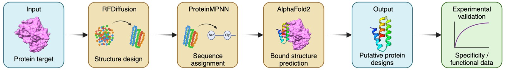

# Preparing the Next Generation of Students for AI-Driven Biomedical Research: Opportunities in Higher Education

**Joshua Hardy, Dylan Silke, Ashley Weir, Daniel Brown, Kerry Ko, Brendan Ansell, Jessica Borger and Megan Taylor**  
*Walter and Eliza Hall Institute of Medical Research and Department of Medical Biology, University of Melbourne*

> *Australian Biochemist* Vol 56 No 2, August 2025, pages 17–18

The rapid advancement of artificial intelligence (AI) in biomedical research has accelerated scientific discovery, particularly in fields like *de novo* protein design. A recent University of Melbourne, Bachelor of Science Honours project, jointly supervised in the Lucet and Papenfuss labs, at the Walter and Eliza Hall Institute of Medical Research (WEHI) exemplified this potential, showcasing the power of interdisciplinary collaboration between experimental and computational scientists in *de novo* protein design. Recognising the need to prepare future biomedical researchers for an AI-embedded research landscape, we have conceptualised a new subject that incorporates coding and AI literacy in a biomedical research context.

## ProteinDJ: where bench science meets AI

Protein binders can be engineered to recognise and specifically bind to a defined target protein to support its visualisation or enact post-translational modifications, relocalisation or degradation.

ProteinDJ¹, a new tool for *de novo* protein binder design, was developed using funding from the NHMRC. It was part of a novel research project that brought together a supervisor with extensive structural biology knowledge and a student with strong computational skills and AI expertise.

ProteinDJ integrates deep learning AI tools AlphaFold2 (1) and ProteinMPNN (2) with the *de novo* protein design tool RFDiffusion (3), to generate novel functional protein binders. Using AI and coding, the student developed this user-friendly package that can leverage high-performance computing systems, dramatically speeding up binder generation (**Fig. 1**). ProteinDJ implements new metrics to evaluate binder quality, including their biochemical attributes such as hydrophobicity, size and charge, with visual plotting of results to help with design filtering and selection. The designs can then be validated by wet lab researchers, using *in vitro* binding assays and assessing functional impact.

***Fig. 1.** Overview of the ProteinDJ de novo protein binder design pipeline. The target protein structure is supplied to RFDiffusion, which generates thousands of potential binder structures through iterative refinement. The output structures are supplied to ProteinMPNN, which generates a feasible sequence for each putative binder. Finally, AlphaFold2 is used to validate each binder–target structure. The putative protein must then be validated experimentally to check for specificity of binding to its target and functional impact. Created in biorender.com*

The success of the ProteinDJ project highlights the importance of collaboration between experimental and computational scientists to integrate traditional wet lab techniques with cutting-edge AI technologies. To address the rapidly evolving landscape of biomedical research and the growing role of AI, the Scientific Education team at WEHI have developed a new Master of Biomedical Science elective subject, Coding and Data Analysis in Biomedicine, at the University of Melbourne.

¹ ProteinDJ work has now been published ([Silke D, Iskander J, Pan J, *et al. Protein Science* 2026. 35(2):e70464](https://doi.org/10.1002/pro.70464)) and is available online at <https://github.com/PapenfussLab/proteindj>.

## Preparing biomedical graduates for AI-integrated biomedical research

The Coding and Data Analysis in Biomedicine graduate subject combines theoretical lectures and tutorials presented by leading experts in biomedical research with hands-on coding workshops. The subject aims to equip students with the core skills needed to succeed in an AI-embedded research environment.

The lecture series exposes students to a broad range of computational approaches used in biomedical research. For example, one lecture introduces students to core principles of machine learning and how these tools are evaluated and applied in biomedical datasets (4). In another, Professor Jodie McVernon explores the use of modelling techniques in interdisciplinary settings, such as COVID-19, demonstrating how computational tools can inform public health decision-making (5).

In parallel, the subject offers a series of coding workshops in which students learn to program using R. These workshops build foundational coding skills and expose biomedical students to one of the languages commonly used by computational biologists. This shared understanding enhances communication between biomedical and computational researchers, fostering more effective interdisciplinary collaboration. For some of the biomedical science students, these workshops may serve as an entry point into computational biology and may inspire a transition into AI and machine learning careers.

Ultimately, this subject aims to build students’ confidence in using AI tools and navigating the intersection of computational and biological approaches.

By integrating these skills, students will be better prepared to undertake research projects that combine AI and biomedical science, accelerating discoveries and contributing to the next generation of AI-embedded biomedical research.

## References

1. Jumper J, Evans R, Pritzel A, *et al. Nature* 2021. 596(7873):583–589.
2. Dauparas J, Anishchenko I, Bennett N, *et al. Science* 2022;378(6615):49–56.
3. Watson JL, Juergens D, Bennett NR, *et al. Nature* 2023;620(7976):1089–1100.
4. Zhu JY, Zheng DW, Zhang MK, *et al. Nano Lett* 2016;16(9):5895–5901.
5. Marcato AJ, Black AJ, Walker CR, *et al. Lancet Reg Health West Pac* 2022;28:100573.
## About the authors

Dr Josh Hardy is a Senior Research Officer in the Department of Medical Biology (WEHI), University of Melbourne. <josh.hardy@unimelb.edu.au>
 

Dylan Silke is an Honours student in the Department of Medical Biology (WEHI), University of Melbourne <dsilke@student.unimelb.edu.au>
 

Ashley Weir is a PhD candidate in the Department of Medical Biology (WEHI), University of Melbourne. <ashley.weir@student.unimelb.edu.au>
 

Dr Daniel Brown is a Senior Research Officer in the Department of Medical Biology (WEHI), University of Melbourne <dbrown1@unimelb.edu.au>
 

Kerry Ko is the Senior Scientific Education Officer in the Department of Medical Biology (WEHI), University of Melbourne. <kerry.ko@unimelb.edu.au>
 

Dr Brendan Ansell is a Senior Research Officer in the Department of Medical Biology (WEHI), University of Melbourne <brendan.ansell@unimelb.edu.au>
 

Associate Professor Jessica Borger is the Director of Education in the School of Translational Medicine, Monash University. <jessica.borger@monash.edu>
 

Dr Meg Taylor is the Scientific Education Program Leader in the Department of Medical Biology (WEHI), University of Melbourne. <meg.taylor2@unimelb.edu.au> Corresponding author
 

---

*This article first appeared in the ASBMB Education Feature of the [Australian Biochemist](https://www.asbmb.org.au/magazine) Vol 56 No 2, August 2025. © 2025 Australian Society for Biochemistry and Molecular Biology Inc.*

[← Back to the August 2025 issue](../README.md)
