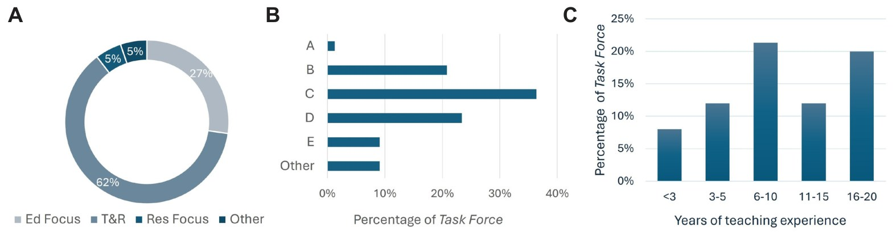
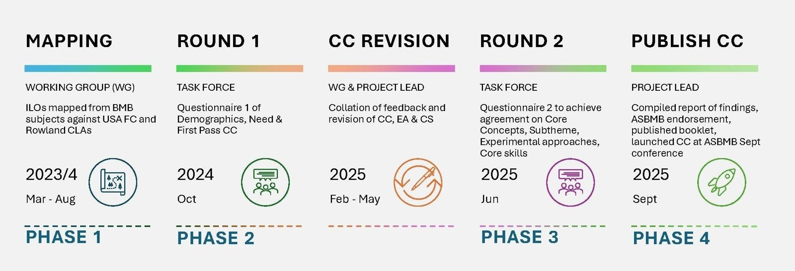

# The Australian Core Concepts of Biochemistry & Molecular Biology

**Amber Willems-Jones**  
*School of Biomedical Sciences, University of Melbourne*

> *Australian Biochemist* Vol 56 No 3, December 2025, pages 18–20

In each discipline taught across universities globally, a set of core principles/concepts are integral to ensuring students gain an appropriate understanding of the relevant aspects within that discipline. These are often referred to as core concepts.

In 2022, I established a project to bring together discipline experts in Biochemistry and Molecular Biology (BMB) to establish a national (Australia-wide) consensus on core concepts in the Australian context. A Working Group of 21 academics from 12 Australian higher education institutions representing most Australian states and territories (excluding NT) joined the project. The Working Group began by firstly mapping 300 unique intended learning outcomes sourced from public-facing web data of 30 Australian universities (from 146 subjects). Secondly, we compared these against the threshold concepts for BMB from the United States (1,2) and the key concept lens areas (CLAs) by Rowland *et al.* (3). A preliminary list of five Core Concepts with associated Subthemes (framed using the Rowland CLAs and USA classifications), three Experimental Approaches and six Core Skills were reviewed by a Task Force of 77 discipline experts from across Australia. **Fig. 1** represents the demographics of the Task Force participants.

We used a Delphi-inspired method of iterative consensus (4) across two questionnaires. **Fig. 2** illustrates the timeline of the project’s four phases illustrating involvement of the Working Group members and Task Force participants.

For Core Concepts, progression into Round 2/Phase 3 was based on 80% agreement (agree plus strongly agree on a 7-point Likert scale) to the statement: *“In my opinion, within [Core Concept], this should be listed as a key BMB concept & subtheme in the Australian context”*. An average of 91% agreement was achieved for the majority of suggested concepts and subthemes, with feedback requesting adjustment to the wording of concepts and subthemes. The preliminary core concept of Evolutionary Biology and Diversity did not meet the required 50% agreement threshold. Progression into Round 2/Phase 3 for Experimental Approaches and Core Skills also required at least 80% agreement (to the statements: *“In my opinion, undertaking this [experimental approach]/[core skill] is essential for students when completing a BMB major”*. Experimental Approaches achieved an average of 98% agreement for the three approaches, with recommendations to expand the list, and Core Skills achieved 92% agreement with requests to include an additional two Core Skills for the second-round questionnaire.

A rigorous revision of each list was undertaken by the project lead to ensure every participant’s feedback was carefully reviewed, actioned and incorporated.

***Fig. 1.** Demographics of Task Force participants who were part of the national consensus project. (A) Work force classification (Ed Focus: Education Focussed, T&R: Teaching and Research, Res Focus: Research Focussed, Other: comprises an Honours student, casual employees, Emeritus professors, and members from the public service) (n=77) (B) Academic Level, ‘other’ includes an Honours student, a member from the TGA and 2 not specified (n=77) (C) Years of teaching experience (n=75)*

***Fig. 2.** Timeline of the project’s four phases highlighting involvement of the Working Group members and Task Force participants.*

A revised list was provided to the Working Group for comments to ensure appropriate wording. After several revisions, the Working Group settled on four Core Concepts and associated Subthemes (with suggested topic areas for each), six Core Experimental Approaches and eight Core Skills.

**Table 1.** The Australian Core Concepts and Subthemes.

| **Core Concept** | **Subtheme and Topics** |
|---|---|
| Genetic Information: Storage, Transfer and Expression | Nucleic Acid Structure and Dynamics Gene Expression and Regulation in Prokaryotes and/or Eukaryotes Mechanisms of Genetic Variation and Repair Biochemical and Molecular Adaptations Driving Evolution and Biodiversity |
| Structure and Function of Biomolecules | Biomolecular Structure and Organisation Protein Structure and Function Enzymology and Catalysis Lipid Structure and Function Carbohydrates and Glycobiology |
| Thermodynamics and Energy | Bioenergetics and Metabolic Pathway Coordination and Integration Thermodynamics in Biological Systems Cellular Homeostasis and Energy Balance |
| Cellular Regulation and Organisation in Living Systems | Cellular Architecture and Dynamics Cell Cycle Regulation Molecular Mechanisms of Cellular Processes Mechanisms of Cell Signalling and Cellular Communication |

In Phase 3, consensus on the revised list of Core Concepts (**Table 1**) was achieved, with an average of 93% agreement (agree plus strongly agree on a 7-point Likert scale) with the statement *“I would like to adopt the Core Concept of A-B-C-D, and subthemes, as part of the National Consensus Project”*. Furthermore, an average of 87% and 95% of the Task Force were in agreement (agree plus strongly agree on a 7-point Likert scale) with the statements: *“In my opinion, undertaking this Experimental Approach is an essential part of a BMB major”* and *“In my opinion, we should include the Core Skills as essential for a student completing a BMB major”*. Therefore, these additional parameters (six core experimental approaches and nine core skills) were adopted as part of the Australian BMB Core Concepts. These have been published in the official *Australian Core Concepts in BMB* booklet.

As part of Phase 4 of the project, the Australian BMB Core Concepts have been officially endorsed by the Executive Council of the ASBMB and the booklet is available in both printed and electronic forms: <https://doi.org/10.26188/30450767.v1>.

The Australian BMB Core Concepts will serve as a guide/framework for what can be taught and assessed across BMB majors in Australian undergraduate higher education. Ultimately, the Australian BMB Core Concepts will help to achieve greater integration of BMB core principles into the undergraduate university curricula with consistent high-quality assessment of the associated content areas.

## References

1. Loertscher J *Biochem Mol Biol Educ* 2011;39(1):56–57.
2. Tansey JT, Baird T Jr, Cox MM *et al. Biochem Mol Biol Educ* 2013;41(5):289–296.
3. Rowland SL, Smith CA, Gillam EM, Wright T *Biochem Mol Biol Educ* 2011;39(4), 267–279.
4. Zanker J, Scott D, Reijnierse EM *et al. J Nutr Health Aging* 2019;23(1):105–110.
## About the author

Associate Professor Amber Willems-Jones is an education-focussed academic in the Department of Biochemistry and Pharmacology at the School of Biomedical Sciences, University of Melbourne. <amber.willems@unimelb.edu.au>
 

---

*This article first appeared in the ASBMB Education Feature of the [Australian Biochemist](https://www.asbmb.org.au/magazine) Vol 56 No 3, December 2025. © 2025 Australian Society for Biochemistry and Molecular Biology Inc.*

[← Back to the December 2025 issue](../README.md)
