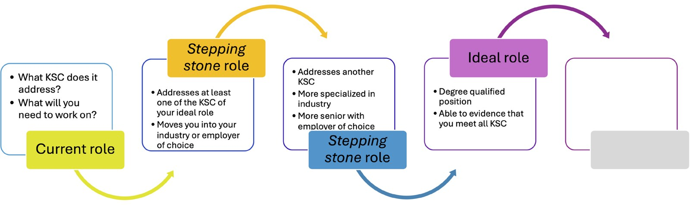
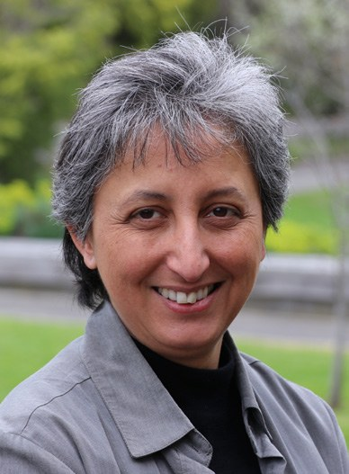
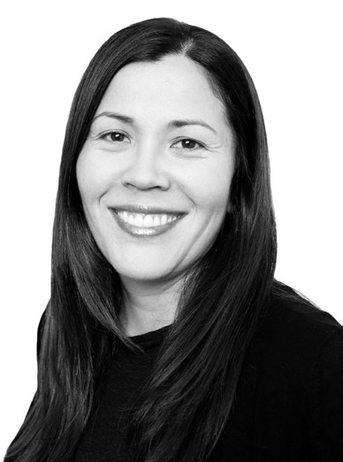
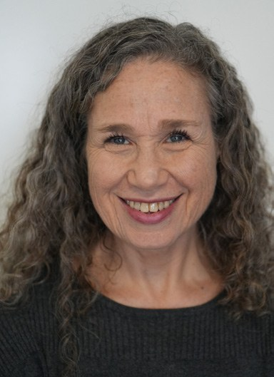
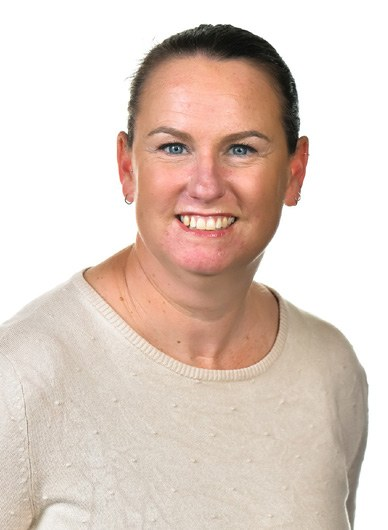
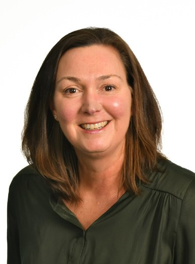
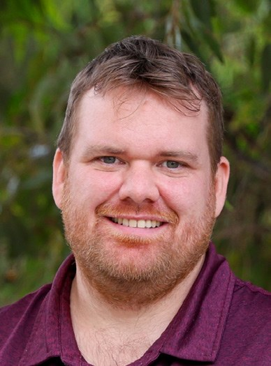

# Enhancing Career Confidence and Employability With a New Approach to Career Development and Work-Integrated Learning in Undergraduate Science Degrees

**Sharon La Fontaine¹,², Cathy Caballero³, Jen Chung², Sharon Berman², Julius Daguman Jr¹, Lynda O’Sullivan¹,⁴, Amanda McPherson¹, Karen Young⁴ and Anthony R. Rendall¹**  
*¹School of Life and Environmental Sciences, Deakin University*  
*²Graduate Employment, Deakin University*  
*³School of Psychology, Deakin University*  
*⁴Faculty of Science Engineering and Built Environment, Deakin University*

> *Australian Biochemist* Vol 56 No 3, December 2025, pages 22–24

Graduate employability has been a persistent challenge in higher education, particularly for science graduates, whose employment rates have remained at approximately 50% since 2012 (1). Equipping students to successfully transition to work and manage their careers is especially important for non-vocational science degrees with diverse career pathways (2,3). In response and aligned with national priorities, we developed a curriculum-integrated career development learning (CDL) approach that leverages students’ need for paid employment (3), alongside work-integrated learning (WIL) to improve science graduates’ career and employability outcomes.

## Theoretical Foundation

Our CDL+WIL approach is grounded in practice and theories that recognise the psychosocial dimensions of career learning (3). Our student-centred, holistic approach is tailored to learners’ diverse needs and designed to meet them where they are. DOTS (decisions, opportunities, transition, self) (4) and Bridgstock’s models (2) underpinned our approach, though we recognise career and employability learning as ongoing processes, rather than fixed career management skill sets (3). The value of WIL and paid, relevant work in improving employability is well established and supports students to build their professional identity, networks and industry engagement (3).

## Implementation

Increasing student diversity, circumstances and career pathways requires personalised career development that is equitable, adaptable and relevant. Recognising students’ need to work, our approach harnesses paid work as a vehicle for CDL, enabling students to “learn while they earn” (3). We designed (2021) and implemented (2022 onwards) an evidence-based CDL program that supports students in securing paid work from year 1 and/or leveraging existing roles into industry-relevant or Stepping Stone roles by graduation (**Fig. 1**) (3). From 2023, all science courses also included a core placement experience (≥600 students/year on placement). The CDL+WIL program is embedded in all undergraduate science degrees, from environmental to biomedical science, reaching over 2,500 students/year.

***Fig. 1.** Stepping Stone roles for career development learning. Stepping Stone roles are paid roles that should help to address the key selection criteria (KSC) of a student’s ideal professional role, helping them move into their industry or employer of choice and develop discipline and/or advanced transferable skills. Illustrates an ongoing, evolving process that should be relevant regardless of career stage (3).*

**Table 1.** Subset of WRS data showing percentage of students in paid work and collected during 2022–2025 for year 1 (CDL: 2022, 2023) and year 3 (CDL: 2024, 2025). Represents matched, aggregated data.

| **Cohort** | **2022 – 2024** | **2022 – 2024** | **2023 – 2025** | **2023 – 2025** |
|---|---|---|---|---|
| Year Level | 1 (n=711) | 3 (n=757) | 1 (n=793) | 3 (n=527) |
| % in Paid Work | 76.4 | 79.4 | 65.2 | 86.0 |
| % Unrelated to field of study | 66.2 | 59.6 | 57.4 | 68.1 |
| % Related to field of study | 9.0 | 16.8 | 5.8 | 13.7 |
| % Directly Related to field of study | 1.1 | 3.0 | 2.0 | 4.2 |

In a whole-of-course approach, four scaffolded CDL touchpoints across all science degrees, from first year to graduation, provide opportunities for reflection, career exploration, planning and action. These touchpoints support students to make informed career decisions and build lifelong career-management skills. Discipline teams and university careers service staff (DeakinTALENT) co-design and co-teach contextualised CDL content and assessments, structurally embedded in core units (weighted at 20%), achieving greater than 90% completion rates. Assessments are flexible to accommodate varying career stages. A year 1 online unit – Career Tools for Employability – prepares students for CDL and placement (5), followed by embedded CDL in years 1–3 that supports students to engage with paid (Stepping Stone) roles (**Fig. 1**) (3) and to prepare for placements. The third CDL touchpoint includes an 80-hour (minimum) placement aligned with students’ course and career goals and incorporates quality WIL assessment design principles.

## Initial Outcomes

A suite of tools helps evaluate impact and support continuous improvement. Graduate Outcomes Survey (GOS) data (www.qilt.edu.au) showed that the percentage of Deakin Mathematics and Science graduates in full-time employment increased from 48% in 2020 (2019 graduates) to 71% in 2023 (2022 graduates), matching the Mathematics and Science study area at other Victorian universities. A similar increase was evident when only the relevant science courses in this study area were considered. More graduates also cited career-related preparation by the institution. Although GOS data has limitations and the increase may not be solely due to the CDL+WIL program, it aligns with significant university investment in these initiatives and marks a shift since implementing a systematic CDL approach. A Work Readiness Scale (WRS) (6) embedded within year 1 and 3 assessments offers a validated measure of students’ perceived work readiness at each year level and captures students’ engagement with paid work (**Table 1**). Year 3 students scored significantly higher on the WRS compared to year 1 students [WRS score 7.68>7.25, t(6027)=-20.50, p<0.001], suggesting substantial perceived development over time. Significantly, students in relevant, paid work increased by year 3, suggesting more students may be engaging with Stepping Stone roles (**Table 1**).

## Conclusion

Our CDL program is an iterative, reflective, and highly personalised approach, fostering student agency in career management and supporting our ethical responsibility to promote self-reliance and informed career decision-making. We have observed improved employment rates and greater student confidence, preparedness, and engagement in career-relevant work. Supported by employers, community partners and institutional leaders, the program is embedded in Faculty strategic plans, ensuring a sustainable, relevant, adaptable and equitable approach to CDL+WIL for science students with diverse career pathways.

## Acknowledgements

Thanks to Professor Jamie Mustard and Associate Professor Lauren Hansen, Graduate Employment for their vision and support of this program; and for support provided by the Faculty of Science, Engineering and Built Environment and the School of Life and Environmental Sciences. The work was approved by Deakin University’s Human Research Ethics Committee (DUHREC) [SEBE-2021-80-MOD08; HEAG-H 132_2004; 2024/HE000379].

## References

1. Norton A, Cakitaki B *Mapping Australian Higher Education 2016*. Grattan Institute.
2. Bridgstock R *High Educ Res Dev* 2009;28(1):31–44.
3. Hansen L, La Fontaine S *J Teach Learn Grad Employab* 2025 (in press).
4. Watts AG *Career Development Learning and Employability*. 2006. The Higher Education Academy.
5. Young K, Cardilini A, Hermon K *Int J Work-Integr Learn* 2021;22(4):445–461.
6. Caballero CL, Walker A, Fuller-Tyszkiewicz M *J Teach Learn Grad Employab* 2011;2(1):41–54.
## About the authors

Associate Professor Sharon La Fontaine is Associate Professor of Biomedical Science and Career Education in the School of Life and Environmental Sciences and Graduate Employment, Deakin University. <sharon.lafontaine@deakin.edu.au>
 

Cathy Caballero is a Lecturer and Organisational Psychologist in the School of Psychology, Deakin University. <cathy.caballero@deakin.edu.au>
 

Dr Jen Chung is a Lecturer with Graduate Employment, Deakin University. <jen.chung@deakin.edu.au>
 

Sharon Berman is a Senior Officer with Employer Services, Graduate Employment, Deakin University. <s.berman@deakin.edu.au>
 

Julius Daguman Jr, is a Research Assistant in the School of Life & Environmental Sciences, Deakin University. <julius.d@deakin.edu.au>
 

Dr Lynda O’Sullivan is a WIL Lecturer, Faculty of Science Engineering and Built Environment, Deakin University. <l.osullivan@deakin.edu.au>
 

Amanda McPherson is a Senior Officer in WIL, Faculty of Business and Law, Deakin University. <amanda.mcpherson@deakin.edu.au>
 

Associate Professor Karen Young is Academic WIL Director, Faculty of Science Engineering and Built Environment, Deakin University. <karen.young@deakin.edu.au>
 

Dr Anthony R. Rendall is a Senior Lecturer, School of Life and Environmental Sciences, Deakin University. <a.rendall@deakin.edu.au>
 

---

*This article first appeared in the ASBMB Education Feature of the [Australian Biochemist](https://www.asbmb.org.au/magazine) Vol 56 No 3, December 2025. © 2025 Australian Society for Biochemistry and Molecular Biology Inc.*

[← Back to the December 2025 issue](../README.md)
