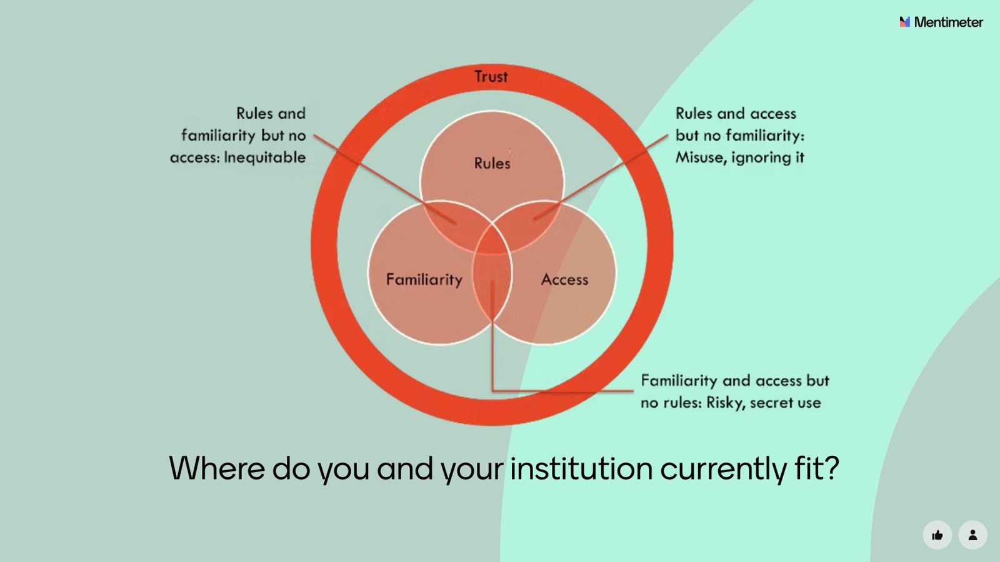
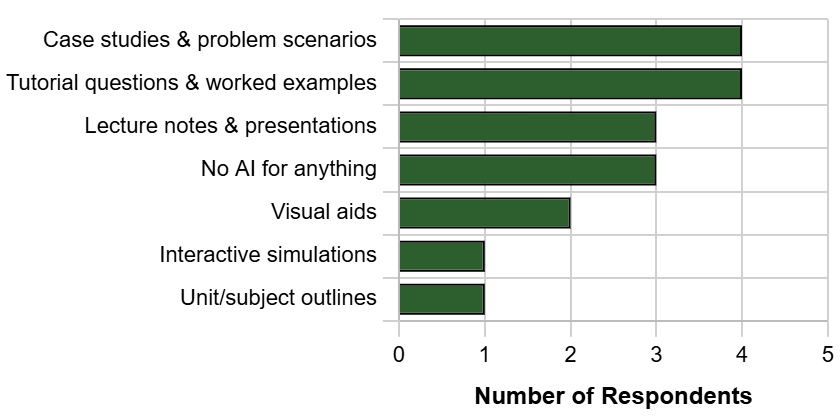
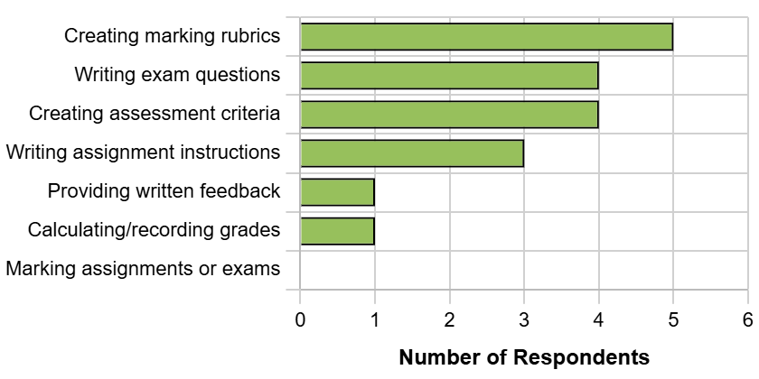
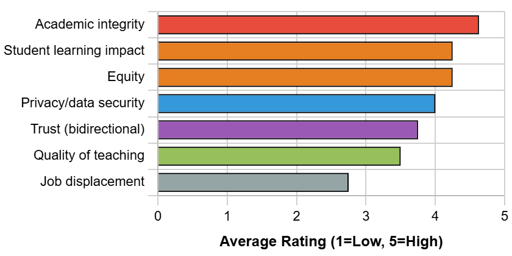
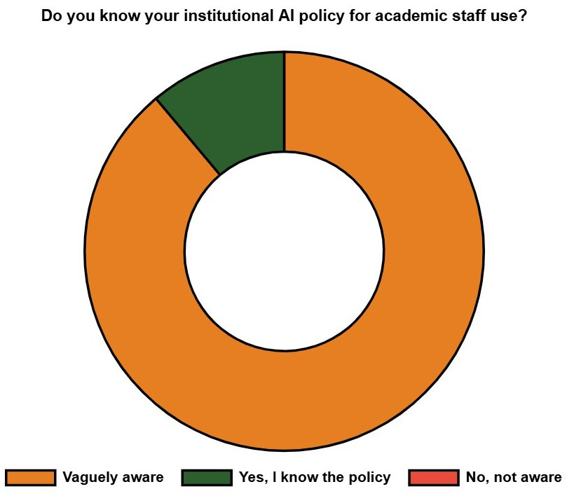

# Navigating the AI Landscape: Insights from Australian Biochemistry Educators

**Matthew Clemson**  
*School of Life and Environmental Sciences, University of Sydney*

> *Australian Biochemist* Vol 56 No 3, December 2025, pages 25–27

With so much attention surrounding the impact of generative AI on higher education, the ASBMB2025 conference was a timely opportunity for biochemistry educators from around Australia to share their views and discuss how each of our institutions are transitioning policy, learning activities and assessments at this time.

Intense scrutiny has already been specifically directed towards student learning, assessment and academic integrity over the last couple of years, so we decided to focus our discussions on how we, as educators, are currently engaging with generative AI as part of our daily work.

The Generative AI in Biochemistry Education Workshop provided educators a setting to share efficiency improvements enabled by generative AI technologies, to consider current institutional policies, and to examine familiarity with and access to specific AI tools within our workplaces.

Underpinning all of this was the concept of trust (**Fig. 1**). Recent work highlights that AI impacts trust between students and teachers, with the absence of ‘two-way transparency’ in AI usage reinforcing the power imbalance (2). Universities need to trust that educators are using AI ethically and responsibly, educators need to trust that their institutions are supporting them effectively by providing both access to the best available tools and the time and support required to upskill and gain confidence in using these tools. Universities need to support their educators so they can provide the best possible to support students throughout this challenging period.

A short polling anonymous questionnaire was presented using Mentimeter at the workshop to gather data to share our current familiarity, use, concerns, ideas and to plan for a world where AI is ubiquitous, that in many ways is already upon us.

The results of the survey indicate that most of the workshop participants are using generative AI in various aspects of their jobs, more so for developing content and teaching resources, such as writing tutorial questions and case studies, drafting lecture notes and even creating interactive simulations for students (**Fig. 2**). Most of the respondents considered that minimal to moderate use of AI was acceptable, yet some participants held the view that AI should never be used.

For assessment-related tasks, use of AI was also relatively widespread among the participants and the variety of tasks for which AI was being used. Many educators had used or currently use AI-driven tools to assist with drafting marking rubrics, creating multiple choice and short answer exam questions, writing assignment instructions and even helping to provide written feedback on student work (**Fig. 3**). Significantly, no participants reported using AI for marking student work – a deliberate boundary suggesting educators recognise that qualitative assessment requires human judgement.

There was a definite shift in opinion regarding AI use for assessment purposes, with most attendees indicating that their current use and what they considered to be ethically acceptable use was lower for assessment compared to content creation.

> “Upskilling is a constant, I just wish we were given more time, support and guidance.”

***Fig. 1.** Considering the practicalities of AI for both educators and students. Adapted from (1).*

***Fig. 2.** Use of AI for content creation tasks.*

The greatest primary concern was academic integrity, followed by the impact on student learning, equity and trust. Interestingly, job displacement ranked lowest (2.75), suggesting educators view AI more as a tool to be managed than as an existential threat to their profession (**Fig. 4**). Almost 90% of participants were only vaguely familiar with their institutional policies, and only a single person indicated that they knew what their institution’s current policy was for the use of AI by academic staff (**Fig. 5**). This finding is particularly concerning given that all participants were engaged enough to attend a workshop on AI in education, suggesting either that policies don’t exist, aren’t being effectively communicated or are insufficiently clear to provide practical guidance.

In terms of policy recommendations for AI use in our roles as biochemistry educators at Australian universities, attendees wanted clarity on what is considered acceptable use and access to the most effective tools to stay a step ahead of – or at least keep pace with – students. They highlighted the importance of professional development and dedicated time to stay ahead of the curve in this rapidly evolving field. They also wanted their institutions to consider the feasibility of any rules that were being considered and to remain open to and continue supporting secure forms of assessment, such as invigilated tasks and paper-based exams.

***Fig. 3.** Use of AI for assessment-related activities.*

***Fig. 4.** Concerns related to AI use in education. Numbers represent average scores on a 5-point Likert scale from strongly disagree (0.0) to strongly agree (5.0).*

Finally, workshop participants were challenged to consider the best and worst outcomes for an AI-driven world, as a call to action for us, our institutional funders and policy makers, to ensure that we are addressing the correct points of contact. Of greatest concern was the possibility that students could graduate without the necessary knowledge and skills to enter the workforce, or that they might avoid the points of constructive struggle or friction that are necessary for deep learning. In the worst-case scenario, a world where AI is used to create, complete and grade tasks, as well as provide feedback on them, outsourcing all aspects of learning considered bottlenecks to technology.

On a positive note, some educators identified that integration of AI into learning and assessment opens new possibilities, with a reduction in the time spent on menial or routine tasks. Ideas included a world where students experience new, personalised challenges and are able to tackle more challenging tasks using data integration. They could also engage with robust simulations that allow hypotheses and ideas to be tested more meaningfully at various levels, all of which offer potential to positively impact learning.

***Fig. 5.** Institutional AI policy awareness.*

The key take-home points for participants, whether in support of or opposed to AI, were the same. There was shared concern that organisations expect an immediate and under-resourced upskilling, with inadequate time, training, support and guidance for educators. There was a consensus among participants that without meaningful investment in the necessary support structures, biochemistry academics risk not only burnout, but the erosion of trust in the very systems meant to guide us through this educational transformation.

We welcome contributions from additional biochemists in Australia to this project survey. The ongoing project intends to gather student opinions on how their educators should be permitted to use AI for content creation and assessment-related tasks. To get involved in this study, email <matthew.clemson@sydney.edu.au> by 31 December 2025. Contribute to the survey via this [link](https://www.menti.com/alzqcwwzdsbz).

## Acknowledgements

Thank you to workshop participants Dr Lisa Akison (University of Queensland), Dr Juliana Antonipillai (RMIT University), Associate Professor Marloes Dekker Nitert (University of Queensland), Dr Doaa Hanafy (Charles Sturt University), Professor Tracey Kuit (UNSW), Associate Professor Sharon La Fontaine, (Deakin University), Professor Terry Piva (RMIT University), Dr James Tsatsaronis (University of Sydney) and Associate Professor Amber Willems-Jones (University of Melbourne).

## References

1. Liu D, Bridgeman A. *Rules, access, familiarity, and trust – a practical approach to addressing generative AI in education.* 2024. Teaching@Sydney. <https://educational-innovation.sydney.edu.au/teaching@sydney/rules-access-familiarity-and-trust-a-practical-approach-to-addressing-generative-ai-in-education/>
2. Luo J *Teach High Educ* 2024;30(4):991–1006.
## About the author

Dr Matthew Clemson is a Senior Lecturer in Biochemistry in the School of Life and Environmental Sciences and a Senior Lecturer in Academic Development and Leadership in the Office of PVC (Educational Innovation) at the University of Sydney. <matthew.clemson@sydney.edu.au>
 

---

*This article first appeared in the ASBMB Education Feature of the [Australian Biochemist](https://www.asbmb.org.au/magazine) Vol 56 No 3, December 2025. © 2025 Australian Society for Biochemistry and Molecular Biology Inc.*

[← Back to the December 2025 issue](../README.md)
