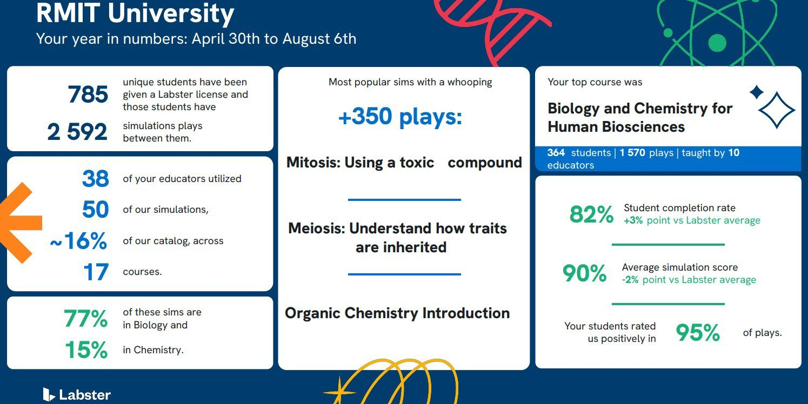
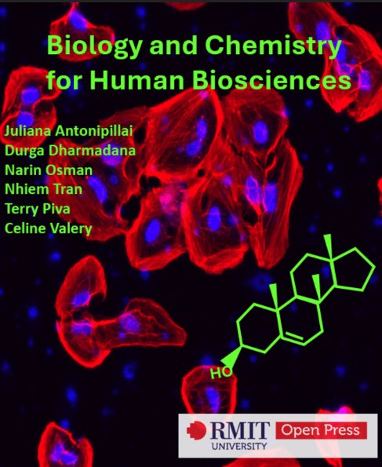
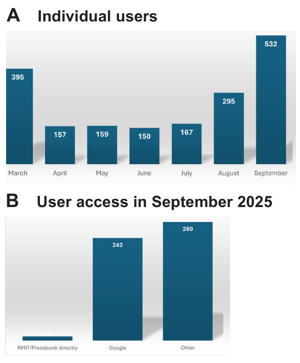

# Reflecting on the Journey: Combining Biology and Chemistry for Health Science Students in the Foundation Year

**Juliana Antonipillai**  
*School of Health and Biomedical Sciences, STEM College, RMIT University*

> *Australian Biochemist* Vol 56 No 3, December 2025, pages 20–21

In recent years, my academic journey at RMIT University has focused on innovative and blended teaching strategies to create inspiring learning environments that motivate students and prepare them for real-world challenges and industry-ready skills. Guided by this approach, I led the development of a new foundation course, [Biology and Chemistry for Human Biosciences](https://rmit.pressbooks.pub/biologyandchemistryhumanbiosciences/) (BIOL2528), specifically designed for health science students. Combining chemistry with biology to form a cohesive curriculum had significant hurdles. We needed to ensure that students, regardless of their prior knowledge, felt confident in handling two complex scientific subjects simultaneously in a course. The idea of developing a combined course arose from students’ feedback that the majority of health science discipline students were overwhelmed by non-human cell biology and advanced chemistry content. Under my leadership, my team developed this course in 2022 and first implemented it in 2023. This course integrates human cell biology, chemistry and foundational biochemistry, catering to students from diverse backgrounds, including those enrolled without completing Year 12 Chemistry or Biology.

Our development teams aimed to teach the theory content through the integration of simulation activities, empowering students to build transferable knowledge and skills that support their progression in health science programs at RMIT University. These simulations, provided by Labster ([Labster.com](http://Labster.com)), offered immersive experiences in a safe environment for students to explore and learn from their mistakes. We found that Labster simulation activities provided extended knowledge in a safe and authentic manner. In 2024, data from the Labster platform revealed that the BIOL2528 course was selected as the top course among 17 RMIT University courses using Labster modules. Data shows 82% of enrolled students completed the activities with an average score of 90%, and 95% rated LABSTER’s simulation activities positively (**Fig. 1**). This highlights the successful integration of simulations in a complex, content-specific course and their impact on student engagement. Student feedback validated this: *“I found the virtual labs very helpful in developing an understanding of all of the topics”* (2025 Course Evaluation Survey).

***Fig. 1.** BIOL2528 achieved the highest Labster engagement and positive student ratings amongst RMIT University courses in 2024.*

During the course development, we realised another big challenge was identifying a course-specific textbook. Failure to identify a suitable textbook at a foundational level led me to consider developing an Open Education Resources Pressbook for our students, using an existing one as a starting template. In late-2023, Dr Durga Dharmadana, Dr Narin Osman, Dr Nhiem Tran, Professor Terry Piva and Associate Professor Celine Valery joined with me in this project, and we published *Biology and Chemistry for Human Biosciences* in March 2025 (**Fig. 2**). Within six months of publication, over 1,800 individual users accessed our book. Although 265 students were enrolled in the Foundation year in 2025 and studied the BIOL2528 course in semester 1 (March to May 2025), a much larger number of individual users outside this period, especially in September (**Fig. 3A**), accessed the resource, indicating the essential need for a simplified textbook for the wider community. This is confirmed after analysing the individual user access points in September, which were outside the RMIT community; the majority of them used Google or other search engine tools, while only a handful of students used the RMIT Pressbook site directly in September 2025 (**Fig. 3B**).

***Fig. 2.** Biology and Chemistry for Human Biosciences.*

***Fig. 3.** Biology and Chemistry for Human Biosciences – RMIT Pressbook user analysis. (A) The number of individual users who accessed the book from March 2025 to September 2025. (B) Access user locations from RMIT/Pressbook, Google, or other search tools in September 2025.*

This successful course development gives me a deep sense of satisfaction with developing a course that suits our health science students the best. After three years of successful coordination, I’m now moving to the next stage of introducing traditional face-to-face labs to provide synergistic lab experiences.

Reflecting on this journey, I am proud of how the development of the Biology and Chemistry for Human Biosciences course has enriched our students’ learning. This experience highlights the importance of adaptive teaching methods in producing competent and confident graduates. For academics developing a course, I encourage you to refer to students’ feedback, collaborate widely and remain flexible in your approach to meet the evolving needs of your students.

## About the author

Dr Juliana Antonipillai is a Senior Lecturer and Biomedical Science Program Manager in the School of Health and Biomedical Sciences, STEM College, RMIT University. She is an Honorary Research Fellow, Royal Melbourne Hospital, University of Melbourne. <juliana.antonipillai@rmit.edu.au>
 

---

*This article first appeared in the ASBMB Education Feature of the [Australian Biochemist](https://www.asbmb.org.au/magazine) Vol 56 No 3, December 2025. © 2025 Australian Society for Biochemistry and Molecular Biology Inc.*

[← Back to the December 2025 issue](../README.md)
