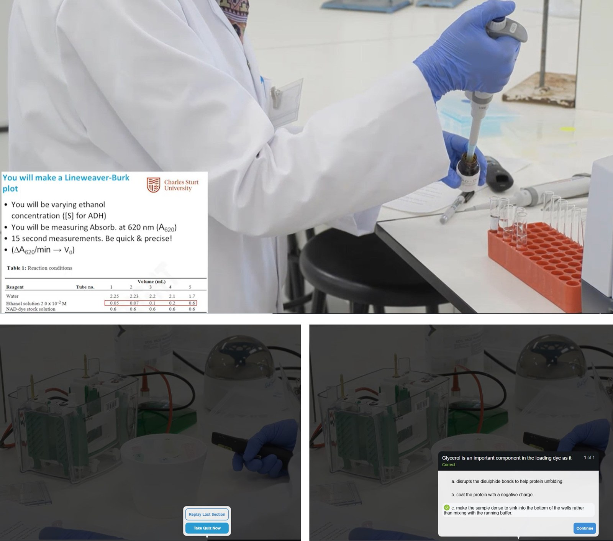
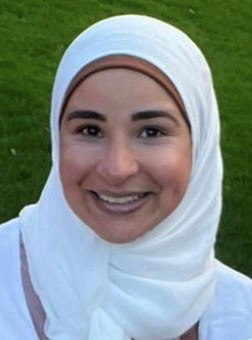

# Hit Play Before You Pipette: Pre-laboratory Videos to Boost Biochemistry Practicals

**David Leaver and Doaa Hanafy**  
*School of Dentistry and Medical Sciences, Charles Sturt University, Wagga Wagga*

> *Australian Biochemist* Vol 57 No 1, April 2026, pages 17–19

Foundations and Techniques in Biochemistry (BCM210) is a second-year subject that is offered at Charles Sturt University (CSU) in internal (face-to-face) and distance (online) modes over twelve teaching weeks. There are weekly practical sessions for internal students and a three-day intensive school for distance students. A recurring challenge observed in both cohorts is a lack of preparedness for practical sessions. The internal cohort predominantly comprises young school leavers who often struggle with sustained engagement and self-directed learning (1). In contrast, distance education students tend to be mature-aged and highly committed; however, their participation is frequently constrained by competing demands such as employment and family responsibilities (2–4). Students in these practical classes work in small groups (two or three students per group), thereby allowing student–student interaction learning (5). To address the issue of inadequate preparation, interactive pre-laboratory videos (6,7) were introduced as a pedagogical strategy to enhance readiness and engagement prior to practical sessions.

BCM210 introduces key biological macromolecules and essential metabolic pathways, alongside hands-on experience with standard biochemical techniques. It serves as a foundation subject which scaffolds other advanced studies in life sciences and health disciplines. With approximately 200 students enrolled annually (about 135 internal and 65 distance), BCM210 draws students from a wide range of science and health degrees and is considered one of the most challenging subjects for students to master.

Students have very different experiences and preparation for learning biochemistry. While intensive schools offer some logistical benefits, being designed in blocks to facilitate managing other responsibilities (8), their condensed schedule is usually tiring for students, which makes it difficult to introduce new concepts. It became evident that fundamental laboratory techniques and biochemical principles needed to be presented to students before they attempted complex and nuanced experiments. Rayment and coauthors recommended pre-laboratory activities in chemistry and biosciences classes in the UK to reduce cognitive demand during laboratory classes (9).

***Fig. 1.** Screenshots from the pre-lab videos showing examples of instructions provided and embedded questions.*

In collaboration with a media technologist from the Division of Learning and Teaching at CSU, interactive pre-laboratory videos for the practical component were recorded while the lead demonstrator carried out the experiments in the laboratory, using equipment consistent with what students encounter during practical sessions, for students to watch before attending each practical session (10). On average, the videos were about 25 minutes to maintain attention. They started with a brief explanation of the scientific relevance of the experiment, followed by an overview of the key biochemical concepts related to the experiment. The experimental procedure then included a step-by-step walkthrough of the practical task, identifying equipment, reagents and techniques while highlighting safety considerations and common errors. The videos contained embedded questions that students needed to correctly answer to be able to continue watching (**Fig. 1**), otherwise they needed to watch that part again. Finally, the videos showed example data or outcomes with an explanation of how to analyse and interpret results. The videos were made easily accessible to both internal and distance students weeks before the practical classes on the subject’s Learning Management System. These videos prepared students for the practicals by familiarising them with the instruments and the techniques they were going to use, which made efficient use of their time and made the practical sessions much more organised, productive and enjoyable. Students were able to watch the videos in their own time, which provided flexible and adaptive learning to students to fit with other commitments (11). In addition, the embedded questions helped to reinforce students’ understanding.

Numerous students liked the inclusion of the pre-laboratory videos, as evidenced by the following end-of-session survey responses: *“The pre-lab videos explaining the experiment were of significant help and majorly aided in my learning prior to and during the practical.” “I also appreciated the very clear instructions given about expectations for intensive school, and the opportunity to have a video presentation.” “The practical videos before going into the practical helped and made it quick and easy to complete.”*

This feedback suggests that student engagement and learning were enhanced as a consequence of the implemented pre-laboratory video strategy. The benefits of the videos did not directly translate into a higher average grade in the practical assessment; however, the end-of-session survey positive response rate increased from 44% and 57% for internal and distance modes, respectively, before implementing the pre-laboratory videos, to 64% and 93% for internal and distance modes, respectively, after introducing the pre-laboratory videos. This approach allowed students to apply their knowledge about what they learnt from BCM210 topics in a practical way (applying theory into practice), thus fostering their learning (12).

In summary, biochemistry practicals supported with pre-laboratory videos enabled students to acquire important laboratory technical skills (13,14), thereby preparing them for their chosen profession. The development of pre-laboratory videos has proven to be a valuable strategy in supporting student learning by reducing cognitive demand and increasing familiarity with equipment and procedures, which have helped students approach practical sessions with greater confidence and preparedness. Producing these videos using the same equipment students use was essential in minimising confusion and building familiarity. Looking forward, several enhancements could further improve their impact and accessibility features such as using captions and multilingual options. This approach not only supports academic success but also contributes to a more inclusive and confident learning environment.

## References

1. Burton LJ, Taylor JA, Dowling DG, *et al. Stud Learn Eval Innovation Development* 2009;6(1):65–81.
2. van Rhijn TM, Lero DS, Bridge K, *et al. Canadian J Stud Adult Educ* 2016;28(1):29–47.
3. Munro B, Pooley JA. *Aust Commun Psychologist* 2009;21(1):50–61.
4. Acosta-Gonzaga E. *Behav Sci* 2023;13(4):348.
5. Biggs J, Tang C. Constructively aligned teaching and assessment. *Teaching for Quality Learning at University: What the Student Does.* 4th ed. McGraw-Hill Education. 2011. p.95–110.
6. Onyeaka H, Passaretti P, Miri T, *et al. Biochem Mol Biol Educ*. 2023;51(1):29–38.
7. Jongsma MV, Scholten DJ, Vuuregge AH, *et al. J Chem Educ* 2024;101(12):5192–5202.
8. Lashley M, McCleery R. *Ecol Evol* 2020;10(22):12613–12619.
9. Rayment SJ, Evans J, Moss K, *et al. J Biol Educ* 2023;57(5):1092–1111.
10. Division of Learning and Teaching CSU. <https://www.csu.edu.au/division/learning-teaching/teaching/strategies/online-learning-model>
11. Biggs J, Tang C. Contexts for effective teaching and learning. *Teaching for Quality Learning at University: What the Student Does.* 4th ed. McGraw-Hill Education. 2011. p.58–80.
12. Biggs J, Tang C. Teaching/learning activities for functioning intended learning outcomes. *Teaching for Quality Learning at University: What the Student Does.* 4th ed. McGraw-Hill Education. 2011. p.160–190.
13. White HB, Benore MA, Sumter TF, *et al. Biochem Mol Biol Educ* 2013;41(5):297–301.
14. Neiles KY, Mertz PS. *ACS Symposium Series 1365*. American Chemical Society. 2020. p.3–15.
## About the authors

Dr David Leaver is a Senior Lecturer in Biochemistry, Charles Sturt University. <dleaver@csu.edu.au>
 

Dr Doaa Hanafy is a Lecturer in Medical Sciences and Pathology, Charles Sturt University. <dhanafy@csu.edu.au>
 

---

*This article first appeared in the ASBMB Education Feature of the [Australian Biochemist](https://www.asbmb.org.au/magazine) Vol 57 No 1, April 2026. © 2026 Australian Society for Biochemistry and Molecular Biology Inc.*

[← Back to the April 2026 issue](../README.md)
