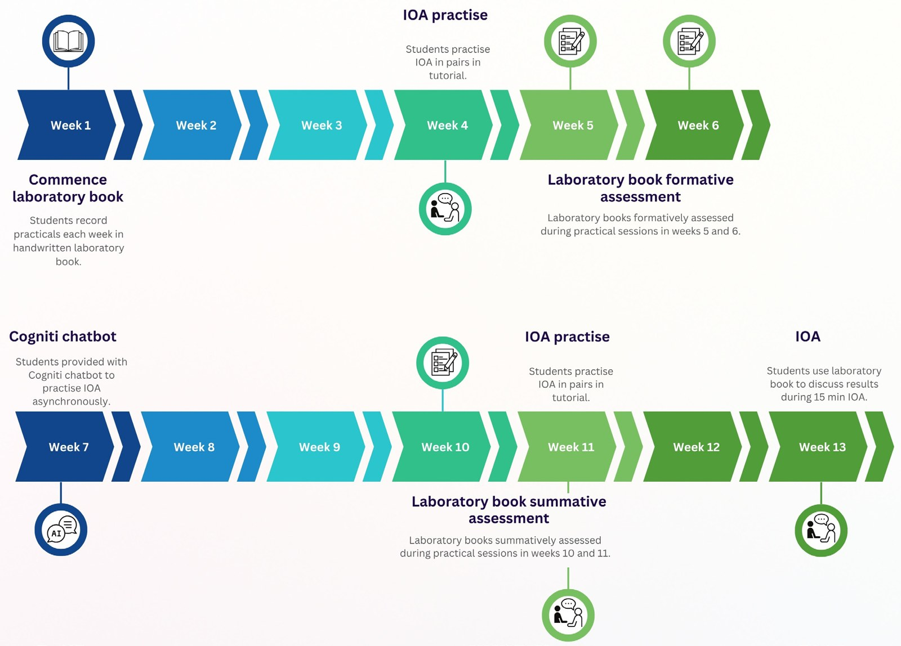

# Lessons Learnt From Interactive Oral Assessments at Scale in a First-year Molecular Biology Unit

**Masha Smallhorn and Narelle Hunter**  
*College of Science and Engineering, Flinders University*

> *Australian Biochemist* Vol 57 No 1, April 2026, pages 14–15

## Context

The advances in generative AI technologies have made it difficult to rely on written tasks to evaluate understanding, as students increasingly turn to generative AI to create submissions. Molecular Basis of Life is a first-year molecular biology unit with over 600 students at Flinders University. Students are enrolled in a broad range of degrees, including the Bachelor of Science, Bachelor of Medical Science and Bachelor of Heath Sciences. Students attend a two-hour weekly inquiry-based practical in classes of 100 and record results in a laboratory book. Students have previously written a report based on one practical. To address the use of generative AI, in 2025 the report was replaced with an interactive oral assessment (IOA). Described as a two-way interactive, genuine and unscripted conversation between assessor and student, IOAs allow students to demonstrate learning through agile and critical analysis in a conversational manner (1).

## IOA logistics

***Fig. 1.** Timeline of IOA. Students had weekly practical sessions and recorded experiments in a laboratory book. One practical was randomly selected from the semester and assessed through an IOA in week 13.*

Practicals ran over 13 weeks, with all students timetabled into a two-hour IOA in week 13 (**Fig. 1**). Students were provided with two timetabled opportunities to practise the IOA with peers and a Cogniti chatbot, which allowed students to practise asynchronously. During the IOA, students had a one-on-one conversation with an assessor, with a 15-minute allocation per student, focussing on one practical carried out during the semester. Assessors initiated a conversation about the experiment where students discussed their results in the context of their experimental design and explained the theoretical underpinnings, referring to their laboratory book. The practical selected for the assessment was chosen at the beginning of the IOA using a random generator. All IOAs were audio recorded on Microsoft Teams for moderation purposes. There were 10 to 12 assessors per session, facilitating assessment of up to 12 students at one time in an open plan classroom.

## Impact and lessons learned

The impact of the IOA on learning outcomes was investigated using a pre-and-post survey and through the analysis of grades. Results revealed a statistically significant increase in grades in the IOA compared to the report (p<.001, Mann-Whitney U Test), suggesting meaningful learning. A thematic analysis was carried out using Copilot and prompts described by Turobov and colleagues (2) The results identified four emerging themes from the open-ended survey question, including content mastery, assessment anxiety, communication skills and active engagement. Students frequently described IOAs as a mechanism for deepening their understanding of content: *“I had to not only study for one practical but all of them which then allowed for me to essentially learn about all of the relevant key molecular aspects.”* However, despite providing opportunities for preparation, students experienced anxiety: *“Despite preparing and understanding I was too nervous to get my thoughts out on the day.”* Assessors reported on the ease of the assessment process and a reduction in marking time. These initial results suggest that IOAs promote deep learning and reinforce conceptual understanding, thus are an authentic, academically rigorous assessment task. However, the results also highlight that students need more opportunities to practise IOAs to reduce assessment anxiety, which will be built into future iterations of the assessment.

## References

1. Tan CP, Howes D, Tan RKW, Dancza KM. *Assess Eval High Educ* 2022;47(8):1183–1199.
2. Turobov A, Coyle D, Harding V. *arXiv e-prints* 2024;arXiv-2405.08828.
## About the authors

Dr Masha Smallhorn is a Senior Lecturer in the College of Science and Engineering, Flinders University. <masha.smallhorn@flinders.edu.au>
 

Dr Narelle Hunter is a Senior Lecturer in the College of Science and Engineering, Flinders University. <narelle.hunter@flinders.edu.au>
 

---

*This article first appeared in the ASBMB Education Feature of the [Australian Biochemist](https://www.asbmb.org.au/magazine) Vol 57 No 1, April 2026. © 2026 Australian Society for Biochemistry and Molecular Biology Inc.*

[← Back to the April 2026 issue](../README.md)
