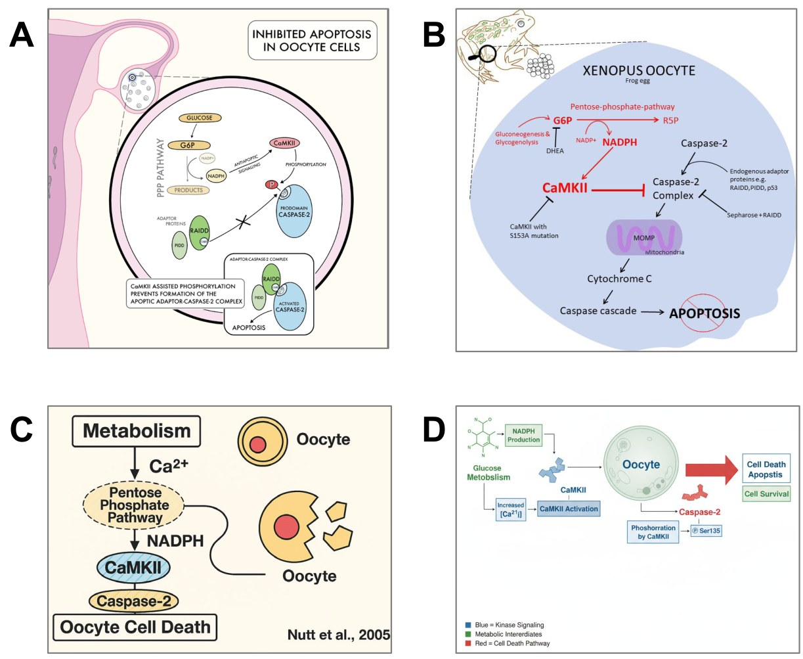

# Sketching Science: Graphical Abstracts as an Authentic Assessment

**Katrina Binger¹,², Maria Demaria³ and Mark Wright³**  
*¹Department of Biochemistry and Chemistry, La Trobe University*  
*²Department of Biochemistry and Molecular Biology, Monash University*  
*³Department of Immunology, Monash University*

> *Australian Biochemist* Vol 57 No 1, April 2026, pages 20–21

Mind maps, concept maps, schematics and other visual representations have long been used by educators to break down complex concepts and to enhance student learning and engagement (1). What’s relatively new is the requirement by scientific journals for authors to include visual representations of their research upon publication (2,3). While these can encompass formats like short videos, they most frequently take the form of 2D schematics or graphical abstracts, which help readers quickly identify relevant articles and allow authors and publishers to drive traffic to their work (4,5). This publishing trend inspired us to design an authentic communication assessment for undergraduate science students that also fosters higher-order cognitive skills and creativity.

## How it works

At La Trobe University, students in the second-year biochemistry subject BCH2MBC learn core concepts of metabolic biochemistry. For their graphical abstract assignment, students select from several provided research articles focused on central carbon metabolism. They read the article and create a visual representation of its findings (**Fig. 1a**–**b**). As part of our blended learning approach, we support students in completing this assessment through an online video explaining the task. This video helps students design their graphical abstract through annotating exemplars and introduces basic graphic design principles, including typography, colour and layout to enhance their communication skills. In-person workshops and ad hoc support sessions allow academics to assist students in interpreting scientific findings and provide informal design feedback.

***Fig. 1.** Comparison of student-created and AI-generated graphical abstracts. Examples of graphical abstracts submitted by BCH2MBC students for the article ‘Metabolic regulation of oocyte cell death through the CaMKII-mediated phosphorylation of caspase 2’ by Nutt et al., 2005. Reproduced with permission from Tara Santamaria (a) and Sarah Hughes (b). AI-generated graphical abstracts for the same article, created using Microsoft Copilot (c) and Lovart (d).*

## Impact and challenges

We used NVivo to analyse deidentified qualitative student feedback responses collected as part of routine subject evaluation. We found 64.5% of students who referenced the assignment expressed positive sentiments. Common words included “understand”, “different” and “creative”. For academics, while marking the assignment requires a deep understanding of the article, the process is efficient as it involves reviewing a single image. The main challenge lies in selecting suitable research articles – those without existing graphical abstracts, not heavily featured in review articles (which often contain visual representations), and of appropriate complexity and length for our second-year cohort. As a result, we primarily offer older research articles published before graphical abstracts became common and avoid those with complex ‘omics datasets.

## Formative and/or summative

In BCH2MBC, this assignment is summative, but we also see its value as a formative tool. At Monash University, third-year immunology students in IMM3031 complete a written News & Views piece based on a provided research article. Since 2023, we have added a graphical abstract as a formative component (weighted as 5% to ensure completion) to this subject. Students submit their graphical abstract in weeks 4–5 and receive detailed feedback and marks. This approach helps us identify students who have misinterpreted or struggled with their article, allowing us to offer targeted support. Prior to implementation, the proportion of students receiving a HD/D (>70) or Pass/Fail (<59) for their News & Views assignment was 62% and 15.4%, respectively. Since inclusion of the graphical abstract, we observed a shift to 67.1% HD/D and 10.3% Pass/Fail, demonstrating the positive impact of this scaffolding.

## Impact of generative AI to this assignment

The rise of generative AI has prompted many academics to reassess open-ended assignments. In our experience, current generative AI tools cannot effectively complete a graphical abstract task. Our testing, and the limited AI-generated student submissions we have seen, suggests these tools struggle with the higher-order skills needed to synthesise research findings and create accurate visual representations. Common issues include biologically inaccurate cell morphologies, spelling errors and incorrect placement or connection of molecules in pathways (**Fig. 1c–d**). While generative AI may eventually improve and prompt us to reassess this assignment, we currently see its value in helping students understand their chosen research article, which remains the most challenging part. This year, we encouraged students to use AI tools to break down experimental methods and interpret results, providing example prompts to support their learning.

## References

1. Eppler MJ. *Inf Vis* 2006;5(3):202–210.
2. Cox L. *Are graphical abstracts changing the way we publish?* The Wiley Network. 2015. <https://www.wiley.com/en-us/network/publishing/research-publishing/promoting-your-article/are-graphical-abstracts-changing-the-way-we-publish>
3. Ghosh R. *The chicken or egg problem – should publishers mandate graphical abstracts or let authors lead the way?* The Scholarly Kitchen. 2024. <https://scholarlykitchen.sspnet.org/2024/10/10/the-chicken-or-egg-problem-should-publishers-mandate-graphical-abstracts-or-let-authors-lead-the-way/>
4. Jambor HK, Bornhäuser M. *PLoS Comput Biol* 2024;20(2):e1011789.
5. Lane S, Karatsolis A, Bui L. In: *Proceedings of the 33rd Annual International Conference on the Design of Communication.* Gossett K, Mallory A, Armfield DM (Eds.) 2015. p.1–9. <https://doi.org/10.1145/2775441.2775465>
## About the authors

Associate Professor Katrina Binger, Department of Biochemistry and Molecular Biology, Monash University. <katrina.binger@monash.edu>
 

Dr Maria Demaria is a Senior Lecturer in the Department of Immunology, Monash University. <maria.demaria@monash.edu>
 

Associate Professor Mark Wright, Department of Immunology, Monash University. <mark.wright@monash.edu>
 

---

*This article first appeared in the ASBMB Education Feature of the [Australian Biochemist](https://www.asbmb.org.au/magazine) Vol 57 No 1, April 2026. © 2026 Australian Society for Biochemistry and Molecular Biology Inc.*

[← Back to the April 2026 issue](../README.md)
