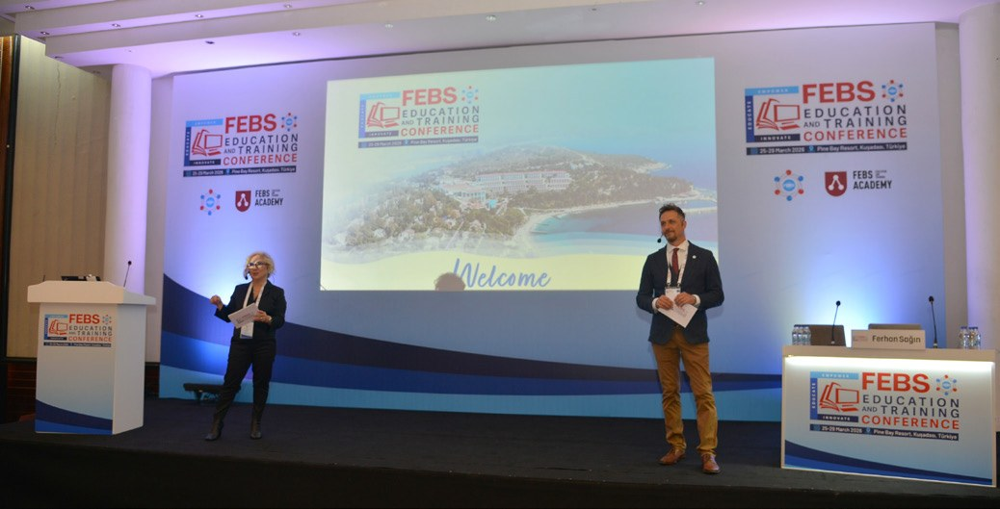
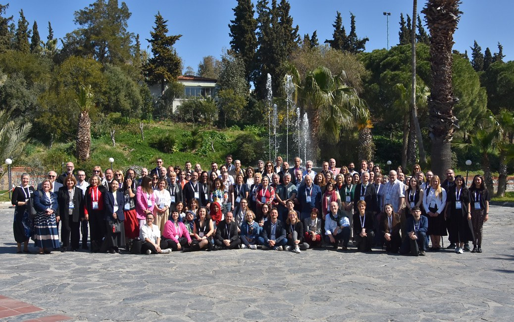
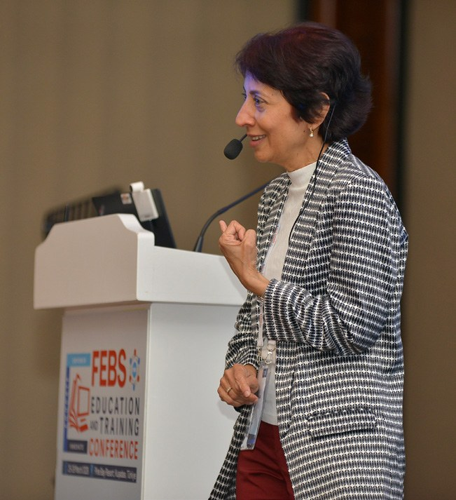
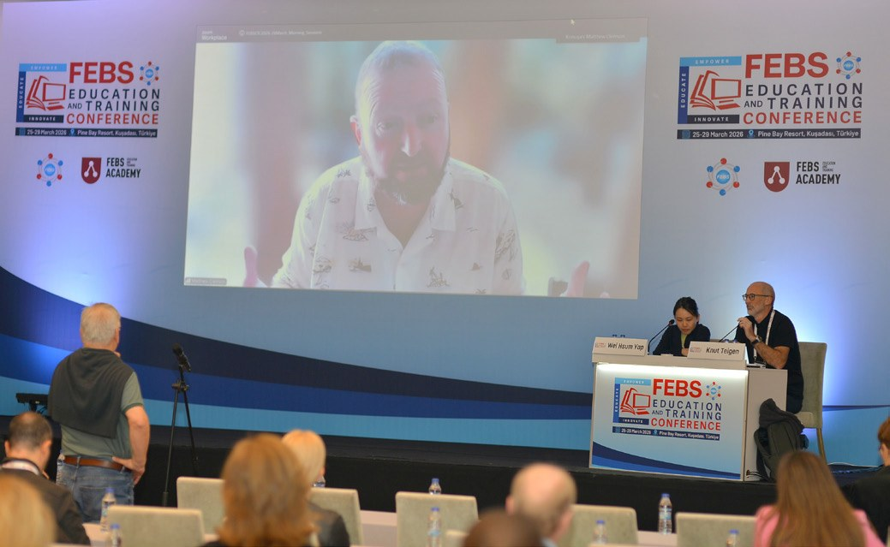
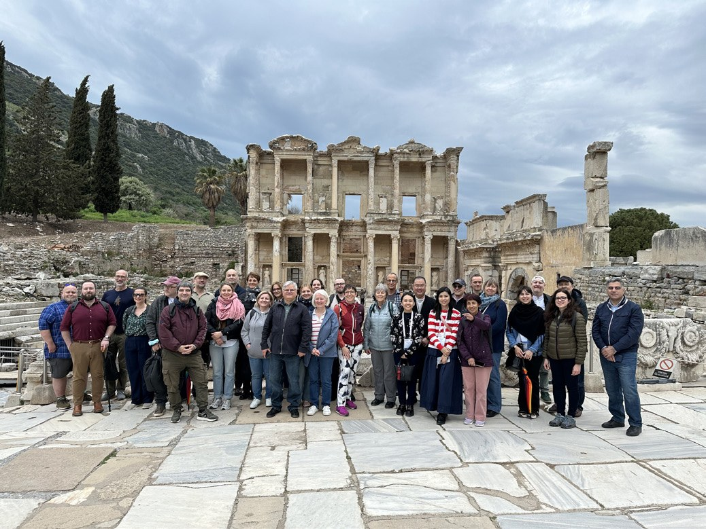
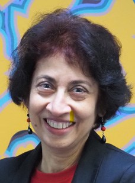

# Taking ASBMB Education to Europe: Report on the FEBS Education and Training Conference

**Nirma Samarawickrema**  
*Biomedicine Discovery Institute, Monash University*

> *Australian Biochemist* Vol 57 No 2, August 2026, pages 19–20

The second FEBS Education and Training Conference (FEBS ETC) held in the beautiful seaside resort town of Kuṣadasi, Türkiye, in March 2026, was an outstanding success. Notwithstanding the geopolitical tensions in the region, the meeting brought together an awe-inspiring and dedicated community of 114 scientists and educators from 28 countries. The conference offered plenary lectures, invited speakers from the region, debates, workshops and a large number of short presentations and posters, as well as multiple inspiring conversation over the four days.

*Welcome address by Professor Ferhan Sagin (Ege University, Türkiye) and Professor Nino Sincac (Zagreb University, Croatia).*

## Thought-provoking plenaries

The opening plenary by Professor Aviad Haramati (Georgetown University School of Medicine, USA) highlighted the importance of fostering wellbeing in the learning environment. The message was simple: learning requires care and empathy. Removing unnecessary examinations, providing suitable curriculum interventions and developing self-awareness were highlighted as being important contributors to student wellbeing in an educational setting. The second plenary by Dr Allegra Via (Sapienza University, Italy) stressed the importance of empowering educators; reminding us to treat students as our colleagues, model the pedagogy we advocate and build a community of practice. It was a reminder that enduring change in education begins with the work of all of us: the educators. This was followed by a plenary from Associate Professor Manuel Costa (University of Minho, Portugal) that focused on how teaching and learning centres can support educators to navigate challenges and leverage opportunities. Finally, the closing plenary by Professor Hakan Abacıoğlu (Izmir University, Türkiye), treated us to a narrative of the evolution of the university, from the Medieval University in Bologna, Italy, in the 11th century to today’s university. This narrative highlighted the human role in shaping universities through periods of change driven by educators’ curiosity and innovations in teaching and learning.

## Lively debates

The debators battled energetically and passionately resulting in much enjoyment and laughter by the audience. The debates were all on highly topical issues, sparking lively discussions. To begin, a thought-provoking debate on ‘Burnout is contagious; whom to save first?’ raged over a ‘happy educator meant a happy student’ or a ‘happy student meant a happy educator’. This was followed by a second debate, ‘Innovation versus tradition in teaching’ which triggered another lively discussion on who is the winner in the classroom and how far should we push for change in education. The final debate was equally passionate; ‘Social media: strategic networking or shallow self-promotion’. Undoubtedly, the debates were a highlight of the conference captivating the entire audience.

## Interactive workshops

There were several highly interactive and hands-on workshops across the four days. The FEBS Education Academy ran a series of three workshops titled ‘Integrating AI tools to enhance learning’. The three workshops were well attended and comprised content including using AI tools to design a course or unit, an activity and an assessment. Many walked away with several strategies and ideas of integrating AI in our teaching.

*Conference attendees in Kuṣadasi, Türkiye.*

## Representing ASBMB Education

Representing the ASBMB at this highly inspiring meeting were Matthew Clemson (University of Sydney) and Nirma Samarawickrema (Monash University) who delivered two invited presentations. Matthew kickstarted day 2 of the conference with a discussion on how the AI-driven chatbot tutor, Dr Mattabolism, was a useful ally to teach the basics of metabolism to second-year biochemistry students. This was followed by Nirma showcasing how she combined case study pedagogy with active learning workshops to foster belonging in large classes, and to facilitate first-year Biochemistry students' transition to university.

*Invited presentation on case study pedagogy and active learning workshops in facilitating transitioning to university by Nirma Samarawickrema.*

*Invited presentation by Matthew Clemson on the benefits of the AI-driven chatbot tutor, Dr Mattabolism. He also gave a remote Workshop on using AI-chat bots.*

## Other highlights

A meeting with the Education section Associate Editor of the *FEBS Open Bio* gave many an opportunity for one-on-one discussions on how to better target their submissions for publication.

Socially, the highlight was a visit to Ephesus, the ancient city in Türkiye’s central Aegean region, in present-day Selcuk in Izmir. Built in the 10th century BCE, the Temple of Artemis and the amphitheatre with seating for 24,000 spectators, were awe-inspiring. It is no small wonder that the Temple was designated one of the seven wonders of the ancient world.

Needless to say, the conference was a resounding success, with each day proving to be dynamic. Inspirational ideas and conversations continued to connect sessions, participants and institutions. We all walked away convinced that meaningful connections and conversations are vital for us educators irrespective of the noise present in the outside world.

*Outside the Temple of Artemis, Ephesus*

## About the author

Dr Nirma Samarawickrema is an Associate Professor of Biochemistry and Molecular Biology, at the Biomedicine Discovery Institute, Monash University. <nirma.samarawickrema@monash.edu>
 

---

*This article first appeared in the ASBMB Education Feature of the [Australian Biochemist](https://www.asbmb.org.au/magazine) Vol 57 No 2, August 2026. © 2026 Australian Society for Biochemistry and Molecular Biology Inc.*

[← Back to the August 2026 issue](../README.md)
