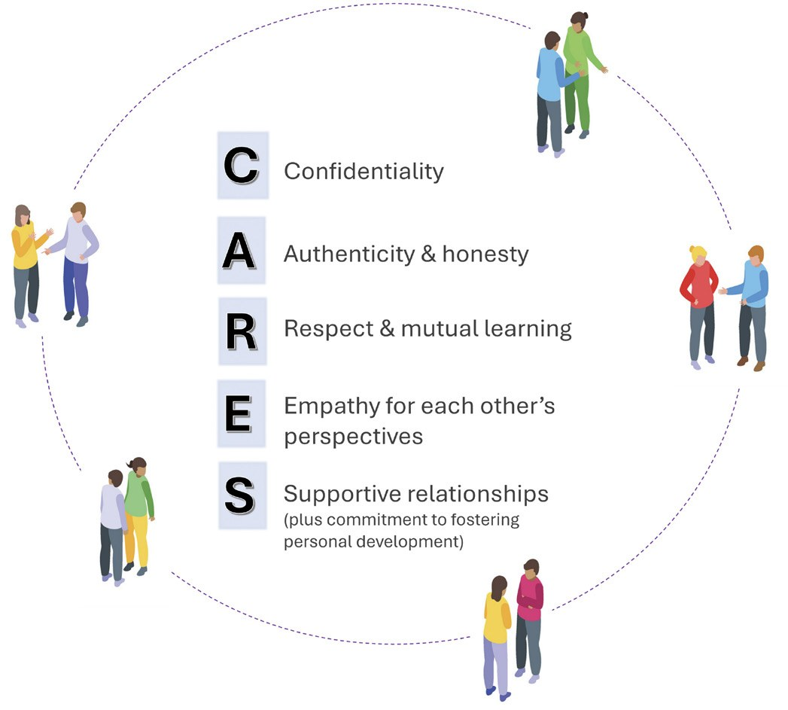

# Building Stronger Biochemistry Educators Nationwide: Early Impact of the ASBMB Education SIG Peer Mentoring Program

**Amber Willems-Jones on behalf of the ASBMB Education SIG**  
*Department of Biochemistry and Pharmacology, University of Melbourne*

> *Australian Biochemist* Vol 57 No 2, August 2026, pages 14–15

Peer mentoring supports the formation of professional identity through reflection, dialogue and meaning making (1). Participants learn through observation and interaction within a social setting to develop capability and self-efficacy through shared experiences (2). When mentoring relationships are collaborative and built on mutual engagement, a sense of belonging and shared purpose, they become dynamic systems that support both personal growth and institutional outcomes (3). Consistent with this, evidence suggests that mentoring relationships broaden perspectives, enhance connectedness, reduce isolation and support professional identity formation and career development pathways (4).

To leverage these positive outcomes for our membership, the ASBMB Education Special Interest Group (Ed SIG) launched a Peer Mentoring Program in February 2025. The Peer Mentoring Program provides a national, discipline-specific mechanism for connecting educators across institutions, supporting career development in teaching and learning, and strengthening the biochemistry education community. It is guided by the acronym, CARES, highlighting the importance of trust, genuine interactions, mutual growth, understanding and encouragement within the mentor–mentee dynamic (**Fig. 1**).

## Program overview and participants

The inaugural 2025 cohort included 13 mentor–mentee pairs drawn from 16 institutions across Australia, reflecting broad representation of academic roles and geographical locations. Participants included six Lecturers (Level B), six Senior Lecturers (Level C), six Associate Professors (Level D) and four Professors (Level E), with at least 50% holding education-focused roles and 25% identifying as teaching/research fellows.

Participants were supported throughout their mentoring journey with a purpose-designed Peer-Mentoring Handbook, which outlined program expectations and provided practical strategies, a mentoring checklist, and a mentor–mentee agreement to guide goal setting, help structure discussions and to support ongoing reflection.

The program was designed for educators in biochemistry and related disciplines across both undergraduate and postgraduate teaching contexts. Though not tied to any single institution or course, participants commonly reported working with large undergraduate cohorts (typically 100–500+ students) within biomedical science and molecular biology programs.

***Fig. 1.** The CARES guiding principles for peer mentoring in the ASBMB Education SIG program.*

## Evidence of impact and participant reflections

Qualitative feedback suggests the program has had a positive impact on participants’ confidence, career clarity and engagement with scholarly teaching. Participants highlighted several key benefits:

- **Career progression support** – discussions around promotion, tracking achievements and developing a coherent Scholarship of Teaching and Learning narrative were frequently cited. *“I think this is a great scheme… it’s important that people get good advice early in their careers which will help them do well as their career progresses.”*
- **Increased motivation and accountability** –regular meetings encouraged goal setting and sustained progress. *“Setting goals using the mentoring booklet gave me something to work towards.”*
- **Enhanced opportunities** – participants reported being inspired to submit conference abstracts, join committees and pursue collaborations. *“I was inspired to submit an abstract for a conference.”*
- **Value of cross-institutional mentoring** – having a mentor from a different university provided fresh perspectives and reduced institutional bias. *“Thanks for organising this! I found it really helpful to have someone outside of my uni to chat with and share ideas.”*

These outcomes are consistent with the literature which demonstrates that mentoring improves academic productivity, career satisfaction and institutional engagement.

## Looking ahead

Given the strong interest from participants in continuing and expanding the program, alongside clear evidence that the ASBMB Education SIG Peer Mentoring Program is addressing an important need within the biochemistry education community, the initiative has continued in 2026. New and returning participants have recently been invited to join, with at least a dozen mentor–mentee pairs established to foster new (and/or continue) relationships and broaden perspectives.

By supporting collaboration, career development and cross-institutional networks, the program continues to contribute to a more connected and resilient community of biochemistry educators in Australia.

If you are interested in being part of the Peer Mentoring Program and are an ASBMB member, please reach out to Dr Jess Gibbons <jessica.gibbons@monash.edu> or Associate Professor Amber Willems-Jones <amber.willems@unimelb.edu.au>.

## References

1. Nganga C, Bowne M, Stremmel A. *Mentor Tutoring: Partnersh Learn* 2020;28(3):259–277.
2. Bandura A. *Annu Rev Psychol* 2001;52:1–26.
3. Baciu C. *Front Educ* 2026;11:1819548.
4. Krishna LKR, Ravindran N, Kwok HYF. *et al. BMC Med Educ* 2025;25:576.
---

*This article first appeared in the ASBMB Education Feature of the [Australian Biochemist](https://www.asbmb.org.au/magazine) Vol 57 No 2, August 2026. © 2026 Australian Society for Biochemistry and Molecular Biology Inc.*

[← Back to the August 2026 issue](../README.md)
