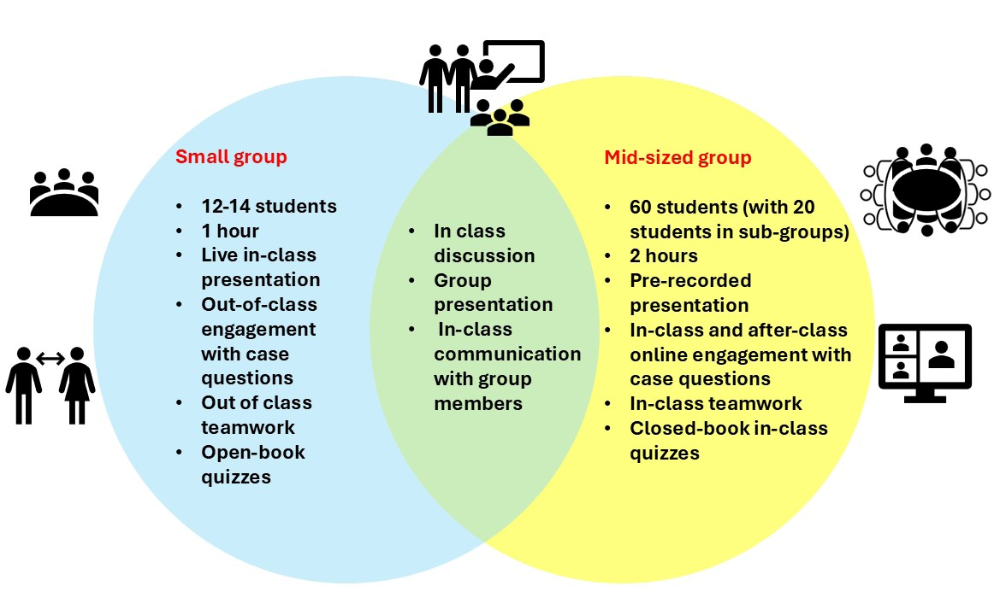
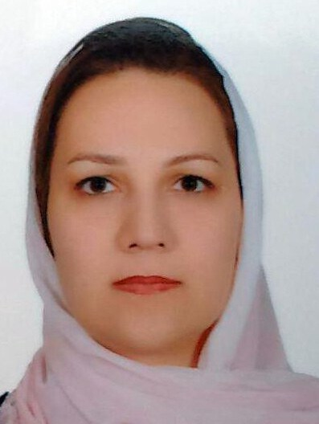
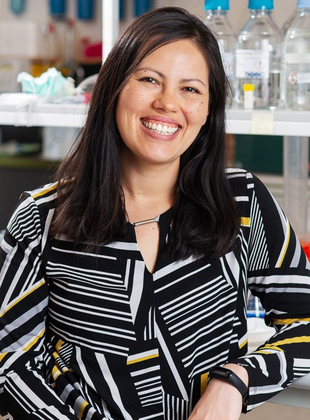

# Scaling Engagement in Large Biochemistry Classes: A Case-based Redesign Using Digital Collaboration to Maintain Learning Quality

**Mehrnaz Keyhanfar, Briony Forbes and Amy Wyatt**  
*College of Medicine and Public Health, Flinders University*

> *Australian Biochemist* Vol 57 No 2, August 2026, pages 17–18

Growing university participation in Australia is increasing enrolments in biochemistry, creating pressure to maintain learning quality in larger classes. Evidence suggests class size alone does not determine outcomes; rather, student engagement and instructional design are key drivers of learning (1). However, large cohorts can reduce interaction and place constraints on effective teaching practices, which may affect the overall learning experience (2). This article outlines a scalable redesign of a third year biochemistry topic that preserves active learning while accommodating growth.

This topic is highly relevant to biochemistry educators, as many programs are experiencing similar expansion pressures. Practical, evidence-informed strategies are needed to sustain student engagement and equitable learning outcomes in laboratory- and concept-heavy disciplines such as biochemistry.

The case study describes a third-year undergraduate topic, Biochemistry of Human Disease, at Flinders University (College of Medicine and Public Health; 162 students in 2024, an increase from 104 in 2023). The subject integrates clinical case-based learning across human diseases including diabetes and cancer. Previously delivered through small tutorials (12–14 students), the redesign implemented mid-sized tutorial groups (approximately 60 students) subdivided into smaller working groups, supported by Padlet, a digital collaboration platform (**Fig. 1**). Pre-recorded lectures maintained a flipped classroom model, enabling active in-class learning (3).

***Fig. 1.** Contrasting pedagogical approaches with a small tutorial group structure used prior to 2023 (blue) and the mid-sized tutorial group structure used in 2024 (yellow), with highlighting shared elements in the overlap. Illustrations depict learning environments for each group size.*

The redesign was guided by the Biochemical Literacy Framework, emphasising critical thinking, communication and conceptual understanding (4). Students engaged in structured, case-based discussions via Padlet, contributed collaboratively during and between tutorials, and completed regular closed-book quizzes to reinforce retrieval practice. Student-generated presentations were submitted as recorded videos to enhance flexibility and reduce performance pressure.

To evaluate the impact of the redesign, deidentified institutional data and student feedback (24.7% response, n=40) were analysed under ethics approval (Flinders University HREC Project ID 8806). Results showed strong engagement: all students contributed to online discussions at least once per case. Student feedback highlighted improved collaboration and deeper understanding, particularly through Padlet activities and peer discussion. Illustrative comments included: “Padlet each week was very useful in finalising my understanding” and “report backs solidified concepts.”

Academic outcomes showed no major negative impact despite increased cohort size. Failure rates decreased (4.8% to 1.8%), though high distinctions declined slightly, resulting in a shift toward mid-range grades. Mean scores decreased modestly (87.7% to 84.7%), suggesting mixed performance outcomes rather than overall decline. These findings align with evidence that active learning improves student performance and is effective across class sizes, including large classes (5).

Reflecting known tensions between active learning and cognitive load, where poorly structured or excessive demands can hinder performance (6), students also identified areas for improvement, including high workload, need for clearer instruction and stronger alignment between lectures, activities and assessment.

Overall, the redesign demonstrated that well-structured digital collaboration and assessment alignment can sustain engagement and inclusivity at scale, even if academic outcomes require careful interpretation. Key lessons for biochemistry educators include:

- Use structured digital tools to scaffold peer learning
- Maintain clear alignment between learning activities and assessment
- Balance active learning with manageable workload and explicit guidance

This approach offers a practical model for Australian educators adapting to larger cohorts while preserving student-centred learning.

## References

1. Wang L, Calvano L. *Organ Manag J* 2022;19:126– 142.
2. Mulryan-Kyne C. *Teach High Educ* 2010;15:175– 185.
3. O’Flaherty J, Phillips C. *Internet High Educ* 2015;25:85–95.
4. Evans DL, Bailey SG, Thumser AE, Trinder SL, Winstone NE, Bailey IG. *FEBS Open Bio* 2020;10:1720–1736.
5. Freeman S, Eddy SL, McDonough M, Smith MK, Okoroafor N, Jordt H, Wenderoth MP. *Proc Natl Acad Sci USA* 2014;111:8410–8415.
6. Sweller J. *Psychol Learn Motiv* 2011;55:37–76.
## About the authors

Dr Mehrnaz Keyhanfar is an education-focused Senior Lecturer in Biochemistry at Flinders University. <mehrnaz.keyhanfar@flinders.edu.au>
 

Professor Briony Forbes is the Head of the Discipline of Biochemistry at Flinders University. <briony.forbes@flinders.edu.au>
 

Dr Amy Wyatt is a Senior Lecturer in Medical Biochemistry at Flinders University. <amy.wyatt@flinders.edu.au>
 

---

*This article first appeared in the ASBMB Education Feature of the [Australian Biochemist](https://www.asbmb.org.au/magazine) Vol 57 No 2, August 2026. © 2026 Australian Society for Biochemistry and Molecular Biology Inc.*

[← Back to the August 2026 issue](../README.md)
